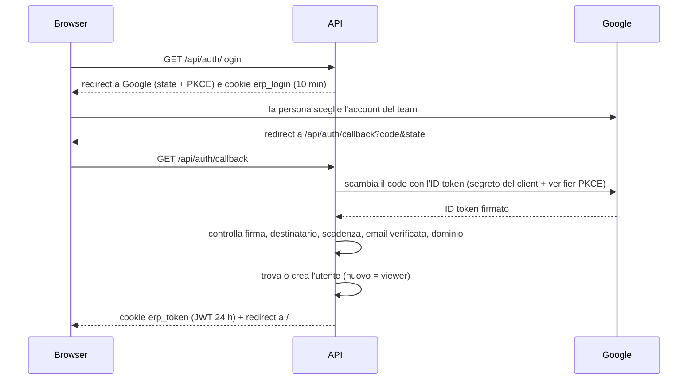

# Accesso, ruoli e storico delle modifiche

**Stato: implementato e provato** (20 ottobre 2026), tranne il collegamento a Google vero, che aspetta le credenziali del Workspace (vedi §9). Nasce dalle risposte del 20 ottobre: login solo con Google (account del team), un JWT di 24 ore al posto delle sessioni nel database, tre ruoli (`admin`, `pm`, `viewer`) con il `pm` legato alle aree, storico delle modifiche in una tabella, deploy da decidere dopo.

## 1. Le scelte, in breve

| Tema | Scelta |
| --- | --- |
| Come si entra | **solo Google**, solo account del dominio del team; niente password nostre |
| Cosa dice "sei dentro" | un **JWT** firmato, valido **24 ore**, in un cookie `HttpOnly`; **nessuna tabella di sessioni** |
| Ruoli | `admin` (il tesoriere), `pm` (per **area**), `viewer` |
| Primo accesso | chi ha un account del team entra da solo come **`viewer`**; un admin lo promuove |
| Fondi, contratti, ingressi, BANK, flag "paga IVA" | **solo `admin`** |
| Fornitori | `admin` e `pm` possono aggiungerli (e toglierli, se non usati) |
| Storico | **tabella** `audit_log` scritta da **trigger** del database; lo vedono `admin` e `pm` |
| Deploy | da decidere dopo ([produzione.md](produzione.md)) |

## 2. Login con Google

1. L'API manda la persona a Google con un valore casuale (`state`, contro i falsi callback) e una prova crittografica (PKCE, contro l'intercettazione del codice). Li ricorda in un cookie breve firmato (`erp_login`, 10 minuti).
2. Google autentica e rimanda alla nostra pagina con un `code` monouso.
3. L'API, **da server a server**, scambia il `code` con un ID token firmato (email, nome, dominio `hd`).
4. L'API verifica la firma con le chiavi pubbliche di Google, che il token sia destinato a noi (`aud`), emesso da Google (`iss`), non scaduto, con email verificata e **del dominio del team**. Il controllo del dominio è nel server (il parametro `hd` mandato a Google è solo un suggerimento grafico): contano sia `hd` sia il dominio dell'email.
5. Trova l'utente per email (senza distinzione di maiuscole) o lo crea come `viewer`. Se è disattivato, rifiuta.
6. Emette il **JWT di sessione**: algoritmo HS256 firmato con `JWT_SECRET`, `sub` = id dell'utente, scadenza 24 ore. Va al browser in un cookie `erp_token`: `HttpOnly` (JavaScript non lo legge), `SameSite=Lax`, `Path=/api`, `Secure` quando `PUBLIC_URL` è https.

Se qualcosa va storto (annullato, scaduto, dominio sbagliato, account disattivato) la persona torna sulla pagina di accesso con **una parola** nell'indirizzo (`/?login_error=cancelled|expired|domain|deactivated|failed`), che è il sito a tradurre in un messaggio. Mai testo preso dall'indirizzo o da Google: un link costruito non può far scrivere frasi a piacere nella nostra pagina (parola sconosciuta = messaggio generico). Il dettaglio dell'errore va nei log del server.

### Il JWT porta solo l'id, non il ruolo

Ruolo, aree e stato "attivo" si **rileggono dal database a ogni richiesta** (una query, trascurabile per poche decine di persone). Quindi cambiare un ruolo o **disattivare una persona vale subito**, anche se il suo token è ancora valido: nessun bisogno di una tabella di sessioni per questo.

### Revocare un accesso

| Cosa vuoi | Come | Effetto |
| --- | --- | --- |
| Togliere una persona | pagina **Users** → "Active" no | **dalla richiesta successiva** |
| Togliere tutti (sospetta fuga del segreto) | cambiare `JWT_SECRET` e riavviare l'API | tutti rifanno il login |
| Niente | aspettare | il token scade da solo dopo 24 ore |
| Uscire da questo browser | pulsante di uscita in basso a sinistra | cancella il cookie; il token in sé non è revocabile, perché non è salvato da nessuna parte |

È il compromesso scelto rispetto alle sessioni: **un singolo token non si può revocare da solo**; si disattiva la persona. Per un'app interna con poche persone fidate è sufficiente.

## 3. Come si protegge l'API

- Un controllo comune (`addAuthHook`, in `modules/auth/auth.routes.ts`) gira prima di ogni rotta: tutto `/api/*` richiede un token valido di un utente attivo, tranne `/api/health` e `/api/auth/{config,login,callback,dev-login,logout}`. Altrimenti: **401**.
- **`getCurrentUser()` resta senza argomenti**: l'utente della richiesta viene messo in un contesto asincrono di Node (`AsyncLocalStorage`, `auth.context.ts`) dal controllo comune, e la funzione lo legge da lì. I servizi non sono cambiati.
- **I permessi si applicano nel server**, nei servizi, prima di ogni scrittura. L'interfaccia nasconde i comandi a chi non può usarli, ma è una comodità: i test provano che il server rifiuta (**403**) anche se qualcuno chiama l'API a mano.
- **CSRF** (un altro sito che manda richieste a nome tuo): `SameSite=Lax` blocca i cookie nelle richieste cross-site di scrittura; in più, una richiesta che modifica dati con intestazione `Origin` è accettata solo se l'`Origin` è l'indirizzo pubblico (`PUBLIC_URL`) o l'host a cui è stata indirizzata la richiesta. *Si confronta con `PUBLIC_URL` e non solo con `Host` perché un proxy davanti all'API (quello di sviluppo di Vite, nginx…) riscrive `Host`: è un problema reale incontrato provando l'app nel browser, ora coperto da un test.* Le richieste senza `Origin` (curl, script) passano: senza un browser un altro sito non può usare i tuoi cookie.
- **Intestazioni di sicurezza e niente cache** (`core/security.ts`, `@fastify/helmet`): CSP `default-src 'none'` e `frame-ancestors 'none'` (l'API risponde solo JSON o redirect), `nosniff`, `X-Frame-Options`, `Referrer-Policy`, HSTS; `Cache-Control: no-store` su ogni risposta.
- **Limite di richieste** per indirizzo (`@fastify/rate-limit`, in memoria): 1.200 al minuto su tutta l'API e **10 al minuto** sulle rotte di accesso (`login`, `callback`, `dev-login`, con contatore a parte); `/api/health` escluso. Superato: **429**. Dietro un proxy tutti arrivano con l'indirizzo del proxy: con `TRUST_PROXY=true` si usa `X-Forwarded-For`, **solo se l'API è raggiungibile unicamente dal proxy** (altrimenti l'intestazione si può inventare e il limite si aggira; un test lo prova).
- **Utente del database dell'API limitato** (vedi §8.2): chi ruba le credenziali dell'API non può cambiare la struttura né riscrivere lo storico.
- Il sito: `GET /api/me` dice chi sei e cosa puoi fare (`permissions`); se risponde 401 mostra la pagina di accesso. Un 401 in qualunque momento (token scaduto, persona disattivata) riporta lì.

## 4. Sviluppo senza Google

In locale non servono credenziali Google. Con `DEV_LOGIN_EMAIL=dev@localhost.test` nel `.env` compare il pulsante **Sign in as developer**, che entra come quell'utente (admin, perché è anche in `ADMIN_EMAILS`). Senza la variabile l'endpoint `/api/auth/dev-login` non esiste (404). **Il server si rifiuta di avviarsi in produzione** (`NODE_ENV=production`) se la variabile è impostata, se `PUBLIC_URL` non è https o se mancano le tre variabili di Google. È un elemento temporaneo dichiarato in [hardcoded-registry.md](hardcoded-registry.md).

Per provare gli altri ruoli in locale: `DEV_LOGIN_EMAIL=altra@localhost.test docker compose up -d api`, esci, e di nuovo "Sign in as developer" (la nuova persona nasce `viewer`; da admin la promuovi dalla pagina Users). Poi `docker compose up -d api` senza la variabile torna al valore del `.env`.

## 5. Configurazione (variabili d'ambiente)

| Variabile | A cosa serve | In produzione |
| --- | --- | --- |
| `JWT_SECRET` | firma i token; **almeno 32 caratteri**; cambiarla disconnette tutti | valore lungo e casuale (`openssl rand -base64 48`) |
| `PUBLIC_URL` | l'indirizzo che le persone digitano; dove Google le rimanda; decide `Secure` dei cookie | **https** obbligatorio |
| `ADMIN_EMAILS` | email (separate da virgola) che sono sempre `admin`: il primo admin, e la via di rientro se tutti fossero stati retrocessi | le email dei tesorieri |
| `DEV_LOGIN_EMAIL` | accesso senza Google, solo sviluppo | **vietata** |
| `GOOGLE_CLIENT_ID`, `GOOGLE_CLIENT_SECRET`, `GOOGLE_ALLOWED_DOMAIN` | accesso con Google e dominio ammesso | tutte e tre obbligatorie |
| `DATABASE_URL`, `APP_DB_PASSWORD` | l'utente del database **dell'API** (`erp_app`): legge e scrive i dati, nient'altro | password lunga e casuale; l'API non parte se è un superutente |
| `DATABASE_OWNER_URL` | il **proprietario** delle tabelle: migrazioni, seed e `pnpm db:roles`; l'API non lo usa mai | password lunga e casuale, solo per i rilasci |
| `TRUST_PROXY` | prendere l'indirizzo del visitatore da `X-Forwarded-For` (per il limite di richieste) | `true` solo dietro un proxy |

Le variabili sono lette e validate quando si costruisce l'API (`core/auth-config.ts`): una configurazione sbagliata ferma l'avvio con un messaggio chiaro, invece di fallire alla prima richiesta. I comandi che non avviano l'API (migrazioni, seed, importer) non ne hanno bisogno.

### Cosa serve su Google (lo fa chi amministra il Workspace)

1. In **Google Cloud Console**, un progetto dentro l'organizzazione del team.
2. *Schermata di consenso OAuth* di tipo **Interno**: solo gli account dell'organizzazione possono accedere. È la seconda barriera, dopo il controllo del dominio.
3. Un **ID client OAuth** di tipo "Applicazione web", con URI di reindirizzamento autorizzato `<PUBLIC_URL>/api/auth/callback` (in sviluppo `http://localhost:5173/api/auth/callback`).
4. Client ID e secret nel `.env` del server, mai nel repository.

Google accetta come URI di reindirizzamento solo indirizzi HTTPS con un nome di dominio vero (non un IP privato), oltre a `localhost`: con Tailscale va bene un nome `<macchina>.<tailnet>.ts.net` con HTTPS (vedi [produzione.md](produzione.md)).

## 6. Ruoli

Il ruolo è in `app_user.role`. Il `pm` è legato alle **aree** che può modificare (`user_area`: utente, area).

| Azione | `admin` | `pm` | `viewer` |
| --- | --- | --- | --- |
| Vedere tutto: aree, viste, grafici, analisi | sì | sì | sì |
| Voci e progetti (aggiungere, modificare, eliminare) | tutte le aree | **solo le aree assegnate** | no |
| Fondi, contratti, flag "paga IVA", ingressi, BANK | sì | **no** | no |
| Fornitori (aggiungere, eliminare) | sì | **sì** | no |
| Utenti, ruoli, aree assegnate | sì | no | no |
| Storico delle modifiche | sì | **sì** (tutto) | no |

`canWrite(utente, area)` (in `auth.service.ts`): `admin` → sì; `pm` → sì solo se l'area è tra le sue; `viewer` → no. Per i dati condivisi si chiede `canWrite(utente, null)`: **solo `admin`**. I fornitori usano `canManageSuppliers` (chiunque non sia `viewer`) e lo storico `canViewHistory` (idem).

Un `pm` senza aree assegnate non modifica nessuna area, ma può gestire i fornitori e leggere lo storico. Se un `pm` deve poter modificare tutto, gli si assegnano tutte le aree.

## 7. Utenti

- Tabella `app_user`: email (unica, senza distinzione di maiuscole), nome, ruolo, attivo, data di creazione. **Non c'è "ultimo accesso"**: ogni scrittura è nello storico, e un campo che cambia a ogni login lo riempirebbe di rumore.
- **Primo accesso = `viewer`**, creato in automatico. Un'email in `ADMIN_EMAILS` nasce `admin` (e se esiste già con un altro ruolo viene promossa al login).
- Chi lascia il team si **disattiva** (non si cancella), per non rompere lo storico.
- Pagina **Users** (solo admin): ruolo, aree (visibili per i `pm`) e casella "Active", con salvataggio immediato.
- **Almeno un admin attivo**: il server rifiuta (409) di retrocedere o disattivare l'ultimo.

## 8. Storico delle modifiche

### 8.1 Tabella, non file

Hai proposto un file di log o una tabella; abbiamo scelto la **tabella**, scritta nella stessa transazione della modifica:

| | File di log | Tabella nel database |
| --- | --- | --- |
| Coerenza con i dati | no: se il server cade tra scrittura e log, non coincidono | **sì**: o c'è la modifica e il suo storico, o nessuno dei due |
| "Cos'è successo alla voce 91?" | si cerca nel testo | una query |
| Pagina "History" | va costruito un lettore | si legge dal database |
| Backup e nuovo server | va curato a parte | è nel backup del database |

Il log normale del server (una riga JSON per richiesta) resta per il debug, ma non è lo storico.

### 8.2 Come si scrive: un trigger

`audit_log`: istante, chi (`actor_id`, **senza chiave esterna**: lo storico deve sopravvivere a tutto), tabella, id della riga, azione (`insert`/`update`/`delete`), **valori prima e dopo** (`jsonb`).

Lo scrive una funzione PostgreSQL unica, `audit_row()`, agganciata con un **trigger** a `project`, `budget_line`, `line_figures`, `fund`, `fund_contract`, `team_inflow`, `bank_snapshot`, `supplier`, `app_user`, `user_area` (migrazione `0002_audit_triggers.sql`, scritta a mano). Chi sta scrivendo glielo dice `runWrite`: all'inizio della transazione esegue `select set_config('app.actor_id', '<id>', true)`, valido solo per quella transazione.

- **Non si può dimenticare**: ogni scrittura è tracciata, anche quelle fatte a mano con SQL;
- registra anche le **cancellazioni a cascata** (cancellare un progetto registra ogni voce e ogni riga di cifre che spariscono);
- una richiesta che fallisce (rollback) **non lascia traccia**;
- senza attore (il seed, l'importer, la creazione di un account al primo accesso) `actor_id` è nullo e la pagina mostra "system". Il caricamento del foglio scrive quindi molte righe "system": è normale.

Il trigger gira con i diritti del **proprietario** delle tabelle (`SECURITY DEFINER`, migrazione `0003_audit_definer.sql`), mentre l'API si collega con un altro utente (`erp_app`) che di `audit_log` può **solo leggere**: con le credenziali dell'API non si può né aggiungere né modificare né cancellare lo storico, né spegnere il trigger. Chi ha le credenziali del proprietario sì: sono quelle da tenere al sicuro (solo per i rilasci). L'utente dell'API lo crea `pnpm db:roles` (dopo le migrazioni; si può ripetere, e cambia la password); `src/db/app-role.test.ts` elenca ciò che gli è vietato.

Non sa *perché* è stato modificato, vede solo i valori. Per un bilancio basta.

### 8.3 Come si legge

- `GET /api/audit?table=&rowId=&actorId=&before=&limit=` (admin e pm): le modifiche più recenti per prime; `limit` 1-500 (predefinito 100); `before` = id da cui continuare (la risposta dà `next`). Per ogni voce: istante, persona, tabella, riga, azione, un'etichetta leggibile (la voce, il progetto, il fondo…) e l'elenco dei **soli campi cambiati** (prima → dopo). Il campo `version` (il contatore del blocco ottimistico) si ignora quando è l'unica differenza.
- Pagina **History**: tabella con filtro per tipo di dato e "Load older changes". Gli inserimenti e le cancellazioni mostrano i campi in un blocco apribile.
- Limiti noti: i numeri passano da JSON, quindi sono numeri e non stringhe esatte (per leggere, non per calcolare); i campi di collegamento mostrano l'id (`fund_id: 3`) e non il nome; non c'è ancora il filtro per persona nella pagina (l'API lo ha: `actorId`).

## 9. Cosa è fatto e cosa aspetta

| Fatto | In sospeso |
| --- | --- |
| login Google completo (codice, PKCE, verifica del token, dominio) provato con un Google finto e chiavi di prova | il **dominio** esatto e un **client OAuth** su Google Cloud (serve chi amministra il Workspace) per provarlo con Google vero |
| JWT 24 h, utente riletto dal database, accesso di sviluppo, controllo CSRF | le email dei **primi admin** per `ADMIN_EMAILS` in produzione |
| ruoli con aree, pagine Users e History, interfaccia che segue i permessi (provata nel browser con admin, pm e viewer) | **layout** di accesso, Users e History **non progettati su Figma**: usano solo token e componenti del design system; da rivedere quando ci sarà il disegno |
| storico con trigger, lettura con filtri e paginazione | server, HTTPS, proxy, rilascio, backup ([produzione.md](produzione.md)) |

Il limite di richieste e le intestazioni dell'API ci sono; mancano HTTPS e le intestazioni delle pagine del sito (le serve il proxy, da decidere: [produzione.md](produzione.md)).

## 10. Le migrazioni restano

Le migrazioni *creano* le tabelle (e le cambiano nel tempo); il caricamento del foglio le *riempie*, **una volta**. Sul server la sequenza è: **migrazioni → dati di base → caricamento del foglio**; dopo, l'app è la fonte dei dati. Con `app_user`, `user_area` e `audit_log` un database di produzione già pieno riceve le nuove tabelle senza perdere niente: è ciò che fa una migrazione. Le migrazioni diventano un passo automatico di ogni rilascio.

## 11. Test

| File | Cosa prova |
| --- | --- |
| `core/auth-config.test.ts` | la configurazione: segreto corto, indirizzo, regole di produzione |
| `modules/auth/google.test.ts` | la verifica vera del token con chiavi e "token endpoint" finti: valido, destinatario sbagliato, scaduto, emittente o firma sbagliati, email non verificata, dominio sbagliato o assente, rifiuto di Google, parametri e PKCE |
| `modules/auth/auth.routes.test.ts` | 401 senza cookie, token falsi/scaduti/di tipo sbagliato, persona disattivata bloccata subito, ruolo letto dal database, CSRF (anche con `Host` riscritto da un proxy), `/me`, tutto il giro del login (primo accesso viewer, admin da `ADMIN_EMAILS`, errori), accesso di sviluppo, uscita |
| `modules/auth/roles.test.ts` | la matrice dei ruoli su tutte le scritture (viewer, pm della propria area e di un'altra, pm senza aree, admin) |
| `modules/users/users.routes.test.ts` | elenco, cambio di ruolo/aree/attivo, effetto immediato, ultimo admin, input sbagliato |
| `modules/audit/audit.routes.test.ts` | cosa viene registrato (insert/update/delete, cascata, rollback, nessun attore), permessi di lettura, filtri, paginazione |
| `modules/auth/auth.routes.test.ts` (login) | anche le parole di `login_error`: mai testo libero |
| `src/db/app-role.test.ts` | l'utente dell'API: non è superutente, legge e scrive i dati, **non può** scrivere `audit_log`, cambiare la struttura, spegnere il trigger, vedere le migrazioni; `ensureAppRole` ripetibile e con nomi/password qualunque |
| `src/security.test.ts` | SQL injection (nessun `sql.raw`, solo modelli `sql` in `execute()`/`query()`, 8 payload in tutti i campi di testo, richieste ostili su id e query string, campi extra ignorati), intestazioni di sicurezza, limite di richieste (per indirizzo, accesso più severo, salute esclusa, `X-Forwarded-For` finto) |
| `apps/web/src/lib/permissions.test.ts`, `loginProblem.test.ts` | la regola "chi può modificare quest'area" e le parole di errore dell'accesso |
