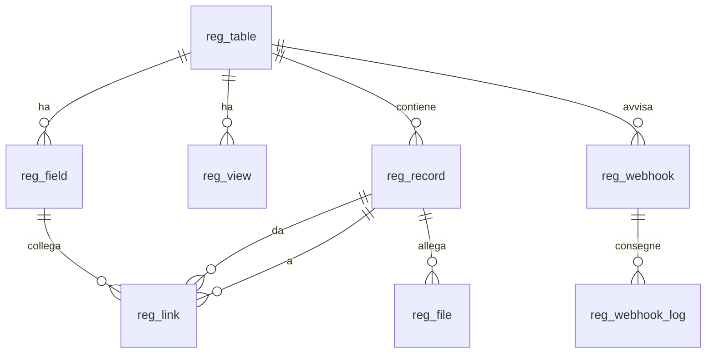

# Anagrafiche (REGISTRY)

**Stato: fatto e provato** (21 e 22 novembre 2026), con test del motore, dell'API e del sito e giri nel browser su un registro dimostrativo (§15).
- **Il confronto con NocoDB**, funzione per funzione sulla sua documentazione ufficiale: [anagrafiche-nocodb.md](anagrafiche-nocodb.md).
- **La valutazione dell'architettura** (ADR, alternative, misure, confini verificati dalle prove): [anagrafiche-architettura.md](anagrafiche-architettura.md).
- **Cosa resta fuori**: §13.
- **Dove sta il codice**: la tabella del §14.

Il modulo **Registry** è un piccolo NocoDB dentro l'ERP. Chi lo gestisce:
- crea le sue tabelle (persone, aree, progetti, certificati, rimborsi…);
- sceglie i campi (testo, numeri, scelte, date, collegamenti, formule, file…);
- le guarda con viste filtrate e le riempie con **moduli** al posto dei Google Form e dei form di NocoDB.

Tutto è disponibile anche da un'**API** completa, per n8n, il bot Telegram, il sito e gli script.

Le anagrafiche sono la fonte di verità su **chi è nel team e con che ruolo**: i **ruoli dell'ERP** (admin, User con le sue aree, Treasury, Sponsors) si possono calcolare da lì (§9), come il team vuole fare con Keycloak.

## 1. Da dove partiamo

### 1.1 Cosa usa il team oggi

Letto dalla documentazione IT del team e dall'istanza NocoDB, **solo in lettura**. Qui c'è solo la struttura: nessun dato di persone.

| Pezzo | Cosa fa |
| --- | --- |
| **NocoDB** (self-hosted, piano gratuito) | Tre basi:<br>• *HR & Recruitment*: People (una riga per persona, dalla candidatura all'uscita, circa 80 campi), Areas, Departments, Projects (progetti e workgroup, con il responsabile), Roles (ruoli di team e legali)<br>• *Documents*: Certificates (con scadenza calcolata dal tipo), Certificate Types, Membership Applications (stato calcolato: copia digitale, copia cartacea, pagato)<br>• *General Data*: Regions, Provinces |
| **I moduli di NocoDB** | Su People ci sono **sei form** con il campo nascosto `form_type`:<br>• Application (il candidato, dal sito);<br>• HR Scouting (il colloquio: voti da 1 a 10, note, «passato»);<br>• HR Management (lo stato, il progetto di prova);<br>• Onboarding (i dati per entrare, mandato da HR via Telegram);<br>• Personal Information (aggiornare i propri dati);<br>• Exit (l'uscita).<br><br>Su Certificates c'è il form per caricare un certificato. I form «personali» portano un `form_jwt` firmato, perché nessuno possa scrivere a nome di un altro cambiando la mail |
| **n8n** | Riceve i webhook di NocoDB e:<br>• mette in ordine i dati (maiuscole dei nomi, mail minuscole, prefisso +39);<br>• scarta i doppioni e i form mandati nell'ordine sbagliato;<br>• cambia lo stato (Waiting, Project o Rejected, In trial, Active Member, Reachable, Alumno) e scrive le date;<br>• manda mail e messaggi Telegram ai gruppi HR;<br>• col pulsante «Create Team Account» crea gli account Google e Active Directory, che sospende quando una persona diventa Alumno.<br><br>Controlli programmati: le prove scadute, i candidati in attesa da una settimana, Reachable che diventa Alumno dopo sei mesi |
| **eagle-api** (Python) | Legge NocoDB per il sito (membri pubblici, sponsor), le ore in laboratorio e il bot Telegram (i tag `@sw` con i membri di un'area) |
| **Keycloak** (in arrivo) | I gruppi `/TL`, `/Executive Board`, `/HR`, `/Areas/<Area>`, `/Areas/<Area>/CT`, `/Projects/<Progetto>`, `/Projects/<Progetto>/PM`, `/Alumni` e i ruoli `admin`, `coreteam`, `pm`, `member`. NocoDB resta la fonte: n8n crea gli utenti in Keycloak; i servizi dietro OAuth2-Proxy ricevono gruppi e ruoli negli header |
| **Google Form** | Il form dei **rimborsi spese**: nome, area, importo, descrizione, categoria, data, scontrino, IBAN. Finisce in un foglio della tesoreria con stato, numero dello scontrino e data del rimborso. C'è anche il form «Acquisti/Pagamenti» |

### 1.2 I problemi che il team ha scritto (e che il modulo risolve)

| Problema (dai documenti del team) | Qui |
| --- | --- |
| NocoDB su SQLite: blocchi e lentezza | Postgres, lo stesso dell'ERP |
| Persone doppie tra HR e Recruitment, aree copiate in ogni base | Un solo registro: le tabelle si collegano tra loro senza limiti di «base» |
| Ruoli ambigui (PM di quale progetto?) | Il responsabile sta nel progetto; i ruoli globali in una tabella a parte. È un modello dati che si costruisce con i campi collegamento |
| Scadenza dei certificati scritta a mano | Campi **formula** e **lookup** (data + giorni del tipo) |
| Nessun permesso per campo: HR deve vedere alcuni campi e non altri (CF, documento, IBAN) | **Permessi per gruppo e per campo** (§7), che NocoDB dà solo a pagamento |
| Lo storico dei dati si teneva copiandolo con i webhook | **Storico automatico** di ogni modifica, chi e quando (la tabella `audit_log` dell'ERP) |
| Le API v2 di NocoDB sono deprecate: automazioni da riscrivere | Un'API nostra, stabile e documentata (§10) |
| I form personali vogliono un JWT nascosto | Il modulo sa chi è entrato (proxy dell'organizzazione), oppure usa un **link personale firmato** (§8.4) |
| Account e ruoli dei servizi copiati a mano (Users dell'ERP) | I ruoli dell'ERP si calcolano dalle anagrafiche (§9) |

### 1.3 Cosa offre NocoDB e cosa prendiamo

In breve qui sotto. L'elenco completo, voce per voce e con il piano di NocoDB che serve, è in [anagrafiche-nocodb.md](anagrafiche-nocodb.md).

| NocoDB | Qui |
| --- | --- |
| Tabelle con tipi di campo | **Sì**: testo, testo lungo, email, url, telefono, numero (anche decimale, valuta, percentuale), valutazione, casella, data, data e ora, ora, durata, scelta singola e multipla, collegamento, utente dell'ERP, lookup, rollup, formula, allegato, coordinate, colore, JSON, pulsante (webhook o indirizzo), UUID, numero automatico, creato e modificato (quando e da chi) |
| Codici a barre e QR, geometrie, testo «smart» | No: nessuno li usa e servirebbero librerie per disegnarli (anagrafiche-nocodb.md, A) |
| Collegamenti 1-1, 1-molti, molti-molti con il campo inverso | **Sì** |
| Valore unico, obbligatorio, predefinito (anche oggi, adesso, io), descrizione | **Sì** |
| Viste griglia, form, galleria, kanban, calendario, mappa, timeline, gantt, lista; filtri, ordinamenti, raggruppamento, campi nascosti, colori, altezza delle righe, colonne ferme, viste bloccate; riepiloghi sotto la griglia | **Griglia, form, galleria** (schede con la foto), **kanban** (colonne per una scelta, le schede si trascinano), **calendario** (i record nel loro giorno, si trascinano a un altro) e **timeline** (barre da una data a un'altra, con le frecce delle dipendenze: il gantt), con filtri annidati (tutti gli operatori di NocoDB), ordinamenti, raggruppamento fino a cinque livelli, campi nascosti, **colori**, altezza delle righe, colonne ferme, viste bloccate e **riepiloghi** (pieni, vuoti, diversi e le loro percentuali, spuntati, somma, media, mediana, deviazione, minimo, massimo, intervallo). La mappa no (§13) |
| Viste condivise pubbliche, con password e download | **Sì**: una vista può avere un indirizzo pubblico in sola lettura, con i soli campi della vista (il sito: membri, sponsor), una password e il download in CSV |
| Form: etichette, aiuti, obbligatori, condizioni, validazioni, precompilazione da URL (anche nascosta o bloccata), una domanda alla volta, bozza nel browser, messaggio finale, «invia un'altra», reindirizzamento, apertura e chiusura | **Sì**, e in più: aggiornare un record esistente («il mio», «quello del link», «quello scelto»), impostare dei valori all'invio, impedire i doppioni |
| Webhook dopo inserimento, modifica, cancellazione, commento (con condizione, «quando diventa vera», solo per certi campi), con metodo, intestazioni e modello del corpo; pulsanti | **Sì**, firmati con HMAC, con l'elenco delle consegne |
| API REST con token, filtri `where`, ordinamenti, campi, pagine, conteggi, aggregati, upsert, collegati a pagine, operazioni in blocco, copie, Swagger | **Sì** (§10), con la descrizione **OpenAPI** fatta dalle tabelle che chi chiede può vedere (§10.5) |
| Commenti sui record (anche modificati e risolti), storico dei record | **Sì**: chi legge un record lo commenta; lo storico mostra solo i campi visibili |
| Import ed export CSV, Excel, JSON, iCalendar; nuova tabella da un file; import da Airtable | **CSV ed Excel** in entrambi i sensi, **JSON** in uscita, **.ics** dal calendario, nuova tabella da CSV o Excel; **import diretto da NocoDB** (schema, record, collegamenti, allegati, valori predefiniti, §13bis) |
| Ruoli Owner/Creator/Editor/Commenter/Viewer per base | **Livelli** lettura / modifica / gestione per tabella e per gruppo, con i campi nascosti o in sola lettura (§7) |
| Automazioni programmate, script, dashboard, documenti, AI, sincronizzazioni | No: restano a n8n, che legge e scrive con l'API (anagrafiche-nocodb.md, N) |

## 2. Principi

1. **Un modulo, non un altro programma.** Le anagrafiche stanno nello stesso server e nello stesso database dell'ERP: niente servizi in più da installare, stesso login, stesso storico, stessi backup.
2. **Moduli legati ma indipendenti.** Il registro non conosce budget, fondi o inventario, e loro non conoscono il registro. Si parlano solo tramite le funzioni pubbliche di un modulo (le sue «API» in senso stretto: `registry.public.ts`) e, da fuori, tramite l'HTTP. Il ponte con i ruoli dell'ERP è un modulo a parte (`rolesync`), che usa le funzioni pubbliche del registro e quelle degli utenti. Questi confini li fanno rispettare delle prove (`apps/api/src/architecture.test.ts`, `apps/web/src/lib/architecture.test.ts`; anagrafiche-architettura.md, D4).
3. **Struttura fissa, dati liberi.** Le tabelle create dalle persone **non** sono tabelle vere del database. Sono righe di poche tabelle fisse (`reg_table`, `reg_field`, `reg_record`…), e i valori di un record stanno in una colonna JSONB. Così:
   - l'utente del database dell'API resta **senza diritti sulla struttura**, come oggi (accesso-e-storico.md, §8.2);
   - lo **storico** funziona da solo con il trigger che c'è già;
   - nessuna migrazione quando qualcuno aggiunge un campo.
4. **Il calcolo è puro e sta in un pacchetto** (`packages/registry`), come `packages/calc` per il budget. Fa da solo, senza database e senza orologio:
   - la validazione e la normalizzazione dei valori;
   - le formule, i lookup e i rollup;
   - i filtri, gli ordinamenti e la ricerca;
   - i permessi;
   - la preparazione di un invio di un modulo;
   - il CSV.

   L'API carica i dati, chiama il pacchetto e salva. Si prova senza infrastruttura.
5. **Interrogare in memoria.** Un registro del team ha centinaia di righe, qualche migliaio al massimo: a ogni lettura si caricano le tabelle che servono e il pacchetto filtra, calcola e ordina (pochi millisecondi), come fa il budget. Niente SQL costruito dai filtri, quindi nessuna SQL injection possibile e una sola semantica per sito, API e moduli. Il limite è dichiarato (§12).
6. **Semplice.** Niente motore di automazioni, niente versioni dello schema, niente plugin: ciò che oggi fa n8n resta a n8n, che usa l'API e i webhook.

## 3. Modello dati



| Tabella | Campi | Note |
| --- | --- | --- |
| `reg_table` | id, name (unico senza maiuscole), description, icon, section, position, primary_field_id, access (jsonb) | Una tabella del registro. `section` raggruppa le tabelle nel menù (come le «basi» di NocoDB). `primary_field_id` è il campo che fa da nome del record nei collegamenti. `access` contiene le regole dei permessi (§7) |
| `reg_field` | id, table_id, name (unico nella tabella), type, options (jsonb), required, unique_values, description, position | Un campo. `options` dipende dal tipo (§4) |
| `reg_view` | id, table_id, name, type (`grid`/`form`/`gallery`/`kanban`/`calendar`/`timeline`), position, slug (unico), config (jsonb) | Una vista: filtro, ordinamenti, campi nascosti, raggruppamento, colori, righe; per un form le sue impostazioni (§8). `slug` è l'indirizzo di un form o di una vista pubblica (la password di una vista pubblica sta in `config` come hash) |
| `reg_record` | id, table_id, data (jsonb), version, created_at, created_by, updated_at, updated_by | Un record. `data` = `{"<id del campo>": valore}`: con l'id e non col nome, quindi rinominare un campo non tocca i dati. `version` per il blocco ottimistico, come le righe del budget |
| `reg_link` | id, field_id, record_id, target_id, position (unico per field, record, target) | Un collegamento, salvato **una volta**, dal lato del campo che l'ha creato; il campo inverso lo legge rovesciato. Le chiavi esterne cancellano i collegamenti insieme ai record |
| `reg_file` | id, record_id, field_id, name, mime, size_bytes, data (bytea), uploaded_by, uploaded_at | Un allegato. Il record tiene in `data` l'elenco degli id (quindi c'è nello storico); i byte si leggono solo quando qualcuno apre il file |
| `reg_webhook` | id, table_id, name, url, events (text[]), filter (jsonb), secret, active, options (jsonb) | Chi avvisare quando cambia qualcosa (§10.4). `options`: metodo, intestazioni, modello del corpo, campi, «quando» (migrazione `0036_registry_more.sql`) |
| `reg_webhook_log` | id, webhook_id, at, event, record_id, status, error | Le ultime consegne, per capire perché n8n non ha ricevuto qualcosa |
| `reg_comment` | id, record_id, author_id, text, created_at, edited_at, resolved_at, resolved_by | I commenti su un record (migrazioni `0034_registry_comments.sql` e `0036`) |
| `reg_settings` | id = 1, people_table_id, email_field_id | Qual è la tabella delle persone e quale campo contiene la mail con cui si entra (§7.2) |
| `app_secret` | name, value | I segreti che il server si fa da sé: la chiave dei link personali dei moduli (`form-links`), creata al primo uso. Non nello storico |
| `role_sync` | id = 1, enabled, active_view_id, admin_view_id, pm_view_id, pm_areas_field_id, treasury_view_id, sponsors_view_id | Del modulo `rolesync`: da quali viste del registro vengono i ruoli dell'ERP (§9) |
| `api_token` | id, name, token_hash (unico), user_id, created_by, created_at, last_used_on, revoked_at | I token per n8n, il bot, il sito (§10.1) |

Nello storico (`audit_log`, trigger `audit_row()`, migrazione `0033_registry.sql`) vanno tutte, tranne `reg_file` (binaria), `reg_webhook_log` (è un registro delle chiamate) e `app_secret` (un segreto non va in una pagina). Di `api_token` va nello storico l'hash, che non permette di risalire alla chiave.

## 4. Tipi di campo

| Tipo | Valore salvato | Opzioni | Note |
| --- | --- | --- | --- |
| `text` | stringa | `maxLength`, `transform` (`none`, `lower`, `upper`, `title`) | `title` scrive «Mario Rossi» anche se arriva «mario rossi» (la pulizia che oggi fa n8n) |
| `longtext` | stringa | `maxLength`, `rich` (markdown) | |
| `email` | stringa minuscola | | validata |
| `url` | stringa | | solo `http(s)://` |
| `phone` | stringa | `defaultPrefix` (es. `+39`) | spazi, punti, trattini e parentesi tolti; il prefisso aggiunto se manca |
| `number` | numero | `precision` (0–6), `min`, `max`, `format` (`plain`, `currency`, `percent`), `symbol` | Un solo tipo per intero, decimale, valuta e percentuale. Il registro **non è la contabilità**: i soldi del team restano nel budget e nel registro di cassa, in centesimi |
| `rating` | intero 0–max | `max` (1–10) | |
| `checkbox` | booleano | | vuoto = falso |
| `date` | `YYYY-MM-DD` | | |
| `datetime` | ISO 8601 in UTC | | |
| `time` | `HH:MM:SS` | | accetta anche «9:05» e «2:30 pm» |
| `duration` | secondi (numero) | `durationFormat` (`h:mm`, `h:mm:ss`, `h:mm:ss.s`…) | si scrive «1:30» o in secondi; come l'API di NocoDB, l'API dà i secondi |
| `select` | stringa (una delle scelte) | `choices: [{name, color}]` | |
| `multiselect` | elenco di stringhe | `choices` | |
| `link` | elenco di id di record (in `reg_link`) | `tableId`, `multiple`, `inverseId`, `limitViewId` | creando un collegamento si crea il campo inverso nell'altra tabella; `multiple` da una parte e dall'altra dà 1-1, 1-molti, molti-molti; con `limitViewId` la scelta offre solo i record di una vista dell'altra tabella |
| `user` | elenco di id di utenti dell'ERP | `multiple` | come il «User» di NocoDB: «il mio» con `@me` nei filtri e nei valori predefiniti; l'API dà `{id, name}` |
| `lookup` | calcolato | `linkFieldId`, `fieldId` | i valori di un campo dei record collegati (anche un lookup di un lookup) |
| `rollup` | calcolato | `linkFieldId`, `fieldId`, `fn` (`count`, `countValues`, `countDistinct`, `sum`, `sumDistinct`, `min`, `max`, `avg`, `avgDistinct`, `concat`) | il minimo e il massimo di date sono date |
| `formula` | calcolato | `expression` | §5 |
| `attachment` | elenco di id di `reg_file` | `accept` (es. `application/pdf`, `image/*`), `maxSizeMb`, `maxFiles` | |
| `geodata` | `lat;lng` | | come il GeoData di NocoDB; si apre su OpenStreetMap |
| `color` | `#RRGGBB` | | |
| `json` | qualsiasi JSON | | per le integrazioni |
| `button` | — | `label`, `webhookId` oppure `url` | premuto, manda il record al webhook (il «Create Team Account» di oggi), oppure apre l'indirizzo che la formula `url` fa con i valori del record (solo `http(s)`) |
| `uuid` | testo, dato dal server | | uno nuovo per ogni record (anche per quelli già lì quando si aggiunge il campo); nessuno lo scrive |
| `qrcode`, `barcode` | calcolato | `fieldId` (un campo della tabella), `barcodeFormat` (CODE128, EAN13… come NocoDB) | il testo di quel campo, che il sito disegna come codice QR o a barre |
| `autonumber` | calcolato | | l'id del record |
| `created`, `modified` | calcolato | | quando |
| `creator`, `modifier` | calcolato | | chi (nome dell'utente dell'ERP, o «form» o «token») |

Il **valore predefinito** (`options.default`) va a un record nuovo che non ha quel campo: un valore fisso, oppure `today` (date), `now` (data e ora), `@me` (un campo utente, o la mail in un testo). Non va a un record a cui il valore viene svuotato apposta, e non a un campo unico (darebbe a tutti lo stesso valore): come in NocoDB.

Il campo **obbligatorio** non può restare vuoto. Il campo **unico** non può avere lo stesso valore in due record (testo e mail senza badare alle maiuscole; il vuoto è ammesso). Cambiare il tipo di un campo converte i valori passando dal testo, e dice quanti non si potevano convertire.

## 5. Formule

Somigliano a quelle di NocoDB e di Airtable, quindi chi le conosce le scrive subito: `CONCAT({Name}, " ", {Surname})`, `DATEADD({Date}, {Validity Days}, "day")`, `FLOOR(AVG({Determination}, {Skills}))`, `IF(ISBLANK({File}), "Missing", "OK")`.

- **Riferimenti**: `{Nome del campo}`, che può essere anche un lookup, un rollup o un'altra formula. I cicli sono rifiutati quando si salva il campo.
- **Operatori**: `+ - * /`, `&` (unisce testi), `= != < <= > >=`, le parentesi.
- **Funzioni**: tutte quelle di NocoDB, con gli stessi nomi e lo stesso comportamento (l'elenco è in anagrafiche-nocodb.md, C):
  - testo, anche con espressioni regolari (`REGEX_MATCH`, `TEXTAFTER`, `URLENCODE`, `MD5`…);
  - logica (`IF`, `SWITCH`…);
  - numeri (`ROUNDUP`, `POWER`, `COUNTA`…);
  - date (`DATETIME_FORMAT`, `WORKDAY`, `IS_SAME`…);
  - liste (`ARRAYSORT`, `ARRAYUNIQUE`…);
  - `JSON_EXTRACT` e `RECORD_ID`.

  `WEEKDAY` conta da 0 (lunedì) come NocoDB. Le date sono in UTC.
- **Vuoti**: in un conto valgono 0, in un testo "". Un errore (divisione per zero, testo dove serve un numero) dà un valore vuoto e non blocca niente.
- `TODAY()` è il giorno del server, passato al pacchetto come dato: il pacchetto non legge l'orologio.
- Le espressioni regolari le scrive chi gestisce la tabella: una scritta male dà un valore vuoto, una troppo lunga (oltre 500 caratteri) è rifiutata.

## 6. Viste, filtri e interrogazioni

Una vista salva come guardare una tabella:
- il **filtro**: gruppi annidati di condizioni con E/O, e un gruppo si può rovesciare (`not`);
- gli **ordinamenti**;
- i campi **nascosti** e l'**ordine** delle colonne;
- il **raggruppamento**, fino a cinque livelli: nella griglia, una tabella per gruppo («SW › In trial»), come i progetti nella pagina di un'area;
- i **colori** dei record: quello della scelta di un campo (`colorBy`) o regole con un filtro (`colors`);
- l'**altezza delle righe** (`rowHeight`) e le **colonne ferme** (`frozen`);
- il **blocco** (`locked`): nessuno la cambia finché chi gestisce la tabella non la sblocca;
- una **descrizione** e una **cartella** (`folder`), che raggruppa le schede delle viste.

Una vista è di uno di sette tipi:
- `grid`: la griglia;
- `gallery`: schede con la foto presa da un campo di file;
- `kanban`: una colonna per ogni scelta di un campo Choice, e trascinare una scheda cambia quella scelta;
- `calendar`: un mese, con ogni record nel giorno del suo campo data, e trascinarlo a un altro giorno cambia la data (se il campo è una data che si può scrivere);
- `timeline`: una barra per record dalla data di inizio a quella di fine (senza fine: un giorno), tre mesi alla volta. Le barre si trascinano (le due date insieme) e si allungano dai bordi. Con `dependencyField` (un collegamento della tabella a se stessa) è un gantt:
  - disegna le frecce verso i record che vengono dopo;
  - spostando una barra, i record dopo che comincerebbero prima della sua fine vanno al giorno dopo, con la stessa durata, a catena;
  - un record senza data di fine resta senza;
- `map`: un punto per record alle coordinate del suo campo `geoField`; le mattonelle passano dall'ERP (§12);
- `form`: un modulo (§8).

Il kanban vuole un campo Choice, il calendario e la timeline un campo data: senza, la vista è rifiutata (400). Il trascinamento usa gli eventi del puntatore, non il drag and drop HTML5: funziona con il mouse, con il dito sul telefono e con le prove automatiche.

I **riepiloghi** (`aggregate`) si calcolano su tutti i record che corrispondono, prima della paginazione, e anche per ogni gruppo quando la lista è raggruppata:
- `count` (pieni), `empty`, `unique` (valori diversi) e le loro percentuali `percentFilled`, `percentEmpty`, `percentUnique`;
- `checked`, `unchecked`, `percentChecked`;
- `sum`, `avg`, `median`, `stddev`, `min`, `max`, `range`.

| Operatore | Per | Valore |
| --- | --- | --- |
| `empty`, `notEmpty` | tutti | — |
| `eq`, `neq` | tutti | testo senza maiuscole; numero; data; `true`/`false` |
| `contains`, `notContains`, `startsWith`, `endsWith` | testi (anche i valori dei lookup) | testo |
| `lt`, `lte`, `gt`, `gte` | numeri, date | numero; data `YYYY-MM-DD`, oppure `today`, `today-7`, `today+30`, `today-1m` (un mese fa), `today+1y` |
| `anyOf`, `allOf`, `noneOf`, `notAllOf` | scelte, scelte multiple, collegamenti, utenti, lookup | elenco (per i collegamenti: id o nome del record) |
| `checked`, `notChecked` | caselle | — |
| `within` | date | un periodo di NocoDB: `pastWeek`, `nextMonth`, `thisCalendarYear`…, `["pastNumberOfDays", 7]`, `["dateRange", "2026-06-01", "2026-06-30"]` |

Il valore speciale **`@me`** vale la persona che sta guardando: la sua mail in un campo testo o email, il suo record in un collegamento alla tabella delle persone («i miei certificati»).

Dall'API il filtro si manda in due modi:
- come oggetto JSON (`filter`);
- con la sintassi `where` di NocoDB, che il team già conosce: `where=(State,anyof,In trial,Active Member)~and(Area,eq,SW)`. Tutto quello che NocoDB accetta:
  - gli operatori `nallof`, `btw`, `nbtw`, `is`, `isnot`, `isWithin`, `~not`;
  - i sotto-operatori delle date (`(Due,lt,daysAgo,10)`, `(Due,eq,exactDate,2026-01-15)`), solo sui campi data;
  - i valori tra virgolette (`("Name", eq, "Rossi, Mario")`);
  - la `@` davanti della sintassi v3 usata dalla v2.

## 7. Permessi

### 7.1 Livelli e regole

Ogni tabella ha delle **regole**: *chi* (tutti quelli che entrano, un gruppo, oppure «il proprio record») ha *quale livello*, con quali campi **nascosti** e quali in **sola lettura**.

| Livello | Cosa permette |
| --- | --- |
| `read` | vedere i record e i campi non nascosti |
| `edit` | in più, aggiungere, modificare e cancellare i record (i campi in sola lettura no) |
| `manage` | in più, cambiare la tabella: campi, viste, moduli, webhook, regole |

- Gli **admin dell'ERP** gestiscono sempre tutto: nessuna regola può chiuderli fuori.
- Più regole valide per la stessa persona **si sommano**. Il livello è il più alto; un campo è visibile se almeno una regola lo mostra, modificabile se almeno una regola con `edit` lo lascia modificare.
- La regola **«il proprio record»** (`self`) vale solo per i record legati a chi guarda:
  - nella tabella delle persone, il proprio record;
  - nelle altre, i record che hanno la persona in un certo collegamento (i propri certificati, i propri rimborsi).

  Permette di leggere e modificare quei record, non di crearne altri: per crearne ci sono i moduli.
- Senza regole, una tabella la vedono solo gli admin.
- **Esempio** (la richiesta del documento «Idee DB management»): People → Executive Board `manage`; HR `read` con CF, documento, matricola, telefono, mail personale, intolleranze e luogo di nascita nascosti, più `edit` solo su stato, progetto e colloquio; tutti gli altri niente, tranne `self` in lettura sul proprio record.

Il controllo è nel server, record per record e campo per campo: i campi nascosti non escono dall'API, nemmeno nello storico di un record o nell'export CSV, e non si possono usare per filtrare, ordinare, raggruppare o cercare (lo si potrebbe usare per indovinarli: 400). Il filtro di una **vista** è invece una scelta di chi gestisce la tabella e può usare qualunque campo. La pagina History generale (`GET /api/audit`) non mostra le righe del registro, dei token e di `role_sync` a chi non è admin: chi non è admin legge lo storico di un record dal registro, con i soli campi che vede. I webhook mandano tutti i campi: l'indirizzo lo sceglie chi gestisce la tabella, che li vede tutti.

### 7.2 Gruppi = viste della tabella delle persone

Nelle impostazioni del registro si sceglie quale tabella è **la tabella delle persone** e quale suo campo contiene **la mail con cui si entra** (la mail del team; può essere una formula). Così il modulo sa chi è «io».

Un **gruppo** è una vista di quella tabella segnata come gruppo: «Executive Board» (Roles contiene CT o TL), «HR» (Projects contiene Human Resources), «Membri attuali» (State è In trial, Active Member o Intern). Ne fa parte chi è nella vista. Quindi:
- i gruppi si cambiano cambiando i dati (entra un nuovo CT: basta il suo ruolo nella tabella);
- la regola di un gruppo si legge come un filtro;
- sono gli stessi gruppi che il team vuole dare a Keycloak (§9.3).

**Attenzione**: chi può modificare la tabella delle persone o le sue viste-gruppo decide chi è in quale gruppo, e quindi anche i ruoli dell'ERP (§9). Va data con cura: di base solo gli admin.

## 8. Moduli (al posto dei Google Form e dei form di NocoDB)

### 8.1 Cosa si imposta

Un modulo è una vista di tipo `form` con un indirizzo: `/forms/<slug>`.

| Impostazione | Valori |
| --- | --- |
| Chi lo può aprire | `public` (chiunque abbia il link, per esempio il candidato dal sito), `members` (chi entra nel sito) o un gruppo (HR) |
| Cosa fa | `create` (un record nuovo) oppure `update` di un record esistente: **il proprio** (`me`), **quello del link personale** (`link`, §8.4) o **uno scelto** da una vista (`pick`: HR sceglie il candidato tra i «Recruits») |
| Campi | per ognuno: etichetta, aiuto, obbligatorio, mostrato solo se (una condizione sui campi sopra) |
| All'invio imposta | valori fissi o speciali: `today`, `now`, `@me` (per esempio State = «Waiting» e Registration Date = oggi), anche solo se vale una condizione (State = «Project» se Interview Passed, altrimenti «Rejected») |
| Dopo | il messaggio finale (markdown) o un indirizzo dove andare |
| Quando | aperto dal… al… |
| Precompilazione | `?Campo=valore` nell'indirizzo (dal sito: l'area già scelta): modificabile, nascosta (`hide`) o mostrata ma bloccata (`lock`) |
| Controlli di una risposta | lunghezza minima e massima, un'espressione regolare, un minimo e un massimo (numeri, date, anche `today`), con il messaggio da mostrare |
| Come si compila | una domanda alla volta (`survey`); la bozza resta nel browser per 30 giorni (moduli che creano un record) |
| Dopo l'invio | un pulsante per compilarlo ancora (`submitAnother`), o un modulo vuoto dopo cinque secondi (`blankAfter`, per un tablet in un evento) |

Le regole dei valori (obbligatori, unici, tipi, normalizzazione) sono quelle del campo, uguali per modulo, griglia e API. Il **doppione** è un campo unico (la mail universitaria): il secondo invio è rifiutato con un messaggio chiaro, e n8n non deve più cancellarlo.

Chi usa un modulo **non** ha bisogno di poter modificare la tabella: il modulo scrive solo i suoi campi.

### 8.2 Il percorso HR con i moduli

| Modulo di oggi | Qui |
| --- | --- |
| Application | `public`, `create`; mail universitaria unica; all'invio State = Waiting, Registration Date = today |
| HR Scouting | gruppo HR, `update` `pick` da «Recruits»; State = Project se Interview Passed, altrimenti Rejected |
| HR Management | gruppo HR, `update` `pick`; State tra le scelte ammesse; Entry Date = today se State diventa Active Member |
| Onboarding | `public`, `update` con **link personale** (§8.4) che HR manda su Telegram (o che manda il bot); State = In trial, Trial Start Date = today |
| Personal Information | `members`, `update` `me` |
| Exit | `members`, `update` `me`; State = Reachable, Exit Date = today |
| Certificates | `members`, `create` con Member = `@me` |
| Rimborsi spese (Google Form) | una tabella «Reimbursements»: `members`, `create` con Member = `@me`, State = «To do». La tesoreria vede l'IBAN, gli altri no (§7) |

Le mail e i messaggi Telegram restano a n8n: riceve il webhook con `source: "form:<slug>"` e sa quale modulo è arrivato.

### 8.3 Indirizzo pubblico e indirizzo per chi è entrato

Un modulo ha due indirizzi API, e la pagina `/forms/<slug>` usa quello giusto da sola:
- **`/api/registry/public/forms/<slug>`** non riconosce **nessuno**, nemmeno chi ha l'intestazione del proxy. Serve i moduli pubblici e quelli con il link personale.
- **`/api/registry/forms/by-slug/<slug>`** sta dietro il login come il resto dell'API. Serve i moduli per i membri e per un gruppo: l'indirizzo pubblico risponde 401 con `code: "sign-in-needed"` e la pagina chiede di nuovo qui.

Perché: il proxy di IT lascia passare **senza il suo login** gli indirizzi pubblici (i candidati non hanno un account, produzione.md A7). Quello che fa dell'intestazione `X-Email` su quegli indirizzi non è affar nostro: se lì l'ERP si fidasse dell'intestazione, chiunque potrebbe mandare `X-Email: <un admin>` e compilare un modulo a suo nome. Per questo l'API lì non guarda nessuno, e Caddy toglie comunque l'intestazione (`Caddyfile`).

### 8.4 Link personali (al posto di `form_jwt`)

Per un modulo `update` con `link`, chi può modificare la tabella (o n8n, o il bot, con un token) chiede `POST /api/registry/forms/<id>/links {recordId, days}` e riceve un indirizzo con un **gettone firmato** (HMAC con il segreto di `reg_settings`), legato a quel modulo e a quel record, che scade. Chi lo apre vede i campi del modulo già con i valori del suo record e scrive solo quelli. Cambiare il gettone lo rende non valido.

## 9. I ruoli dell'ERP dalle anagrafiche (`rolesync`)

### 9.1 Come funziona

Nelle impostazioni (Settings › Registry, solo admin) si scelgono, tra i gruppi della tabella delle persone:

| Permesso dell'ERP | Da |
| --- | --- |
| può entrare (`active`) | una vista, es. «Membri attuali» |
| `admin` | una vista, es. TL e tesorieri |
| `pm` («User») e le sue **aree** | una vista (es. CT e PM) e un campo che dà i codici delle aree (es. il lookup `Area › Tag`: SW, HW, MT…). Un valore trova l'area dell'ERP con lo stesso codice, lo stesso nome o una parte di un codice composto (`mt-dmt` vale per MT e per DMT); un codice che non trova niente è segnalato nell'anteprima |
| la spunta **Treasury** | una vista |
| la spunta **Sponsors** | una vista |

Acceso il collegamento, dopo ogni modifica del registro (nella stessa transazione, quindi con lo stesso autore nello storico) `rolesync` ricalcola gli account dell'ERP:
- crea quelli delle persone attive che non ci sono ancora;
- aggiorna ruolo, aree, spunte e nome;
- disattiva chi non è più attivo.

Prima di accenderlo si vede **l'anteprima** di cosa cambierebbe.

- Chi ha una spunta Treasury o Sponsors senza essere in un gruppo da User diventa un User senza aree (le spunte sono solo dei pm, accesso-e-storico.md §6).
- La pagina **Users** mostra i valori in sola lettura con l'etichetta «registry»; il server rifiuta di cambiarli a mano (409).
- Se il ricalcolo lasciasse l'ERP senza admin attivi, gli admin di quel momento restano admin, e l'anteprima lo dice.
- Chi è in `ADMIN_EMAILS` resta sempre admin: non ci si chiude fuori.
- Chi entra e non è nel registro resta com'è oggi (`viewer`).
- Spento il collegamento, gli account restano come sono e si gestiscono di nuovo a mano.

### 9.2 Perché un modulo a parte

`rolesync` conosce le funzioni pubbliche del registro (`registry.public.ts`: `peopleInViews`, `groupsOfRegistry`, `onRegistryChange`, `onRegistryUse`) e quelle degli utenti (`setManagedCheck`); il registro non sa niente dei ruoli dell'ERP e gli utenti non sanno niente del registro.
- `rolesync` si iscrive ai cambiamenti del registro;
- dice al registro quali campi e gruppi usa, perché non si cancellino;
- dice agli utenti chi è gestito. Togliere `rolesync` (una riga in `app.ts`) lascia due moduli che funzionano da soli.

### 9.3 Domani con Keycloak

Il team vuole dare i gruppi a Keycloak e far arrivare gruppi e ruoli ai servizi negli header di OAuth2-Proxy (`X-Auth-Request-Groups`). I gruppi del registro sono già quei gruppi. Le strade sono due, entrambe senza toccare il registro:
- n8n li copia in Keycloak dall'API (`GET /api/registry/groups/<id>/members`);
- l'ERP li legge dall'header e `rolesync` diventa una mappa header → ruoli.

## 10. API

Prefisso `/api/registry`. Le tabelle si indicano con l'id o con il nome (`/tables/People/records`). I campi, in lettura e in scrittura, con il nome; l'id resta stabile (`fields` nella risposta della tabella). Gli errori sono quelli dell'ERP: 400 validazione, 403 permesso, 404, 409 (versione vecchia, valore già usato), con il messaggio.

### 10.1 Accesso dall'esterno: token

Un admin crea un token (Settings › API tokens) per un servizio: nome e utente dell'ERP per cui agisce (con i suoi permessi). Il token si vede **una volta**; nel database c'è solo il suo hash (SHA-256).

Si manda con `Authorization: Bearer <token>`. Vale per tutta l'API dell'ERP, non solo per il registro. Si revoca dalla stessa pagina. Dietro il proxy dell'organizzazione, le richieste con un token devono poter arrivare all'API senza il login del proxy: va chiesto a IT (§12).

### 10.2 Endpoint

| Endpoint | Cosa fa |
| --- | --- |
| `GET /tables` · `POST /tables` · `GET/PATCH/DELETE /tables/:t` | le tabelle (con campi, viste e i miei permessi); creare e cancellare una tabella è degli admin, il resto di chi la gestisce |
| `POST /tables/import` · `POST /tables/:t/duplicate` | una tabella nuova da un CSV (i tipi indovinati dalle colonne) e la copia di una tabella, con o senza i record (admin) |
| `POST /tables/:t/fields` · `GET/PATCH/DELETE /fields/:id` · `POST /fields/:id/duplicate` · `PUT /tables/:t/fields/order` | i campi |
| `POST /tables/:t/views` · `GET/PATCH/DELETE /views/:id` · `POST /views/:id/duplicate` · `GET/PUT /views/:id/filters` e `/sorts` | le viste e i moduli |
| `GET /tables/:t/records?view=&filter=&where=&sort=&fields=&q=&groupBy=&aggregate=&limit=&offset=&page=&pageSize=&fieldKey=` | i record: filtro della vista più quello mandato, ricerca libera, ordinamento (`sort=-Date,Name`), campi scelti (per nome, o per id con `fieldKey=id`), pagine (`limit`/`offset` o `page`/`pageSize`, con `next`); con `total`. Con `groupBy=Area,State` i gruppi e i loro conteggi; con `aggregate=sum:Amount,count:Email` i riepiloghi; con i colori della vista, `color` per record |
| `GET /tables/:t/count` | quanti record corrispondono |
| `POST /tables/:t/records/upsert` | `{match: ["Email"], records: [...]}`: cambia i record con gli stessi valori, aggiunge gli altri |
| `POST /tables/:t/records/bulk-update` · `…/bulk-delete` | gli stessi valori in tutti i record trovati (da `ids`, `view`, `filter`, `where`, `q`), o la loro cancellazione |
| `POST /tables/:t/records/:id/duplicate` | la copia di un record (valori e collegamenti, non i file) |
| `GET /tables/:t/records/:id/links/:field?q=&limit=&offset=` | i record collegati, a pagine |
| `GET /tables/:t/records/:id` · `GET …/:id/history` | un record (con i campi che puoi cambiare) e il suo storico (solo i campi che puoi vedere) |
| `GET /tables/:t/names?view=` | i record che puoi vedere, solo id e nome: le scelte di un collegamento (con `view`, solo quelli della vista) |
| `GET/POST /tables/:t/records/:id/comments` · `PATCH/DELETE /comments/:id` · `POST /comments/:id/resolve` | i commenti: chi legge il record commenta; l'autore li cambia; li risolve chi può cambiare il record; cancella l'autore o chi gestisce la tabella |
| `GET /openapi.json` | la descrizione OpenAPI delle tabelle che puoi vedere (§10.5) |
| `POST /tables/:t/records` | uno o più record (`{fields}` o `[{fields}, …]`), tutto o niente |
| `PATCH /tables/:t/records/:id` · `PATCH /tables/:t/records` | modifica uno (con `version` facoltativa) o più record |
| `DELETE /tables/:t/records/:id` · `DELETE /tables/:t/records?ids=` | cancella |
| `POST/DELETE /tables/:t/records/:id/links/:field` | aggiunge o toglie collegamenti (`{ids}`) |
| `POST /tables/:t/records/:id/files/:field?name=` · `GET /files/:id` · `DELETE /files/:id` | allegati (il corpo è il file) |
| `POST /tables/:t/records/:id/buttons/:field` | preme un pulsante (uno che apre un indirizzo risponde con `url`) |
| `GET /tables/:t/export.csv` · `export.json` · `export.ics` (con gli stessi parametri della lista) · `POST /tables/:t/import` | CSV, JSON, iCalendar (una vista calendario o timeline); l'import prima controlla e dice cosa farebbe |
| `GET/POST /tables/:t/webhooks` · `GET/PATCH/DELETE /webhooks/:id` · `GET /webhooks/:id/log` · `POST /webhooks/:id/test` · `POST /webhooks/:id/duplicate` | webhook |
| `GET /tiles/:z/:x/:y.png` | un pezzo della mappa, preso dal server delle mappe e tenuto una settimana (per chi è entrato) |
| `GET /users` | le persone dell'ERP (solo id e nome), per i campi utente |
| `GET/PUT /settings` | tabella delle persone, campo della mail |
| `GET /me` | il mio record nella tabella delle persone e i miei gruppi |
| `GET /groups/:id/members` | chi è in un gruppo (mail e nome): per Keycloak, il bot, i tag |
| `POST /forms/:id/links` | un link personale per un modulo (§8.4) |
| `GET/POST /public/forms/:slug` · `GET/POST /forms/by-slug/:slug` | il modulo da compilare e il suo invio (con il link personale: `?t=`); il primo per chiunque, il secondo per chi è entrato (§8.3) |
| `GET /public/views/:slug` · `…/export.csv` · `…/files/:id` | una vista pubblica in sola lettura (il sito), il suo CSV se lo permette; la password nell'intestazione `X-View-Password` |
| `GET/PUT /api/role-sync` · `POST /api/role-sync/preview` | i ruoli dell'ERP dal registro (§9) |
| `GET/POST/PATCH/DELETE /api/tokens` · `POST /api/users` | i token (admin; `PATCH` cambia il nome); un utente aggiunto a mano, per esempio l'account di un servizio |

### 10.3 Forma dei record

```json
{
  "id": 42,
  "version": 3,
  "fields": {
    "Name": "Anna",
    "State": "In trial",
    "Area": [{ "id": 1, "name": "SW" }],
    "CV": [{ "id": 7, "name": "cv.pdf", "mime": "application/pdf", "size": 120334 }],
    "Interview Rating": 7
  }
}
```

In scrittura un collegamento si dà come elenco di id (`"Area": [1]`), un allegato come elenco di id di file già caricati. Non si scrivono i campi calcolati.

### 10.4 Webhook

Per tabella, sugli eventi `create`, `update`, `delete`, `button`, `comment`, con un filtro facoltativo: il record, dopo la modifica (o prima, se cancellato), deve soddisfarlo. Come in NocoDB:
- `when: "becomes"` chiama solo quando il record **comincia** a soddisfare il filtro (Waiting → Active Member, una volta sola); il predefinito `"matches"` chiama a ogni modifica di un record che lo soddisfa;
- `fields`: un aggiornamento conta solo se cambia uno di quei campi;
- `method` (`POST` di base, o `GET`, `PUT`, `PATCH`, `DELETE`) e `headers` (per esempio la chiave di n8n);
- `body`: un modello del corpo come quelli di Handlebars, controllato al salvataggio. `{{record.fields.Name}}` scrive un valore, `{{json record}}` lo scrive come JSON; ci sono anche `{{#each record.fields.Area}}{{this.name}}{{/each}}` e `{{#if previous}}…{{else}}…{{/if}}`. Senza modello parte l'evento intero.

Il server manda in `POST` un JSON:

```json
{ "event": "update", "table": { "id": 1, "name": "People" }, "record": { "id": 42, "fields": {} }, "previous": { "fields": {} }, "source": "form:onboarding", "actor": { "email": "…", "name": "…" }, "at": "…" }
```

L'intestazione `X-Registry-Signature: sha256=<HMAC del corpo con il segreto del webhook>` permette a n8n di controllare che arrivi da noi.

L'invio parte **dopo** che la modifica è salvata, non la blocca e non la annulla se n8n non risponde (10 secondi di attesa, nessun redirect seguito). L'esito delle ultime 200 consegne è nel log del webhook (`GET /webhooks/:id/log`); `POST /webhooks/:id/test` manda subito un esempio.

Un **pulsante** chiama il suo webhook (`event: "button"`, `source: "button:<nome del campo>"`) qualunque siano gli eventi e il filtro del webhook: è premuto apposta. Un webhook usato da un pulsante non si cancella (409).

### 10.5 La descrizione OpenAPI

`GET /api/registry/openapi.json` descrive l'API come lo Swagger che NocoDB fa per ogni base. La descrizione è fatta su misura per chi la chiede:
- contiene solo le tabelle che può vedere, con i loro campi e i loro tipi (le scelte come `enum`, i collegamenti come elenchi di id);
- i campi nascosti non ci sono;
- nel corpo delle richieste compaiono solo i campi che può scrivere.

n8n, Postman o uno script la leggono invece di indovinare i nomi.

## 11. Interfaccia

Non c'è un disegno su Figma per queste pagine: usano i token e i componenti che ci sono già (come Users, History e Settings, accesso-e-storico.md §9).

- **Menù**: un gruppo **Registry** con la pagina REGISTRY (le tabelle per sezione e i moduli), le tabelle che si possono vedere e i moduli che si possono compilare (non quelli che si aprono solo con un link personale).
- **Pagina di una tabella**:
  - le viste come schede (griglia, galleria, kanban, calendario, timeline);
  - la barra con Filter (anche «is within» e «le righe che non corrispondono»), Sort, Fields, Group (fino a cinque livelli), Summary (i riepiloghi), la ricerca, «New record»;
  - i download CSV, JSON, Excel e, per un calendario o una timeline, il calendario `.ics`.

  La griglia si modifica sul posto per i tipi semplici, colora le righe e ferma le prime colonne come dice la vista. Si scelgono più righe per cambiare un campo in tutte o cancellarle. Una riga (o una scheda) si apre a lato con:
  - tutti i campi, i collegamenti (con la scelta dei record), gli allegati e i pulsanti;
  - i commenti: modifica, risolto;
  - lo storico;
  - «copia il link» (`?record=<id>` apre il record) e «duplica».
- **Gestione** (chi ha `manage`, pulsante «Table settings»):
  - campi: aggiungere, cambiare (con il valore predefinito), duplicare, spostare, scegliere quello che dà il nome;
  - viste: filtro, campi, gruppo, colori, righe, colonne ferme, blocco, frecce della timeline, pubblica con password e download, duplicare;
  - moduli: il costruttore, con i controlli delle risposte, la precompilazione, una domanda alla volta, «invia un'altra»; l'indirizzo da copiare; i link personali;
  - accesso: le regole;
  - webhook: metodo, intestazioni, corpo, campi, «quando», prova e log;
  - import CSV o Excel: controllo e poi caricamento;
  - la tabella: nome, sezione, icona, duplicare e cancellare (admin). «Keep in the view» salva nella vista il filtro, gli ordinamenti, i campi e il gruppo scelti al momento; la larghezza delle colonne si salva da sola.
- **Settings › Registry** (admin, e **solo a modulo acceso**: spento, la scheda non c'è, [moduli.md](moduli.md)): la tabella delle persone e il campo della mail, i ruoli dell'ERP dal registro (scelte, anteprima, acceso/spento). I **token e gli account dei servizi** sono in **Settings › App**, perché valgono per tutto l'ERP.
- **Pagina del modulo** (`/forms/<slug>`): da sola, senza menù, adatta al telefono; per i moduli `public` anche senza essere entrati.

## 12. Limiti e cose da sapere

- **Dimensioni**: pensato per decine di tabelle con qualche migliaio di record ciascuna; ogni lettura carica le tabelle che servono (quella chiesta, quelle a cui si collega e la tabella delle persone). Oltre le decine di migliaia di record serve un'altra strategia (una cache con un controllo di freschezza, o filtri in SQL sui campi salvati); il punto da cambiare è uno (`registry.data.ts` e `query.ts`). Una pagina della griglia chiede fino a 1.000 record.
- **File** nel database: 10 MB per file di base, configurabile per campo (fino a 50). Per gli allegati grandi (video) servirà uno storage a parte. Un file si mostra nella pagina solo se è davvero un'immagine o un PDF (si guardano i primi byte); tutto il resto si scarica.
- **Scelte**: togliere o rinominare una scelta non cambia i valori già scritti (restano col vecchio testo, che i filtri trovano ancora). Rinominare una scelta in tutti i record si fa con l'import CSV in modalità «upsert».
- **Cambiare il tipo** di un campo è possibile tra i tipi semplici (testo, numero, data, scelta…), passando dal testo, e dice quanti valori non si potevano convertire; un collegamento, un campo calcolato o un campo di file non cambiano tipo (se ne aggiunge uno nuovo).
- **I moduli pubblici** e i **token** dietro il proxy di IT: il proxy deve lasciar passare senza il suo login `/forms/*`, `/assets/*`, `/api/registry/public/*` e `/ext/*` (produzione.md, A7). Su questi indirizzi nessuno è riconosciuto (§8.3), e `/ext/` vuole un token. Da chiedere a IT, come `PROXY_IPS`.
- **Fuso orario**: date e ore delle formule e dei filtri sono in UTC; un giorno (`date`) è un giorno, senza ora.
- **La mappa**:
  - le mattonelle le scarica il server dell'ERP da OpenStreetMap (`tileAddress` in `tiles.service.ts`, nel registro dei valori fissi) e le tiene in memoria per una settimana, al massimo 2.000;
  - in produzione il server deve poter uscire in HTTPS verso `tile.openstreetmap.org`, altrimenti la mappa mostra i punti senza lo sfondo;
  - per molti utenti o un uso pesante, la politica di OpenStreetMap chiede un server di mattonelle proprio: si cambia solo `tileAddress`.
- **Webhook verso indirizzi interni**: li può creare solo chi gestisce la tabella; il server chiama l'indirizzo scritto (come fa NocoDB). Solo `http(s)`.

**Spegnere il modulo (23 novembre 2026).** Un admin può spegnere le anagrafiche in Settings › App › Modules: spariscono dal menù e dal sito, le API rispondono 404, i dati restano e tornano riaccendendo, e il collegamento dei ruoli si ferma (gli account tornano modificabili a mano). Come funziona: [moduli.md](moduli.md).

## 13. Cosa resta fuori (per ora) e come si aggiunge

L'elenco completo, voce per voce rispetto a NocoDB, è in [anagrafiche-nocodb.md](anagrafiche-nocodb.md) (le righe ✗). Le principali:

| Cosa | Come si aggiunge |
| --- | --- |
| I gruppi di punti vicini nella mappa, il clic destro per un record nuovo | in `MapView` (`Boards.tsx`): raggruppare i punti a meno di qualche pixel, e un menù sul clic destro |
| Giorni festivi, margini e modalità di pianificazione del gantt | in `planMove` (`apps/web/src/lib/registry.ts`), che sposta i successori |
| Annulla e ripeti nella griglia | le ultime modifiche tenute nel sito, rimandando i valori di prima |
| Un'altra vista | un tipo in `VIEW_TYPES` (`packages/registry/src/types.ts`) e nel vincolo di `reg_view`, un componente in `Boards.tsx`: l'interrogazione è la stessa |
| Un tipo di campo nuovo | un caso in `packages/registry/src/values.ts` (validazione, testo, confronto) e uno nell'editor del sito |
| Controlli programmati (prove scadute, Alumno dopo sei mesi) | restano a n8n: `GET …/records?where=` e `PATCH` con un token |
| Collegare un rimborso al registro di cassa, un fornitore del budget a un'anagrafica | un campo «riferimento all'ERP» o un collegamento tenuto dal modulo che ne ha bisogno, tramite le funzioni pubbliche |

## 13bis. Portare i dati da NocoDB

Lo script legge una o più basi con l'API v3 di NocoDB e un token di NocoDB (Account settings › Tokens). Di NocoDB **legge soltanto**. Senza `--apply` dice cosa farebbe e cosa non può portare, senza scrivere niente:

```bash
docker compose exec -e NOCODB_TOKEN=<token> api sh -c "cd apps/api && pnpm exec tsx src/db/import-nocodb.ts --url https://nocodb.eagletrt.it --base <id della base>[,<altra>]"
```

Poi lo stesso comando con `--apply`.

- **Cosa porta**:
  - ogni tabella, con la sezione del menù uguale al nome della base;
  - i campi, convertiti nei tipi del registro: ora, durata (con il formato), geodati, colore e utente hanno il loro tipo; l'anno è un numero; le persone di NocoDB diventano utenti dell'ERP con la stessa mail; un pulsante che apre un indirizzo tiene la sua formula; geometrie e UUID arrivano come testo; codici a barre e QR (un'immagine di un altro campo) restano fuori, e lo dice;
  - i valori predefiniti (se uno non va bene qui, il campo arriva senza, e lo dice);
  - i rollup con le funzioni di NocoDB: il suo `count` è quello di SQL (`countValues`), `countAll` conta i collegati;
  - i collegamenti, i lookup, i rollup e le formule (fatti in più giri, perché uno può leggere l'altro);
  - il campo che dà il nome ai record;
  - i record, i collegamenti e gli allegati (scaricati da NocoDB).
- **I collegamenti a coppie**: NocoDB elenca i due lati di un collegamento senza dire quale va con quale. Il lato giusto è quello con lo stesso tipo di relazione rovesciato (`mo` con `om`, `mm` con `mm`); se ce n'è più d'uno (Birth Place e Home Town verso Provinces), quello i cui collegamenti sono gli stessi letti al contrario.
- **Cosa non porta e lo dice**:
  - valori che non passano le regole del campo (una mail scritta male resta vuota);
  - formule con funzioni che qui non ci sono;
  - collegamenti verso basi non portate.

  I campi di sistema di NocoDB (id, creato, modificato) non vengono portati: i record hanno i loro.
- **Mai sopra a qualcosa**: se una tabella con lo stesso nome c'è già, non scrive niente.
- **Provato sullo schema vero** (22 novembre 2026): la descrizione delle tre basi del team (HR & Recruitment, Documents, General Data), letta in sola lettura dall'API di NocoDB e senza nessun record, servita da un NocoDB finto a una prova temporanea sul database di test. Esito:
  - arrivano le 10 tabelle, ognuna nella sezione della sua base, con il campo giusto per il nome dei record;
  - tutte le formule e tutti i lookup, compresi Expiration Date (che legge un lookup) e Area di Membership Applications (un lookup di un collegamento);
  - i collegamenti inversi abbinati;
  - un solo avviso: Areas › Questions punta a una base che non c'era;
  - un record inventato con le valutazioni passa, e Interview Rating viene giusto.

  Ha trovato un difetto, corretto: NocoDB tiene il massimo delle stelle in `max_value`, e prima si usava 5, quindi i voti sopra il 5 sarebbero stati rifiutati.
- **Collegamenti di una tabella con se stessa** (People › Scouts, People › Candidate): in NocoDB hanno un lato solo; qui nasce anche l'altro (`Scouts (from People)`), che si può rinominare o cancellare.
- **Va fatto da chi lo decide.** NocoDB ha dati personali veri (codice fiscale, documenti): portarli nell'ERP va deciso dal team, e le regole di accesso (§7) vanno messe **prima** di aprire il registro agli altri. Le tabelle appena portate le vedono solo gli admin. **Deciso il 22 novembre 2026: non ora.** I dati veri non si portano finché non lo decide il team; il comando resta pronto.

## 14. Dove sta il codice

| Parte | File |
| --- | --- |
| Il motore puro | `packages/registry/src/`:<br>• `types.ts` tipi;<br>• `values.ts` valori e valori predefiniti;<br>• `formula.ts` formule, con `datetime.ts` (formati, settimane, giorni lavorativi) e `hash.ts` (MD5, SHA);<br>• `template.ts` il corpo dei webhook;<br>• `compute.ts` calcolo dei record e bozze;<br>• `filter.ts` e `where.ts` filtri;<br>• `query.ts` interrogazioni;<br>• `access.ts` permessi;<br>• `form.ts` invii dei moduli;<br>• `checks.ts` controlli sui campi;<br>• `csv.ts` |
| Il database | `apps/api/src/db/schema.ts` (in fondo) e le migrazioni `apps/api/drizzle/0033_registry.sql`, `0034`, `0035`, `0036_registry_more.sql`, `0037_registry_map.sql` |
| L'API del registro | `apps/api/src/modules/registry/`:<br>• `registry.data.ts` carica;<br>• `registry.write.ts` scrive, con i webhook e gli ascoltatori;<br>• `registry.access.ts` chi guarda;<br>• `schema.service.ts` tabelle, campi, viste, impostazioni;<br>• `webhooks.service.ts` webhook;<br>• `records.service.ts` record, file, storico, import CSV, conteggi, collegati, upsert, modifiche in blocco, copie di record;<br>• `exports.service.ts` CSV, JSON, iCalendar;<br>• `comments.service.ts` commenti;<br>• `copies.service.ts` copie di viste, campi, tabelle, e tabelle da un CSV;<br>• `forms.service.ts` moduli, link personali, viste pubbliche;<br>• `registry.public.ts` ciò che gli altri moduli possono usare;<br>• `registry.routes.ts` e `registry.schema.ts` |
| I ruoli dell'ERP | `apps/api/src/modules/rolesync/` |
| I token | `apps/api/src/modules/auth/api-tokens.service.ts`; il controllo in `auth.routes.ts` (`Authorization: Bearer`) |
| Il sito | • `apps/web/src/api/registry.ts`;<br>• `lib/registry.ts`;<br>• `components/registry/Values.tsx`;<br>• `pages/registry/` (`RegistryHome`, `TablePage`, `RecordPanel`, `ViewTools`, `ManagePanels`, `FormBuilder`, `RegistrySettings`);<br>• `pages/FormPage.tsx` (fuori dal menù, anche senza accesso) |
| Commenti, riepiloghi, OpenAPI | `comments.service.ts`, `packages/registry/src/query.ts` (`aggregate`, `recordColor`), `openapi.service.ts` |
| Excel nel sito | `apps/web/src/lib/registrySheet.ts` (con exceljs, già usato dal registro di cassa) |
| Il proxy | `Caddyfile`: `/ext/*` e `/api/registry/public/*` senza l'intestazione della mail |
| Mappa, QR e codici a barre | `apps/api/src/modules/registry/tiles.service.ts`; nel sito `MapView` in `Boards.tsx` e `components/registry/Codes.tsx` (qrcode-generator e JsBarcode, caricate solo quando servono) |
| Timeline che si trascina e gantt | `Timeline` in `Boards.tsx`; `planMove` in `apps/web/src/lib/registry.ts` (i successori) |
| L'import da NocoDB | `apps/api/src/modules/registry/nocodb.ts`, lo script `apps/api/src/db/import-nocodb.ts` |
| Galleria, kanban, calendario, timeline (e il trascinamento) | `apps/web/src/pages/registry/Boards.tsx`; migrazione `0035_registry_calendar.sql` (i tipi ammessi di una vista) |
| I dati dimostrativi | `apps/api/src/db/seed-registry.ts` |

## 15. Provarlo

```bash
docker compose exec api sh -c "cd apps/api && pnpm exec tsx src/db/seed-registry.ts"
```

Crea un registro inventato con la forma di quello del team:
- tabelle: Areas, Projects, Roles, People, Certificate Types, Certificates;
- gruppi: Current Members, Executive Board, HR;
- le regole del §7;
- i moduli del §8.2: `/forms/apply`, `/forms/hr-scouting`, `/forms/onboarding`, `/forms/exit`, `/forms/certificates`.

Lo crea come il primo admin, passando dai servizi, quindi è nello storico. Si toglie con `… seed-registry.ts --remove`.

**Prove automatiche**:
- **motore** (`packages/registry`, 64): formule, valori, calcolo, filtri, `where`, interrogazioni e riepiloghi, permessi, moduli, controlli dei campi, CSV. In più `nocodb-parity.test.ts` (19) con gli esempi della documentazione di NocoDB: funzioni delle formule, `where` e periodi, tipi nuovi, valori predefiniti, riepiloghi (anche per gruppo), rollup, colori, QR e codici a barre, controlli dei moduli, modelli dei webhook, hash;
- **import da NocoDB** (`nocodb.test.ts`, 2), con un NocoDB finto con la forma dell'API v3 (pagine con `next`, file, e i tipi Time, Duration, Year, User, QrCode, un pulsante con indirizzo e un valore predefinito):
  - senza `--apply` non scrive;
  - con `--apply` porta tabelle, tipi, formule, lookup, il nome dei record, record, file e i collegamenti a coppie (anche due verso la stessa tabella, abbinati dai dati);
  - una seconda volta si rifiuta;
- **API** (`registry.routes.test.ts`, 19): le viste calendario e timeline (senza data rifiutate, il campo data tolto dalla vista quando si cancella), commenti, riepiloghi e OpenAPI (con i campi nascosti fuori), tabelle e campi, filtri, valori rifiutati, collegamenti singoli, cambio di tipo, storico e CSV, permessi per gruppo, per campo e sul proprio record, moduli (pubblico, «me», link personale, «pick», file), webhook firmati e pulsanti, vista pubblica, token, ruoli dell'ERP;
- **API, il resto di NocoDB** (`parity.routes.test.ts`, 14): cartelle, vista mappa (rifiutata senza coordinate) e le sue mattonelle (prese una volta e tenute, indirizzo sbagliato 400, senza accesso 401), QR e codici a barre, collegamenti limitati a una vista, copia di un webhook, riepiloghi per gruppo; conteggio, pagine con `next`, campi per id, gruppi a due livelli, collegati a pagine, upsert, modifiche e cancellazioni in blocco per `where`, copia di un record, `where` con virgolette, `~not`, sotto-operatori e `isWithin`, tipi nuovi e uuid, valori predefiniti, pulsante-indirizzo (e `javascript:` rifiutato), formule, colori, vista bloccata, filtri e ordinamenti a parte, copie di vista, campo e tabella, tabella da CSV, JSON e `.ics`, vista pubblica con password e download, webhook con metodo, intestazioni, corpo, campi e «becomes», commenti modificati, risolti e mandati al webhook, moduli per i membri all'indirizzo dietro il login;
- **proxy** (`proxy-login.routes.test.ts`): un `X-Email` dell'admin sugli indirizzi pubblici non fa entrare nessuno;
- **valori unici** (`parity.routes.test.ts`): dieci richieste insieme con la stessa mail danno un record; una seconda transazione aspetta la prima e trova il doppione (togliendo il blocco della tabella, fallisce);
- **architettura** (`architecture.test.ts` nell'API e nel sito): i confini dei moduli (anagrafiche-architettura.md, D4);
- **sito** (`lib/registry.test.ts`): valori come testo (anche durate, ore, coordinate), condizioni per tipo, indirizzo di una lista (anche i livelli dei gruppi), campi di una vista, e lo spostamento delle barre del gantt (successori spinti a catena, un giro di collegamenti che si ferma, mai una fine prima dell'inizio).

**Nel browser** (21 novembre 2026, registro dimostrativo):
- **REGISTRY:** il menù e le sezioni.
- **People:** viste come schede, gruppo «By area» (una griglia per area), modifica in griglia di una scelta, record a lato (telefono normalizzato al salvataggio, storico con i collegamenti).
- **Table settings:** campi (un campo formula aggiunto dal sito), moduli, accesso.
- **`/forms/apply`:** errori domanda per domanda, poi un invio con lo stato, la data e la mail pulita; area già scelta da `?Area=SW`; anche sul telefono.
- **Settings › Registry:** anteprima dei ruoli; ha trovato le aree composte (`mt-dmt`), ora riconosciute.
- **Il giorno dopo (22 novembre):**
  - kanban «Pipeline»: una scheda trascinata da Waiting a Contacted cambia lo stato (allora con il drag and drop HTML5 ed eventi creati a mano, perché il mouse dell'automazione non lo faceva partire; ora con il puntatore, vedi sotto);
  - galleria «Faces» con la foto caricata (un clic sulla copertina la ingrandisce, un clic sul resto della scheda apre il record; gli allegati che sono immagini si ingrandiscono ovunque, [stile-interfaccia.md](stile-interfaccia.md), punto 25);
  - commenti dal record;
  - riepilogo «Different values of State = 6»;
  - `openapi.json` e `aggregate` dalla pagina;
  - account di servizio e token fatti dal sito: la chiave si vede una volta e una richiesta con quella chiave agisce come l'account.
  - Poi, con il **trascinamento vero del mouse**:
    - una scheda del kanban da Waiting a Contacted: la prima volta non andava, perché la colonna «(empty)» compariva in testa durante il trascinamento e spostava tutte le altre. Ora sta in fondo;
    - una candidatura del calendario dal 18 al 25: la data si salva e il record non si apre;
    - un clic semplice apre ancora il record;
    - la timeline da Registration Date a Entry Date.

**Dopo il confronto con NocoDB** (22 novembre 2026, un altro registro dimostrativo, poi tolto con le sue righe di storico):
- **Vista «Check»:** gruppi a due livelli («CM › Reachable», «DMT › Active Member»…), righe verdi per la regola «State = Active Member», righe medie, colonna Name ferma, caselle di selezione fisse a sinistra.
- **Modifica in blocco:** due righe di gruppi diversi, un colore scritto «e67e22», salvato come `#E67E22` in tutte e due.
  - Ha trovato un difetto, corretto: con i gruppi ogni griglia riscriveva la scelta delle altre, e la modifica partiva con zero righe. Ora la scelta si tiene gruppo per gruppo.
- **Record da link** (`?record=127`): durata «12:30», colore, utente, «Next step».
- **Commento:** scritto, poi risolto (grigio, «resolved»).
- **Timeline «Path»:** le frecce Marco → Elena → Luca.
- **Moduli:**
  - `/forms/hr-scouting` (per un gruppo): 401 dall'indirizzo pubblico, poi 200 da quello dietro il login, da solo;
  - `/forms/apply?Area=SW`, una domanda alla volta: l'area si vede e non si cambia, e la bozza torna dopo aver ricaricato la pagina.
- **Impostazioni:** il nuovo webhook (metodo, eventi con «comment», filtro, «quando», campi, intestazioni, corpo) e la vista (blocco, righe, colonne ferme, colori, pubblica con password e download).
- **Excel:** un file fatto dai record si rilegge come CSV identico.
  - Ha trovato un difetto, corretto: il file aveva un titolo nella prima riga e non si reimportava.

**Poi, lo stesso giorno: mappa, codici, timeline che si trascina, cartelle** (registro dimostrativo con coordinate inventate tra Trento, Verona, Bolzano, Trieste e Milano; poi tolto con le sue righe di storico):
- **Vista «Where» (mappa):** gli otto punti con il nome, mattonelle arrivate dall'ERP; trascinata col mouse vero e ingrandita; un clic su «Paolo Gatti» apre il suo record.
  - Ha trovato un difetto, corretto: righe sottili tra le mattonelle, posate a frazioni di pixel.
- **Record:** il codice QR della mail universitaria e il codice a barre CODE128 del nome.
- **Timeline «Path» (gantt Marco → Elena → Luca), col mouse vero:**
  - la fine di Marco tirata di due settimane: Elena è passata al giorno dopo con i suoi 30 giorni, e Luca dopo di lei;
  - poi la barra di Elena spostata di una settimana: Luca è passato al 17 dicembre;
  - un clic semplice apre ancora il record.

  Ha trovato un difetto, corretto: a Luca, senza data di fine, ne veniva scritta una.
- **Cartella «Places»:** raccoglie le schede «Path» e «Where».
- **Riepiloghi per gruppo:** «Filled of Name» sotto ogni gruppo di State.
