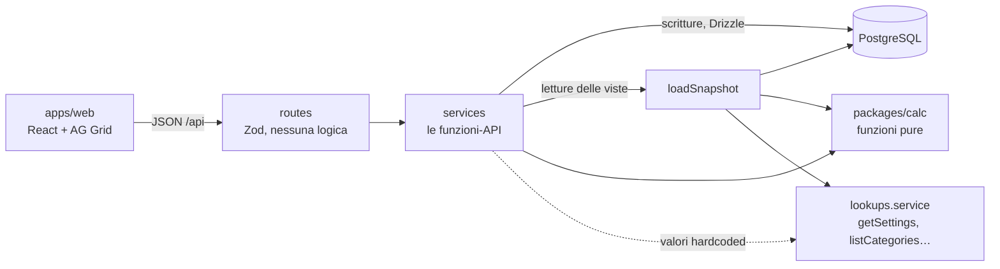

# Architettura

Un monolite in Docker Compose: **Postgres** conserva i dati, un'**API** (Fastify) contiene tutte le regole, un **web app** (React) la usa, un **pacchetto di calcolo puro** (`packages/calc`) fa tutti i conti. La visione completa (inventario, analisi, backup, deploy) è nel piano originale in `fonti/`; qui c'è quello che serve alla v0 e i punti dove si innesta il resto.

## Principi

1. **API-first.** Ogni capacità è una funzione di servizio tipizzata; la route Fastify che la espone non contiene logica. Il web app parla solo con l'API.
2. **Il calcolo è puro.** `packages/calc` riceve dati semplici e restituisce dati semplici: nessun database, nessuna rete, nessun orologio. Si testa senza infrastruttura e può girare anche nel browser.
3. **Hardcode dentro la funzione-API** (regola 4 di `CLAUDE.md`). Ciò che oggi è fisso ma domani sarà configurabile vive nel corpo di una funzione di servizio che è già l'API futura (vedi sotto e [hardcoded-registry.md](hardcoded-registry.md)).
4. **Semplice.** Nessun livello che non serva oggi. Dove c'è una predisposizione (`runWrite`) è perché il piano la richiede e costa poche righe.

## Stack

| Livello  | Scelta                                                                                | Nota                                                                                                                                                                                                                                             |
| -------- | ------------------------------------------------------------------------------------- | ------------------------------------------------------------------------------------------------------------------------------------------------------------------------------------------------------------------------------------------------ |
| Database | PostgreSQL 16                                                                         | Non Mongo: i dati sono relazionali (riga → progetto → area, riga → fondo/fornitore), i soldi vogliono `numeric` e transazioni. La flessibilità che serve all'inventario (attributi diversi per tipo di pezzo) arriva con una colonna JSONB |
| API      | Node (LTS), Fastify, Drizzle ORM, Zod                                                 | Zod valida gli input una volta sola                                                                                                                                                                                                              |
| Calcolo  | TypeScript puro, Vitest                                                               | `packages/calc`                                                                                                                                                                                                                                |
| Web      | React + Vite, AG Grid Community, TanStack Query, React Router, Recharts, Font Awesome | Stili da Figma ([stile-interfaccia.md](stile-interfaccia.md)). Incolla multi-riga da Sheets non garantito in Community: verifica dopo la v0                                                                                                       |
| Monorepo | pnpm workspaces                                                                       | Niente altri strumenti di build                                                                                                                                                                                                                  |
| Ambienti | Docker Compose: `db`, `api`, `web`                                              | Caddy e HTTPS arrivano col deploy (dopo)                                                                                                                                                                                                         |

## Struttura del repository

```
.
├── CLAUDE.md
├── docs/
├── fonti/                    # locale, ignorata da git: script, xlsx reale, piano originale
├── docker-compose.yml, Dockerfile, .env.example
├── apps/
│   ├── api/
│   │   ├── drizzle/          # migrazioni SQL generate (si committano)
│   │   ├── test/             # database di test ricreato a ogni esecuzione
│   │   └── src/
│   │       ├── main.ts           # avvio Fastify, registra i moduli
│   │       ├── db/               # schema.ts, client.ts (utente dell'API), owner.ts (proprietario), migrate.ts, roles.ts + app-role.ts, seed-base.ts, seed.ts
│   │       ├── core/             # tx.ts (runWrite), errors.ts, money.ts (numeric ↔ centesimi), auth-config.ts, security.ts (intestazioni, limite di richieste)
│   │       ├── snapshot.ts       # loadSnapshot(): dal DB al formato di calc
│   │       └── modules/
│   │           ├── auth/         # login Google, JWT, controllo delle richieste, ruoli e permessi
│   │           ├── users/        # utenti, ruoli, aree dei pm
│   │           ├── audit/        # lettura dello storico delle modifiche
│   │           ├── lookups/      # categorie, aliquote, regole IVA, impostazioni (HARDCODED)
│   │           ├── seasons/      # stagione corrente (HARDCODED)
│   │           ├── budget/       # aree, progetti, righe
│   │           ├── funds/        # fondi e contratti
│   │           ├── suppliers/
│   │           ├── inventory/    # articoli, arrivi, movimenti, componenti (distinte), statistiche, immagini
│   │           ├── cashflow/     # ingressi del team e BANK
│   │           └── views/        # una funzione per vista (Gantt, Total, analisi…)
│   └── web/src/
│       ├── theme/            # tokens.css (token Figma), base.css (tipografia), components.css, grid.ts
│       ├── api/              # client.ts (una funzione per endpoint), types.ts
│       ├── lib/              # format.ts (soldi, date), useAction.ts (scritture + ricarica), auth.tsx (chi è dentro), permissions.ts,
│       │                     # export/ (tabelle e grafici → PDF ed Excel nel browser, vedi download.md)
│       ├── components/       # Shell, Button, Chips, Cards, BarsChart, Notice, DownloadMenu, ExportBlocks
│       └── pages/            # una pagina per foglio del vecchio file, più Login, Users, History
├── packages/calc/src/        # funzioni pure + test
└── tools/import-xlsx/        # legge l'xlsx reale: riconciliazione col foglio e caricamento nel DB (usa fonti/)
```

Ogni modulo API ha gli stessi tre file: `*.service.ts` (le funzioni, cioè l'API), `*.routes.ts` (wrapper Fastify + Zod), `*.test.ts`.

## Flusso



- **Ogni richiesta** (tranne health e login): un controllo comune legge il cookie con il JWT, ricarica l'utente dal database (attivo, ruolo, aree) e lo mette nel contesto della richiesta; senza token valido risponde 401. Vedi [accesso-e-storico.md](accesso-e-storico.md).
- **Scrittura**: route → service → `getCurrentUser()` e `canWrite(utente, area)` → `runWrite(actor, fn)` (apre la transazione e dice al database chi scrive; i trigger registrano la modifica in `audit_log`) → Drizzle.
- **Lettura di una vista**: route → service della vista → `loadSnapshot()` (carica stagione, aree, progetti, righe con le due fasi, fondi, contratti, ingressi, fornitori, BANK **e** i valori di `lookups`) → funzione di `calc` → JSON. Niente tabelle di risultati salvate: i conti si rifanno a ogni lettura (qualche centinaio di righe: un istante) e non possono mai essere vecchi.

## Il pattern "hardcode nella funzione-API"

Cosa oggi è fisso e domani non lo sarà? Le categorie, le aliquote IVA, le regole delle scadenze, la soglia di scostamento, la stagione corrente. Ognuna ha già la sua funzione di servizio e la sua route; **il valore è scritto nel corpo della funzione** e nessun altro file lo conosce:

```ts
// apps/api/src/modules/lookups/lookups.service.ts
export async function listCategories(): Promise<string[]> {
  // HARDCODED: diventa la tabella `category`, modificabile dall'admin
  return ["Components", "Manufacturing", "Consumable", "Asset", "Logistic", "Administration", "Software"];
}

// altrove (validazione di una riga): si chiama la funzione, mai una costante
const categories = await listCategories();
```

Quando la funzionalità si implementa davvero, cambia solo il corpo (`return db.select().from(category)…`) più una migrazione e le route di scrittura: i chiamanti non si toccano. Il pacchetto `calc` non può chiamare le funzioni: i valori gli arrivano nello snapshot (`snapshot.lookups`), riempito da `loadSnapshot()` con quelle stesse funzioni.

Le domande Q1–Q7 sono impostazioni dentro `getSettings()` con il valore dello script (tabella in [regole-script-attuale.md](regole-script-attuale.md#15-domande-aperte--dove-sono-isolate)): la risposta del tesoriere diventa una riga da cambiare.

Fisso per sempre (enum nel codice, non registrati come hardcode): fasi `estimate`/`actual`, tipi sponsor `none`/`partial`/`total`, priorità `High`/`Medium`/`Low`.

## Modello dati (v0)

Soldi in `numeric` nel database e in interi nel codice: importi in centesimi, quantità in millesimi, costi unitari in decimillesimi di euro (`apps/api/src/core/money.ts` è l'unico punto di conversione, senza mai passare dai decimali binari); date come `date` ISO. Il VAT si arrotonda al centesimo riga per riga (Q7) in `calc/money.ts`. Le colonne SQL sono in `snake_case` (comodo per chi analizza). I nomi si confrontano senza distinzione di maiuscole (indice unico su `lower(name)`).

| Tabella           | Campi                                                                                                                                 | Note                                                                                                                       |
| ----------------- | ------------------------------------------------------------------------------------------------------------------------------------- | -------------------------------------------------------------------------------------------------------------------------- |
| `season`        | id, name, starts_on, ends_on                                                                                                          | Una sola riga (2026-2027); tutto il budget appartiene a una stagione                                                       |
| `area`          | id, code, name, position                                                                                                              | Seed: MT + DMT, SW, HW, CM, MGT, RT                                                                                        |
| `project`       | id, season_id, area_id, name, owner_name, position                                                                                    | `owner_name` = la persona nella riga gialla del foglio                                                                   |
| `budget_line`   | id, project_id, position, item, category, priority, note, version                                                                     | `category` e `priority` testo validato dal servizio (diventerà chiave esterna); `version` per il blocco ottimistico |
| `line_figures`  | id, line_id, phase, quantity, unit_net_cost, sponsor_type, sponsor_value, vat_rate, supplier_id, purchase_date, arrival_date | Unico per (line_id, phase); fase mancante = tutto zero. `vat_rate` conta per il fondo del team; con uno sponsor vale la sua aliquota. Senza fondo, tipo sponsor o aliquota nulli = riga incompleta |
| `line_fund`     | id, figures_id, position, fund_id                                                                                                    | I fondi che pagano una riga in una fase, in ordine (da 1 a 4). Vedi [sponsor-e-fondi.md](sponsor-e-fondi.md)                |
| `fund`          | id, season_id, name, kind (`team`/`external`), pays_vat, mode (`virtual`/`cash`), type (`fund`/`gift`/`gift_vat`), vat_rate, group_name | "Team's fund" è un fondo `team`, seed, non eliminabile, senza parametri da sponsor. Uno sponsor è un fondo `external` con le sue regole (aliquota, gruppo, cosa dà, dove vanno i soldi, se copre l'IVA). Una sola casella `pays_vat` (Q5 chiusa) |
| `fund_contract` | id, fund_id, phase, amount, inflow_date                                                                                               | I soldi di uno sponsor: **una riga per sponsor e fase** (unica). `inflow_date` può mancare                              |
| `team_inflow`   | id, season_id, phase, source_name, amount, inflow_date                                                                                | Le tabelle CASH FLOW                                                                                                       |
| `bank_snapshot` | id, season_id (unico), amount, as_of_date                                                                                             | Il BANK, valido per le due fasi                                                                                            |
| `supplier`      | id, name                                                                                                                              | Lista unica, senza stagione (servirà all'inventario)                                                                      |
| `app_user`      | id, email (unica, senza maiuscole), name, role (`admin`/`pm`/`viewer`), active, created_at                                      | Chi può entrare; creato al primo accesso come `viewer`; si disattiva, non si cancella                                   |
| `user_area`     | id, user_id, area_id                                                                                                                  | Le aree che un `pm` può modificare                                                                                      |
| `inventory_item` | id, code, name, purpose, category, unit, origin (`bought`/`made`), safety_codes, disposal, storage_notes, maintenance_notes, image_updated_at | l'articolo (vedi [inventario.md](inventario.md)); nome unico senza maiuscole |
| `item_image`    | item_id, mime, full, thumb (bytea)                                                                                                    | l'immagine nel database; non nello storico                                                                                 |
| `stock_movement` | id, item_id, kind (`receipt`/`use`/`transfer`/`adjustment`/`disposal`), occurred_on, quantity, location, spot, to_location, to_spot, unit_net/gross/team, project_id, budget_line_id, note | il registro di tutto ciò che cambia lo scaffale; la giacenza è la somma, mai salvata |
| `component_part` | id, component_id, part_id, quantity, note                                                                                            | la distinta dei materiali di un componente (anche sottoassiemi); mai un anello                                              |
| `audit_log`     | id, at, actor_id (senza chiave esterna), table_name, row_id, action, before, after (jsonb)                                            | Scritta dai trigger; attore nullo = seed, importer, creazione account                                                      |

Vincoli, applicati dal servizio con messaggi chiari: quantità e costi ≥ 0; aliquota tra `listVatRates()`; sponsor parziale con 0 < valore ≤ netto; sponsor totale ignora il valore inserito; fondo o fornitore in uso → eliminazione rifiutata (409); fondi di una riga combinabili solo secondo le regole di [sponsor-e-fondi.md](sponsor-e-fondi.md#4-più-fondi-sulla-stessa-riga); `PATCH` di una riga con `version` vecchia → 409.

**Limiti dell'input** (un solo posto: `apps/api/src/core/validation.ts`; chi li supera riceve 400 con il campo e il motivo, mai un 500). Servono a tenere ogni importo — e ogni somma di importi — esatto: i conti sono in centesimi interi, che smettono di essere esatti sopra circa 9 × 10¹⁵.

| Cosa | Limite |
| --- | --- |
| quantità di una voce | fino a 1.000.000 unità |
| costo unitario netto | fino a 10.000.000 € |
| costo netto di una voce (quantità × costo) e sponsor parziale | fino a 100.000.000 € |
| contratto, ingresso, BANK | fino a 1.000.000.000 € |
| date | giorni veri tra il 2000 e il 2100 (`YYYY-MM-DD`) |
| id, versione | numeri interi in cifre, da 1 a 2.147.483.647 (il massimo di una colonna `integer`) |
| nomi, voci, fornitori… | 1–200 caratteri (la voce fino a 500), tagliati agli estremi; non vuoti |
| note | fino a 5.000 caratteri |
| ogni testo | niente carattere NUL (il database non lo sa conservare) |

Se un valore supera la validazione e il database lo rifiuta lo stesso (numero fuori misura, testo troppo lungo, carattere o data che non sa conservare), il gestore degli errori risponde comunque 400 (`badValueMessage`, `core/errors.ts`): un errore del 500 vuol dire sempre un difetto da correggere.

## Web app

- **Dati**: ogni pagina legge con TanStack Query (`['sheet', area]`, `['gantt', fase]`…) e non calcola nulla: i numeri arrivano dall'API.
- **Scritture**: ogni modifica passa da `useAction()`, che esegue la chiamata, mostra in un angolo un eventuale rifiuto del server (validazione, conflitto di versione, elemento in uso) e **in ogni caso ricarica tutto**: la schermata mostra sempre ciò che il server ha davvero.
- **Pagina di un'area**: un AG Grid per progetto; la riga dei subtotali è una riga fissata in fondo; le celle non scrivono nei dati della griglia ma chiamano `PATCH /lines/:id` con la `version` letta (`pages/areaColumns.tsx` dice quale colonna manda cosa). Il triangolo arancione segnala una riga "incompleta" (tipo di sponsor o aliquota mancanti).
- **Altre pagine**: tabelle semplici con "chip" per scegliere il blocco (ALL ITEMS o una categoria) e grafici a colonne (`BarsChart`) dove li aveva il foglio.
- **Tipi**: le risposte del motore usano i tipi di `@erp/calc` (solo tipi: nessun codice del motore finisce nel browser).

## Pacchetto `calc`

Funzioni pure, input = `Snapshot` (JSON), output = JSON. Una per vista, più i mattoni:

| File                       | Funzioni                                                                                                        |
| -------------------------- | --------------------------------------------------------------------------------------------------------------- |
| `money.ts`, `dates.ts` | arrotondamento, chiave di mese, giorno della settimana, `nextBusinessDay`, parser flessibile (per l'importer) |
| `line.ts`                | `lineAmounts(figures, settings)` → netto, IVA, lordo, sponsor, outflow                                       |
| `vat.ts`                 | `vatDeadline(date, rules)`, `teamVat(line, fund, phase)`                                                    |
| `budget.ts`              | `areaSheet(snapshot, areaCode)` (righe, subtotali di progetto, totale area)                                   |
| `vatReport.ts`           | `vatReport(snapshot, areaCode)`                                                                               |
| `settle.ts`              | `settleLine(figures, funds, phase, balances, settings)`: la "scatola nera" degli sponsor (copertura, IVA, chi la paga, quote dei fondi) |
| `cash.ts`                | `bankInflows`, `cashSponsorVat`: gli sponsor in cassa (ingresso e IVA dell'11%)                            |
| `funds.ts`               | `fundSummary(snapshot, phase)`, `inflowsByMonth(rows)`                                                      |
| `cashflow.ts`            | `cashFlowSummary(snapshot, phase)`                                                                            |
| `gantt.ts`               | `gantt(snapshot, phase)` (tabelle per blocco + tabella "Team's fund")                                         |
| `totals.ts`              | `totals(snapshot)`                                                                                            |
| `analysis.ts`            | `analysisByFund`, `analysisBySupplier`                                                                      |
| `items.ts`               | `itemsView(snapshot, filters)` (CATEGORY ANALYSES)                                                            |

I confronti con la data BANK passano da un solo helper, `isAfterBank(date, bankDate, mode)` con `mode` = `day` o `month`, scelto da `settings.bankCompare`.

## API (v0)

Prefisso `/api`. Tutto richiede un utente che ha fatto il login, tranne `/health` e `/auth/*`. Tutte le scritture passano da `canWrite` (o dai controlli di fornitori e utenti) e da `runWrite`.

| Endpoint                                                                                              | Funzione (modulo)                                                                                    | Note                                                                 |
| ----------------------------------------------------------------------------------------------------- | ---------------------------------------------------------------------------------------------------- | -------------------------------------------------------------------- |
| `GET /auth/config`, `/auth/login`, `/auth/callback`, `/auth/dev-login`, `POST /auth/logout` | `authRoutes` (auth)                                                                                | pubblici; dev-login esiste solo con `DEV_LOGIN_EMAIL`              |
| `GET /me`                                                                                           | `getCurrentUser`, `permissionsOf` (auth)                                                         | chi sei, ruolo, aree, cosa puoi fare                                 |
| `GET /users`, `PATCH /users/:id`                                                                  | `listUsers`, `updateUser` (users)                                                                | solo admin: ruolo, attivo, aree                                      |
| `GET/POST/PATCH/DELETE /inventory/items…`, `/inventory/pending`, `/inventory/receive`, `/inventory/movements`, `/inventory/components…`, `/inventory/stats` | `modules/inventory` | tutto l'inventario: [inventario.md](inventario.md#11-permessi-api-schermate) |
| `GET /audit?table=&rowId=&actorId=&before=&limit=`                                                  | `listHistory` (audit)                                                                              | admin e pm: storico, più recente prima, paginato                    |
| `GET /lookups/categories`, `/priorities`, `/vat-rates`, `/vat-rules`, `/settings`           | `listCategories`, `listPriorities`, `listVatRates`, `getVatRules`, `getSettings` (lookups) | HARDCODED (le priorità sono fisse)                                  |
| `GET /seasons/current`                                                                              | `getCurrentSeason` (seasons)                                                                       | HARDCODED: 2026-2027                                                 |
| `GET /areas`                                                                                        | `listAreas` (budget)                                                                               | dal DB                                                               |
| `GET /areas/:code/sheet`                                                                            | `getAreaSheet` (budget)                                                                            | righe + subtotali + IVA del team                                     |
| `POST /projects`, `PATCH /projects/:id`, `DELETE /projects/:id`                                 | `createProject`… (budget)                                                                         | "Add New Project"                                                    |
| `POST /projects/:id/lines`, `PATCH /lines/:id`, `DELETE /lines/:id`                             | `createLine`… (budget)                                                                            | `PATCH` con `version`, accetta anche `figures.estimate/actual` |
| `GET/POST /funds`, `PATCH/DELETE /funds/:id`                                                      | `listFunds`, `createFund`, `updateFund`, `deleteFund` (funds)                                    | gli sponsor e le loro regole ([sponsor-e-fondi.md](sponsor-e-fondi.md)) |
| `PUT/DELETE /funds/:id/contracts/:phase`                                                                  | `setContract`, `clearContract` (funds)                                                                          | i soldi di uno sponsor: un valore e una data per fase                                                  |
| `GET/POST/DELETE /suppliers`                                                                        | `listSuppliers`… (suppliers)                                                                      | BOUGHT FROM                                                          |
| `GET/POST/DELETE /inflows`                                                                          | `listInflows`… (cashflow)                                                                         | CASH FLOW, per fase                                                  |
| `GET/PUT /bank`                                                                                     | `getBank`, `setBank` (cashflow)                                                                  |                                                                      |
| `GET /views/funds-summary?phase=`                                                                   | `getFundsSummary` (views)                                                                          | riepilogo + mensile                                                  |
| `GET /views/cashflow`                                                                               | `getCashFlowView`                                                                                  | stima e consuntivo                                                   |
| `GET /views/gantt?phase=`                                                                           | `getGantt`                                                                                         |                                                                      |
| `GET /views/totals`                                                                                 | `getTotals`                                                                                        |                                                                      |
| `GET /views/analysis/funds`, `/analysis/suppliers`                                                | `getFundAnalysis`, `getSupplierAnalysis`                                                         |                                                                      |
| `GET /views/items?categories=&priority=&sort=`                                                      | `getItemsView`                                                                                     | CATEGORY ANALYSES                                                    |
| `GET /views/vat-report?area=`                                                                       | `getVatReport`                                                                                     |                                                                      |

Gli stessi endpoint `/views/*` sono la fonte per le analisi esterne (script Python con `requests` + pandas): una sola logica, nessuna copia in SQL.

## Docker e comandi

`docker-compose.yml`: `db` (postgres:16, volume nominato, pubblicato solo su 127.0.0.1), `api` (porta 3000, sorgenti montati, ricarica automatica), `web` (Vite, porta 5173). Configurazione in `.env` (con `.env.example` nel repository).

**Due utenti del database**, come in produzione: il *proprietario* (`erp`) crea e cambia le tabelle (migrazioni, seed, `db:roles`: `DATABASE_OWNER_URL`); l'*utente dell'API* (`erp_app`: `DATABASE_URL`) legge e scrive i dati e basta. Vedi [accesso-e-storico.md](accesso-e-storico.md#82-come-si-scrive-un-trigger).

```bash
cp .env.example .env               # una volta sola: valori di sviluppo per il DB locale
docker compose up --build          # avvia db, api (3000), web (5173)
pnpm db:migrate                    # applica le migrazioni (come proprietario delle tabelle)
pnpm db:roles                      # crea l'utente del database dell'API (dopo le migrazioni)
pnpm db:seed                       # stagione, 6 aree, Team's fund
pnpm test                          # calc, API e importer
pnpm reconcile                     # confronta il motore col foglio reale (richiede fonti/)
pnpm --filter @erp/import-xlsx load            # carica il foglio reale nel DB (--replace per ricaricare)
```

Prerequisiti sul computer: Node 24 o più recente, Docker, pnpm. Se `pnpm` non c'è, `npm install -g pnpm@12.14.0` (il `corepack` incluso in alcune versioni di Node 26 ha un bug di verifica delle firme). I contenitori usano la propria installazione.

**Sicurezza**: login solo con Google (in sviluppo, l'accesso "Sign in as developer"), JWT di 24 ore, ruoli applicati nel server, storico delle modifiche: tutto in [accesso-e-storico.md](accesso-e-storico.md). Le porte restano pubblicate solo su `127.0.0.1`; per esporre l'app serve ancora il lavoro di [produzione.md](produzione.md) (HTTPS, server, backup).

## Test

| Livello          | Cosa                                                                                                                                                                                                                                                     | Dati                                                                                         |
| ---------------- | -------------------------------------------------------------------------------------------------------------------------------------------------------------------------------------------------------------------------------------------------------- | -------------------------------------------------------------------------------------------- |
| Unitari `calc` | ogni regola di [regole-script-attuale.md](regole-script-attuale.md), compresi i casi del §17                                                                                                                                                             | sintetici                                                                                    |
| Integrazione API | CRUD, versione, blocchi di eliminazione, viste su uno snapshot noto, **accesso, ruoli e storico** ([accesso-e-storico.md](accesso-e-storico.md#11-test))                                                                                            | sintetici, Postgres di test                                                                  |
| Riconciliazione  | `pnpm reconcile`: legge `fonti/Budget 26-27.xlsx`, calcola con il motore e confronta ogni valore salvato dal foglio (righe, IVA del team, saldi dei fondi, CASH FLOW, TOTAL, report IVA, tabelle Gantt, analisi, CATEGORY ANALYSES: 1.995 confronti) | reali, è uno script e non gira senza `fonti/`; nessun dato reale entra nei file tracciati |

## Come si estende

| Voglio…                                        | Si fa così                                                                                                                                                                   |
| ----------------------------------------------- | ----------------------------------------------------------------------------------------------------------------------------------------------------------------------------- |
| trasformare un hardcode in funzionalità        | trova la riga in [hardcoded-registry.md](hardcoded-registry.md); cambia il corpo della funzione; aggiungi tabella, migrazione e route di scrittura; togli la riga dal registro |
| aggiungere un campo a una riga                  | `schema.ts` → migrazione → Zod nel modulo → tipo in `calc` → colonna nella griglia                                                                                    |
| aggiungere un'analisi                           | funzione pura in `calc` + `GET /views/<nome>` in `views` (+ pagina, se serve)                                                                                           |
| un permesso nuovo o un ruolo                    | `canWrite()` e le funzioni vicine in `modules/auth/auth.service.ts`; i test in `roles.test.ts`                                                                          |
| tracciare una tabella nello storico             | una migrazione con `create trigger … execute function audit_row()` (vedi `0002_audit_triggers.sql`)                                                                      |
| tabelle `calc_*` e viste SQL per gli analisti | dentro `runWrite()`: rigenera con `calc` dopo la scrittura                                                                                                                |
| inventario                                      | nuovo modulo `inventory` con `inventory_unit` e `inventory_movement`; `budget_line_id` facoltativo; non tocca il resto                                                |

## Differenze dal piano originale

| Piano originale                                 | v0                                                                                         | Perché                                                                                                 |
| ----------------------------------------------- | ------------------------------------------------------------------------------------------ | ------------------------------------------------------------------------------------------------------- |
| Tabelle `calc_*` ricalcolate a ogni scrittura | calcolo alla lettura                                                                       | più semplice e mai incoerente; le tabelle si aggiungono in `runWrite()` quando servono agli analisti |
| Analisi su viste SQL `reporting`              | anche gli endpoint `/views/*` come fonte JSON                                            | stessa logica, nessuna copia                                                                            |
| Login Google, ruoli per area, audit log         | **fatti** dopo la parità, con un JWT di 24 ore al posto delle sessioni nel database | scelta dell'utente: [accesso-e-storico.md](accesso-e-storico.md)                                         |
| Un solo flag "paga IVA" per fondo               | due flag, uno per fase, finché Q5 era aperta; **dal 21/10/2026 uno solo** (come nel piano)  | parità col foglio all'inizio; poi la scelta del tesoriere: una sola casella per sponsor              |
| Importer in fase 1                              | importer e riconciliazione appena c'è il motore (B3)                                      | l'xlsx reale è l'oracolo e prova il motore prima dell'interfaccia                                      |
| `project` senza responsabile                  | `owner_name`                                                                             | il foglio reale lo contiene                                                                             |
| Date d'incasso e BANK come mese                 | date intere, mostrate come mese                                                            | il foglio reale ha il giorno                                                                            |
