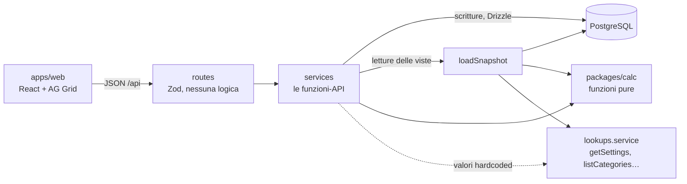

# Architettura

Un monolite in Docker Compose: **Postgres** conserva i dati, un'**API** (Fastify) contiene tutte le regole, un **web app** (React) la usa, un **pacchetto di calcolo puro** (`packages/calc`) fa tutti i conti. La visione completa (inventario, analisi, backup, deploy) è nel piano originale in `fonti/`; qui c'è quello che serve alla v0 e i punti dove si innesta il resto.

## Principi

1. **API-first.** Ogni capacità è una funzione di servizio tipizzata; la route Fastify che la espone non contiene logica. Il web app parla solo con l'API.
2. **Il calcolo è puro.** `packages/calc` riceve dati semplici e restituisce dati semplici: nessun database, nessuna rete, nessun orologio. Si testa senza infrastruttura e può girare anche nel browser.
3. **Hardcode dentro la funzione-API** (regola 4 di `CLAUDE.md`). Ciò che oggi è fisso ma domani sarà configurabile vive nel corpo di una funzione di servizio che è già l'API futura (vedi sotto e [hardcoded-registry.md](hardcoded-registry.md)).
4. **Semplice.** Nessun livello che non serva oggi. Dove c'è una predisposizione (`runWrite`, `getCurrentUser`, `canWrite`) è perché il piano la richiede e costa poche righe.

## Stack

| Livello | Scelta | Nota |
| --- | --- | --- |
| Database | PostgreSQL 16 | Non Mongo: i dati sono relazionali (riga → progetto → area, riga → fondo/fornitore), i soldi vogliono `numeric` e transazioni. La flessibilità che serve all'inventario (attributi diversi per tipo di pezzo) arriva con una colonna JSONB |
| API | Node (LTS), Fastify, Drizzle ORM, Zod | Zod valida gli input una volta sola |
| Calcolo | TypeScript puro, Vitest | `packages/calc` |
| Web | React + Vite, AG Grid Community | Stili da Figma ([stile-interfaccia.md](stile-interfaccia.md)). Incolla multi-riga da Sheets non garantito in Community: verifica dopo la v0 |
| Monorepo | pnpm workspaces | Niente altri strumenti di build |
| Ambienti | Docker Compose: `db`, `api`, `web` | Caddy e HTTPS arrivano col deploy (dopo) |

## Struttura del repository

```
.
├── CLAUDE.md
├── docs/
├── fonti/                    # locale, ignorata da git: script, xlsx reale, piano originale
├── docker-compose.yml
├── apps/
│   ├── api/src/
│   │   ├── main.ts           # avvio Fastify, registra i moduli
│   │   ├── db/               # schema.ts, client.ts, migrations/, seed.ts (dati sintetici)
│   │   ├── core/             # tx.ts (runWrite), errors.ts, money.ts (numeric ↔ centesimi)
│   │   ├── snapshot.ts       # loadSnapshot(): dal DB al formato di calc
│   │   └── modules/
│   │       ├── auth/         # getCurrentUser, canWrite          (HARDCODED)
│   │       ├── lookups/      # categorie, aliquote, regole IVA, impostazioni (HARDCODED)
│   │       ├── budget/       # aree, progetti, righe
│   │       ├── funds/        # fondi e contratti
│   │       ├── suppliers/
│   │       ├── cashflow/     # ingressi del team e BANK
│   │       └── views/        # una funzione per vista (Gantt, Total, analisi…)
│   └── web/src/
│       ├── theme/            # token estratti da Figma (unico punto)
│       ├── api/              # client tipizzato, una funzione per endpoint
│       ├── components/
│       └── pages/            # una pagina per foglio del vecchio file
├── packages/calc/src/        # funzioni pure + test
└── tools/import-xlsx/        # importer una tantum + riconciliazione (usa fonti/)
```

Ogni modulo API ha gli stessi tre file: `*.service.ts` (le funzioni, cioè l'API), `*.routes.ts` (wrapper Fastify + Zod), `*.test.ts`.

## Flusso



- **Scrittura**: route → service → `runWrite(actor, fn)` (apre la transazione) → Drizzle. Il service chiama `canWrite(actor, area)` prima di scrivere.
- **Lettura di una vista**: route → service della vista → `loadSnapshot()` (carica stagione, aree, progetti, righe con le due fasi, fondi, contratti, ingressi, fornitori, BANK **e** i valori di `lookups`) → funzione di `calc` → JSON. Niente tabelle di risultati salvate: i conti si rifanno a ogni lettura (qualche centinaio di righe: un istante) e non possono mai essere vecchi.

## Il pattern "hardcode nella funzione-API"

Cosa oggi è fisso e domani non lo sarà? Le categorie, le aliquote IVA, le regole delle scadenze, la soglia di scostamento, l'utente corrente. Ognuna ha già la sua funzione di servizio e la sua route; **il valore è scritto nel corpo della funzione** e nessun altro file lo conosce:

```ts
// apps/api/src/modules/lookups/lookups.service.ts
export async function listCategories(): Promise<string[]> {
  // HARDCODED: diventa la tabella `category`, modificabile dall'admin
  return ["Components", "Manufacturing", "Consumable", "Asset", "Logistic", "Administration", "Software"];
}

// altrove (validazione di una riga): si chiama la funzione, mai una costante
const categories = await listCategories();
```

Quando la funzionalità si implementa davvero, cambia solo il corpo (`return db.select().from(category)…`) più una migrazione e le route di scrittura: i chiamanti non si toccano. Il pacchetto `calc` non può chiamare le funzioni: i valori gli arrivano nello snapshot (`snapshot.lookups`), riempito da `loadSnapshot()` con quelle stesse funzioni.

Le domande Q1–Q7 sono impostazioni dentro `getSettings()` con il valore dello script (tabella in [regole-script-attuale.md](regole-script-attuale.md#15-domande-aperte--dove-sono-isolate)): la risposta del tesoriere diventa una riga da cambiare.

Fisso per sempre (enum nel codice, non registrati come hardcode): fasi `estimate`/`actual`, tipi sponsor `none`/`partial`/`total`, priorità `High`/`Medium`/`Low`.

## Modello dati (v0)

Soldi in `numeric` nel database e in centesimi interi nel codice (`core/money.ts` è l'unico punto di conversione); date come `date` ISO. I nomi si confrontano senza distinzione di maiuscole (indice unico su `lower(name)`).

| Tabella | Campi | Note |
| --- | --- | --- |
| `season` | id, name, starts_on, ends_on | Una sola riga (2026-2027); tutto il budget appartiene a una stagione |
| `area` | id, code, name, position | Seed: MT + DMT, SW, HW, CM, MGT, RT |
| `project` | id, season_id, area_id, name, owner_name, position | `owner_name` = la persona nella riga gialla del foglio |
| `budget_line` | id, project_id, position, item, category, priority, note, version | `category` e `priority` testo validato dal servizio (diventerà chiave esterna); `version` per il blocco ottimistico |
| `line_figures` | id, line_id, phase, quantity, unit_net_cost, sponsor_type, sponsor_value, vat_rate, fund_id, supplier_id, purchase_date, arrival_date | Unico per (line_id, phase); fase mancante = tutto zero. Tipo sponsor o aliquota nulli = riga incompleta |
| `fund` | id, season_id, name, kind (`team`/`external`), pays_vat_estimate, pays_vat_actual | "Team's fund" è un fondo `team`, seed, non eliminabile. Due flag per parità col foglio (⚠ Q5) |
| `fund_contract` | id, fund_id, phase, amount, inflow_date | Le tabelle CASH FROM. `inflow_date` può mancare |
| `team_inflow` | id, season_id, phase, source_name, amount, inflow_date | Le tabelle CASH FLOW |
| `bank_snapshot` | id, season_id (unico), amount, as_of_date | Il BANK, valido per le due fasi |
| `supplier` | id, name | Lista unica, senza stagione (servirà all'inventario) |

Vincoli, applicati dal servizio con messaggi chiari: quantità e costi ≥ 0; aliquota tra `listVatRates()`; sponsor parziale con 0 < valore ≤ netto; sponsor totale ignora il valore inserito; fondo o fornitore in uso → eliminazione rifiutata (409); `PATCH` di una riga con `version` vecchia → 409.

## Pacchetto `calc`

Funzioni pure, input = `Snapshot` (JSON), output = JSON. Una per vista, più i mattoni:

| File | Funzioni |
| --- | --- |
| `money.ts`, `dates.ts` | arrotondamento, chiave di mese, giorno della settimana, `nextBusinessDay`, parser flessibile (per l'importer) |
| `line.ts` | `lineAmounts(figures, settings)` → netto, IVA, lordo, sponsor, outflow |
| `vat.ts` | `vatDeadline(date, rules)`, `teamVat(line, fund, phase)` |
| `budget.ts` | `areaSheet(snapshot, areaCode)` (righe, subtotali di progetto, totale area) |
| `vatReport.ts` | `vatReport(snapshot, areaCode)` |
| `funds.ts` | `fundSummary(snapshot, phase)`, `inflowsByMonth(rows)` |
| `cashflow.ts` | `cashFlowSummary(snapshot, phase)` |
| `gantt.ts` | `gantt(snapshot, phase)` (tabelle per blocco + tabella "Team's fund") |
| `totals.ts` | `totals(snapshot)` |
| `analysis.ts` | `analysisByFund`, `analysisBySupplier` |
| `items.ts` | `itemsView(snapshot, filters)` (CATEGORY ANALYSES) |

I confronti con la data BANK passano da un solo helper, `isAfterBank(date, bankDate, mode)` con `mode` = `day` o `month`, scelto da `settings.bankCompare`.

## API (v0)

Prefisso `/api`. Tutte le scritture passano da `runWrite` e `canWrite`.

| Endpoint | Funzione (modulo) | Note |
| --- | --- | --- |
| `GET /me` | `getCurrentUser` (auth) | HARDCODED: admin |
| `GET /lookups/categories`, `/vat-rates`, `/vat-rules`, `/settings`, `/seasons/current` | `listCategories`, `listVatRates`, `getVatRules`, `getSettings`, `getCurrentSeason` (lookups) | HARDCODED |
| `GET /areas` | `listAreas` (budget) | dal DB |
| `GET /areas/:code/sheet` | `getAreaSheet` (budget) | righe + subtotali + IVA del team |
| `POST /projects`, `PATCH /projects/:id`, `DELETE /projects/:id` | `createProject`… (budget) | "Add New Project" |
| `POST /projects/:id/lines`, `PATCH /lines/:id`, `DELETE /lines/:id` | `createLine`… (budget) | `PATCH` con `version`, accetta anche `figures.estimate/actual` |
| `GET /funds`, `PATCH /funds/:id` | `listFunds`, `updateFund` (funds) | flag "paga IVA" |
| `GET/POST/DELETE /funds/contracts` | `listContracts`… (funds) | CASH FROM, per fase |
| `GET/POST/DELETE /suppliers` | `listSuppliers`… (suppliers) | BOUGHT FROM |
| `GET/POST/DELETE /inflows` | `listInflows`… (cashflow) | CASH FLOW, per fase |
| `GET/PUT /bank` | `getBank`, `setBank` (cashflow) | |
| `GET /views/funds-summary?phase=` | `getFundsSummary` (views) | riepilogo + mensile |
| `GET /views/cashflow` | `getCashFlowView` | stima e consuntivo |
| `GET /views/gantt?phase=` | `getGantt` | |
| `GET /views/totals` | `getTotals` | |
| `GET /views/analysis/funds`, `/analysis/suppliers` | `getFundAnalysis`, `getSupplierAnalysis` | |
| `GET /views/items?categories=&priority=&sort=` | `getItemsView` | CATEGORY ANALYSES |
| `GET /views/vat-report?area=` | `getVatReport` | |

Gli stessi endpoint `/views/*` sono la fonte per le analisi esterne (script Python con `requests` + pandas): una sola logica, nessuna copia in SQL.

## Docker e comandi

`docker-compose.yml` (creato nel blocco B0): `db` (postgres:16, volume nominato, non pubblicato fuori da localhost), `api` (porta 3000, sorgenti montati, ricarica automatica), `web` (Vite, porta 5173). Configurazione in `.env` (con `.env.example` nel repository).

```bash
docker compose up --build          # avvia db, api, web
pnpm db:migrate                    # applica le migrazioni
pnpm db:seed                       # aree, stagione, Team's fund, dati sintetici
pnpm test                          # calc + API
pnpm reconcile                     # importer + confronto col foglio reale (richiede fonti/)
```

**Sicurezza della v0**: nessun login (`getCurrentUser()` restituisce l'admin). L'app va usata solo in locale; non esporla su una rete finché non c'è l'accesso con Google.

## Test

| Livello | Cosa | Dati |
| --- | --- | --- |
| Unitari `calc` | ogni regola di [regole-script-attuale.md](regole-script-attuale.md), compresi i casi del §17 | sintetici |
| Integrazione API | CRUD, versione, blocchi di eliminazione, viste su uno snapshot noto | sintetici, Postgres di test |
| Riconciliazione | importa `fonti/Budget 26-27.xlsx` e confronta con i valori calcolati dal foglio (TOTAL, saldi dei fondi, CASH FLOW, scadenze IVA) | reali, si salta se `fonti/` manca; nessun dato reale entra nei file tracciati |

## Come si estende

| Voglio… | Si fa così |
| --- | --- |
| trasformare un hardcode in funzionalità | trova la riga in [hardcoded-registry.md](hardcoded-registry.md); cambia il corpo della funzione; aggiungi tabella, migrazione e route di scrittura; togli la riga dal registro |
| aggiungere un campo a una riga | `schema.ts` → migrazione → Zod nel modulo → tipo in `calc` → colonna nella griglia |
| aggiungere un'analisi | funzione pura in `calc` + `GET /views/<nome>` in `views` (+ pagina, se serve) |
| login con Google e ruoli | corpo di `getCurrentUser()` e `canWrite()` |
| storico delle modifiche | dentro `runWrite()`: scrive `audit_log` nella stessa transazione |
| tabelle `calc_*` e viste SQL per gli analisti | dentro `runWrite()`: rigenera con `calc` dopo la scrittura |
| inventario | nuovo modulo `inventory` con `inventory_unit` e `inventory_movement`; `budget_line_id` facoltativo; non tocca il resto |

## Differenze dal piano originale

| Piano originale | v0 | Perché |
| --- | --- | --- |
| Tabelle `calc_*` ricalcolate a ogni scrittura | calcolo alla lettura | più semplice e mai incoerente; le tabelle si aggiungono in `runWrite()` quando servono agli analisti |
| Analisi su viste SQL `reporting` | anche gli endpoint `/views/*` come fonte JSON | stessa logica, nessuna copia |
| Login Google, ruoli per area, audit log | funzioni predisposte (`getCurrentUser`, `canWrite`, `runWrite`) con valori fissi | dopo la parità |
| Un solo flag "paga IVA" per fondo | due flag, uno per fase | parità col foglio finché Q5 è aperta |
| Importer in fase 1 | importer e riconciliazione appena c'è il motore (B3) | l'xlsx reale è l'oracolo e prova il motore prima dell'interfaccia |
| `project` senza responsabile | `owner_name` | il foglio reale lo contiene |
| Date d'incasso e BANK come mese | date intere, mostrate come mese | il foglio reale ha il giorno |
