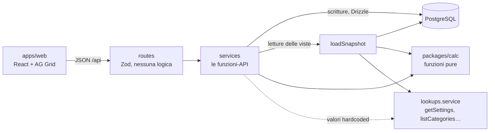

# Architettura

Un monolite in Docker Compose: **Postgres** conserva i dati, un'**API** (Fastify) contiene tutte le regole, un **web app** (React) la usa, un **pacchetto di calcolo puro** (`packages/calc`) fa tutti i conti. Le **anagrafiche** (REGISTRY) hanno un motore puro tutto loro (`packages/registry`) e un modulo dell'API indipendente dal resto ([anagrafiche.md](anagrafiche.md)). La visione completa (inventario, analisi, backup, deploy) è nel piano originale in `fonti/`; qui c'è quello che serve alla v0 e i punti dove si innesta il resto.

## Principi

1. **API-first.** Ogni capacità è una funzione di servizio tipizzata; la route Fastify che la espone non contiene logica. Il web app parla solo con l'API.
2. **Il calcolo è puro.** `packages/calc` riceve dati semplici e restituisce dati semplici: nessun database, nessuna rete, nessun orologio. Si testa senza infrastruttura e può girare anche nel browser.
3. **Hardcode dentro la funzione-API** (regola 4 di `CLAUDE.md`). Ciò che oggi è fisso ma domani sarà configurabile vive nel corpo di una funzione di servizio che è già l'API futura (vedi sotto e [hardcoded-registry.md](hardcoded-registry.md)).
4. **Semplice.** Nessun livello che non serva oggi. Dove c'è una predisposizione (`runWrite`) è perché il piano la richiede e costa poche righe.

## Stack

| Livello  | Scelta                                                                                | Nota                                                                                                                                                                                                                                             |
| -------- | ------------------------------------------------------------------------------------- | ------------------------------------------------------------------------------------------------------------------------------------------------------------------------------------------------------------------------------------------------ |
| Database | PostgreSQL 16                                                                         | Non Mongo: i dati sono relazionali (riga → progetto → area, riga → fondo/fornitore), i soldi vogliono `numeric` e transazioni. La flessibilità che serve all'inventario (attributi diversi per tipo di pezzo) arriva con una colonna JSONB |
| API      | Node (LTS), Fastify, Drizzle ORM, Zod                                                 | Zod valida gli input una volta sola                                                                                                                                                                                                              |
| Calcolo  | TypeScript puro, Vitest                                                               | `packages/calc`                                                                                                                                                                                                                                |
| Web      | React + Vite, AG Grid Community, TanStack Query, React Router, Recharts, Font Awesome | Stili da Figma ([stile-interfaccia.md](stile-interfaccia.md)). Incolla multi-riga da Sheets non garantito in Community: verifica dopo la v0                                                                                                       |
| Monorepo | pnpm workspaces                                                                       | Niente altri strumenti di build                                                                                                                                                                                                                  |
| Ambienti | Docker Compose: `db`, `api`, `web`                                              | produzione: `docker-compose.prod.yml` con Caddy e HTTPS ([rilascio.md](rilascio.md))                                                                                                                                                                                                         |

## Struttura del repository

```
.
├── CLAUDE.md
├── docs/
├── fonti/                    # locale, ignorata da git: script, xlsx reale, piano originale
├── docker-compose.yml, Dockerfile, .env.example   (sviluppo)
├── docker-compose.prod.yml, Dockerfile.prod, Caddyfile, .env.prod.example   (produzione, docs/rilascio.md)
├── apps/
│   ├── api/
│   │   ├── drizzle/          # migrazioni SQL generate (si committano)
│   │   ├── test/             # database di test ricreato a ogni esecuzione
│   │   └── src/
│   │       ├── main.ts           # avvio Fastify, registra i moduli
│   │       ├── db/               # schema/ (le tabelle: un file per proprietario) e schema.ts (le riunisce per il client), client.ts (utente dell'API), owner.ts (proprietario), migrate.ts, roles.ts + app-role.ts, seed-base.ts, seed.ts
│   │       ├── core/             # tx.ts (runWrite), errors.ts, money.ts (numeric ↔ centesimi), auth-config.ts, security.ts (intestazioni, limite di richieste),
│   │       │                     #   contracts.ts (eventi, domande, porte e dichiarazioni fra i proprietari del server: moduli-architettura.md, §5), usage.ts (conta chi usa un elenco, in una query)
│   │       ├── architecture.map.ts   # chi possiede ogni cartella e ogni tabella, e le eccezioni di oggi (le prove di architettura lo leggono)
│   │       ├── platform/         # il nucleo, sempre acceso (moduli-architettura.md, §4.1); platform.public.ts è ciò che i moduli ne usano: le domande («chi usa questo?»), gli eventi (categoria rinominata, stagione nuova) e i nomi dello storico
│   │       │   ├── auth/         # login Google, JWT, controllo delle richieste, ruoli e permessi
│   │       │   ├── users/        # utenti, ruoli, aree dei pm
│   │       │   ├── areas/        # l'elenco delle aree (GET /api/areas)
│   │       │   ├── audit/        # lettura dello storico delle modifiche
│   │       │   ├── lookups/      # le liste comuni: categorie e aliquote IVA (dal database), «editing on a phone»; quelle dei moduli sono nei moduli
│   │       │   ├── settings/     # la parte del nucleo della pagina Settings: categorie, aliquote, «editing on a phone» (impostazioni.md)
│   │       │   ├── seasons/      # stagioni e macchine; la stagione scelta nel menù (header X-Season)
│   │       │   ├── appmodules/   # gli interruttori dei moduli (moduli.md)
│   │       │   └── health/
│   │       ├── bridges/
│   │       │   ├── registry-access/  # il ponte: i ruoli dell'ERP calcolati dalle anagrafiche (anagrafiche.md, §9); risponde sotto /api/registry-access
│   │       │   ├── treasury-budget/  # il ponte: ciò che ha bisogno del registro e del budget insieme (TO PAY, righe pagate, inflow ricevuti, area ADMINISTRATION, Voci di partenza, cancellazione scelta); risponde sotto /api/treasury-budget
│   │       │   └── inventory-budget/ # il ponte: ciò che ha bisogno dell'inventario e del budget insieme (PENDING, l'arrivo per una riga, ARRIVED, il progetto di un movimento e di «Make new», le statistiche per progetto e area)
│   │       └── modules/          # ognuno ha un <nome>.contract.ts (budget, inventory, cash): ciò che risponde al nucleo e ascolta da lui
│   │           ├── budget/       # il budget, in una cartella sola dal passo G6: progetti, righe e il foglio di un'area (budget.*), fondi e contratti (funds.*),
│   │           │                 #   fornitori (suppliers.*), una funzione per vista (views.*: Gantt, Total, analisi…), ingressi del team e BANK (cashflow.*:
│   │           │                 #   il BANK lo chiede al registro con una porta, `budget.ports.ts`), snapshot.ts (loadSnapshot(): dal DB al formato di calc),
│   │           │                 #   le sue liste e gli interruttori del calcolo (lookups.*); budget.public.ts è ciò che i ponti ne usano
│   │           ├── inventory/    # articoli, arrivi fuori budget, movimenti, componenti (distinte), statistiche, immagini, unità, posti e campi per categoria; inventory.public.ts è ciò che il ponte ne usa
│   │           ├── treasury/     # il registro di cassa del fondo del team, le sue liste e l'import dell'Excel (era `cash`), sotto /api/treasury; treasury.public.ts è ciò che gli altri ne usano
│   │           └── registry/     # le anagrafiche: tabelle, campi, viste, record, file, moduli, webhook (anagrafiche.md)
│   └── web/src/              # diviso per proprietario come il server dal passo G7 (moduli-architettura.md, §7)
│       ├── App.tsx, main.tsx, manifests.ts # il cablaggio: l'elenco dei manifesti e le pagine che ne vengono; l'unico che può usare tutto
│       ├── architecture.test.ts # le regole del sito: chi può importare chi (moduli-architettura.md, §7.3)
│       ├── theme/            # tokens.css (token Figma), base.css (tipografia), components.css, grid.ts
│       ├── core/             # la cornice, non conosce nessun modulo: api.ts (request(), errori, upload), calcTypes.ts (i tipi del motore),
│       │                     # ui/ (i modelli: PageHeader, Panel, FormPanel, Field, DataTable, Table, RowAction…), export/ (tabelle e grafici →
│       │                     # PDF ed Excel, vedi download.md), Button, Chips, SearchSelect, Picture, BarsChart, LineChart, DownloadMenu,
│       │                     # format.ts (soldi, date), useAction.ts (scritture + ricarica), bozze (useDraft, drafts), sort, screen, theme…
│       ├── platform/         # il nucleo: api.ts e types.ts del nucleo, auth.tsx (chi è dentro), permissions.ts, season.ts, modules.ts,
│       │                     # manifest.tsx (com'è fatto un manifesto), index.tsx (il suo), Shell (il menù, dai manifesti),
│       │                     # SeasonSwitcher, Login, Users, History, Settings (le schede dai manifesti; App, stagioni, IVA, token)
│       ├── modules/          # ognuno con index.tsx (il manifesto: pagine, menù, sezione di Settings), api.ts (le chiamate ai suoi
│       │                     # indirizzi) e types.ts, le sue pagine, componenti e lib
│       │   ├── budget/       # le pagine delle aree, CASH FROM, BOUGHT FROM, CASH FLOW, Gantt, TOTAL, analisi, il form delle righe
│       │   ├── treasury/     # CASH REGISTER, FINANCIAL STATEMENT, l'import dell'Excel, le liste del registro
│       │   ├── inventory/    # INVENTORY, il pezzo, i componenti, le statistiche, i tipi, i form di movimenti, produzione e arrivi
│       │   └── registry/     # le anagrafiche e il modulo pubblico (FormPage)
│       └── bridges/          # ognuno con il suo index.tsx: acceso solo con tutti e due i suoi moduli
│           ├── treasury-budget/  # TO PAY, PayForm, PayLines, ReceiveInflow, DeleteInflow
│           └── inventory-budget/ # PENDING e la pillola ARRIVED
├── packages/calc/src/        # funzioni pure + test
├── packages/registry/src/    # il motore puro delle anagrafiche: valori, formule, filtri, permessi, moduli, CSV
└── tools/import-xlsx/        # legge l'xlsx reale: riconciliazione col foglio e caricamento nel DB (usa fonti/)
```

Ogni modulo API ha gli stessi tre file: `*.service.ts` (le funzioni, cioè l'API), `*.routes.ts` (wrapper Fastify + Zod), `*.test.ts`.

**Moduli legati ma indipendenti.** Un modulo usa di un altro solo le funzioni pubbliche. Per le anagrafiche è esplicito:
- `registry` espone a tutti gli altri soltanto `registry.public.ts`;
- `rolesync` le usa e si aggancia agli utenti con `setManagedCheck`;
- né `registry` né `users` sanno che `rolesync` esiste.

Da fuori tutto passa dall'HTTP, anche con i token per i servizi.

## Flusso



- **Ogni richiesta** (tranne health e login): un controllo comune legge il cookie con il JWT, ricarica l'utente dal database (attivo, ruolo, aree) e lo mette nel contesto della richiesta; senza token valido risponde 401. Vedi [accesso-e-storico.md](accesso-e-storico.md). Un secondo controllo legge la stagione scelta nel menù (header `X-Season`) e la mette nello stesso modo a disposizione di `getCurrentSeason()`; senza header vale la stagione di oggi ([stagioni-anni-fiscali-e-macchine.md](stagioni-anni-fiscali-e-macchine.md)).
- **Scrittura**: route → service → `getCurrentUser()` e `canWrite(utente, area)` → `runWrite(actor, fn)` (apre la transazione e dice al database chi scrive; i trigger registrano la modifica in `audit_log`) → Drizzle.
- **Lettura di una vista**: route → service della vista → `loadSnapshot()` (carica, della stagione scelta: aree, progetti, righe con le due fasi, fondi, contratti, ingressi, fornitori, BANK **e** i valori di `lookups`) → funzione di `calc` → JSON. Niente tabelle di risultati salvate: i conti si rifanno a ogni lettura (qualche centinaio di righe: un istante) e non possono mai essere vecchi.

## Il pattern "hardcode nella funzione-API"

Cosa oggi è fisso e domani non lo sarà? Le categorie, le aliquote IVA, le regole delle scadenze, la soglia di scostamento, la stagione corrente (le ultime tre non lo sono più). Ognuna ha già la sua funzione di servizio e la sua route; **il valore è scritto nel corpo della funzione** e nessun altro file lo conosce:

```ts
// apps/api/src/platform/lookups/lookups.service.ts (oggi le liste comuni del nucleo; quelle del budget sono in modules/budget/lookups.service.ts)
export async function listCategories(): Promise<string[]> {
  // HARDCODED: diventa la tabella `category`, modificabile dall'admin
  return ["Components", "Manufacturing", "Consumable", "Asset", "Logistic", "Administration", "Software"];
}

// altrove (validazione di una riga): si chiama la funzione, mai una costante
const categories = await listCategories();
```

Quando la funzionalità si implementa davvero, cambia solo il corpo (`return db.select().from(category)…`) più una migrazione e le route di scrittura: i chiamanti non si toccano. Il pacchetto `calc` non può chiamare le funzioni: i valori gli arrivano nello snapshot (`snapshot.lookups`), riempito da `loadSnapshot()` con quelle stesse funzioni.

Le domande Q1–Q7 sono impostazioni dentro `getSettings()` con il valore dello script (tabella in [regole-script-attuale.md](regole-script-attuale.md#15-domande-aperte--dove-sono-isolate)): la risposta del tesoriere diventa una riga da cambiare.

Fisso per sempre (enum nel codice, non registrati come hardcode): fasi `estimate`/`actual`, tipi sponsor `none`/`partial`/`total`, priorità `High`/`Medium`/`Low`.

## Modello dati (v0)

I diagrammi di tutto il database, area per area, sono in [schema-database.md](schema-database.md); qui sotto ci sono le tabelle con le colonne.

Soldi in `numeric` nel database e in interi nel codice: importi in centesimi, quantità in millesimi, costi unitari in decimillesimi di euro (`apps/api/src/core/money.ts` è l'unico punto di conversione, senza mai passare dai decimali binari); date come `date` ISO. Il VAT si arrotonda al centesimo riga per riga (Q7) in `calc/money.ts`. Le colonne SQL sono in `snake_case` (comodo per chi analizza). I nomi si confrontano senza distinzione di maiuscole (indice unico su `lower(name)`).

| Tabella           | Campi                                                                                                                                 | Note                                                                                                                       |
| ----------------- | ------------------------------------------------------------------------------------------------------------------------------------- | -------------------------------------------------------------------------------------------------------------------------- |
| `season`        | id, name, starts_on, ends_on, car, read_only                                                                                          | Una riga per stagione (1/9 – 31/8): tutto il budget appartiene a una stagione; `car` è la macchina di quella stagione, `read_only` blocca le modifiche al suo budget ([stagioni-anni-fiscali-e-macchine.md](stagioni-anni-fiscali-e-macchine.md)) |
| `area`          | id, code, name, position, derived                                                                                                     | Seed: MT + DMT, SW, HW, CM, MGT, RT e ADMINISTRATION (`derived`: calcolata dal registro, [spese-fuori-budget.md](spese-fuori-budget.md)) |
| `project`       | id, season_id, area_id, name, owner_name, position                                                                                    | `owner_name` = la persona nella riga gialla del foglio                                                                   |
| `budget_line`   | id, project_id, position, item, category, priority, note, version, car_season_id                                                      | `category` e `priority` testo validato dal servizio (diventerà chiave esterna); `version` per il blocco ottimistico; `car_season_id` = comprata per la macchina di un'altra stagione (vuoto: quella della sua) |
| `line_figures`  | id, line_id, phase, quantity, unit_net_cost, unit_gross_cost, sponsor_type, sponsor_value, vat_rate, supplier_id, purchase_date, arrival_date | Unico per (line_id, phase); fase mancante = tutto zero. `arrival_date` si scrive solo in EXPECTED: quella di ACTUAL è calcolata dagli arrivi ([inventario.md](inventario.md), §3) e l'API rifiuta di scriverla. Il prezzo di un'unità è **uno solo**: `unit_net_cost` (senza IVA) oppure `unit_gross_cost` (con IVA, e allora il netto salvato è 0; [prezzo-lordo.md](prezzo-lordo.md)). `vat_rate` conta per il fondo del team; con uno sponsor vale la sua aliquota. Senza fondo, tipo sponsor o aliquota nulli = riga incompleta |
| `line_fund`     | id, figures_id, position, fund_id                                                                                                    | I fondi che pagano una riga in una fase, in ordine (da 1 a 4). Vedi [sponsor-e-fondi.md](sponsor-e-fondi.md)                |
| `fund`          | id, season_id, name, kind (`team`/`external`), type (`fund`/`gift`/`gift_vat`), vat_rate, group_name | "Team's fund" è un fondo `team`, seed, non eliminabile, senza parametri da sponsor. Uno sponsor è un fondo `external` con le sue regole (aliquota, gruppo, cosa dà, dove vanno i soldi, se copre l'IVA). Una sola casella `pays_vat` (Q5 chiusa) |
| `fund_contract` | id, fund_id, phase, amount, inflow_date                                                                                               | I soldi di uno sponsor: **una riga per sponsor e fase** (unica). `inflow_date` può mancare                              |
| `team_inflow`   | id, season_id, phase, source_name, amount, inflow_date, sponsorship | Le tabelle CASH FLOW. `sponsorship` (di base vera): solo gli inflow di sponsorizzazione pagano l'11% di IVA. `cash_entry_id` (unico): l'entrata del registro che ha ricevuto un inflow atteso |
| `bank_snapshot` | id, season_id (unico), amount, as_of_date                                                                                             | Il BANK, valido per le due fasi                                                                                            |
| `cash_entry`    | id, entry_on, description, category_id, method_id, account (`cash`/`bank`/`paypal`), amount (con segno), invoice_checked, sponsorship | Il registro di cassa del fondo del team: un movimento su un conto. I progressivi non si salvano |
| `cash_entry_line` | id, entry_id, line_id, amount (sopra zero; unico per coppia) | Quanto un'uscita del registro ha pagato di una riga del budget (la quota del fondo del team, ACTUAL) |
| `cash_opening`  | id, year, account, amount (unico per anno e conto) | I saldi di un conto al 1° gennaio; senza, l'anno riparte dalla chiusura dell'anno prima |
| `cash_category` | id, name (unico senza maiuscole), position, sponsorship, scope | Le Voci del registro (Settings); `scope`: dove conta il loro denaro (`project`, `outside`, `ignore`) |
| `cash_method`   | id, name (unico senza maiuscole), position | I metodi di pagamento del registro (Settings) |
| `supplier`      | id, name                                                                                                                              | Lista unica, di tutte le stagioni e dell'inventario                                                                       |
| `app_user`      | id, email (unica, senza maiuscole), name, role (`admin`/`pm`/`viewer`), treasury, sponsors, active, created_at                                      | Chi può entrare; creato al primo accesso come `viewer`; si disattiva, non si cancella                                   |
| `user_area`     | id, user_id, area_id                                                                                                                  | Le aree che un `pm` può modificare                                                                                      |
| `inventory_item` | id, code, name, purpose, category, area_id, type_id, unit, origin (`bought`/`made`), safety_codes, disposal, storage_notes, maintenance_notes, flammable, toxic, carcinogenic, image_updated_at | l'articolo (vedi [inventario.md](inventario.md)); nome unico senza maiuscole |
| `item_type`, `item_type_param`, `item_param_value` | id, name, parent_id (il tipo sopra), area_id, hazards, category_id (la categoria del budget) · id, type_id, name, kind (`number`/`list`/`text`/`yesno`), unit, prefixes, choices (text[]), position · id, item_id, param_id, number (numeric), text, flag | i tipi dell'inventario, i loro parametri e ciò che è scritto per ogni articolo (una sola colonna per valore) ([inventario.md](inventario.md), §19 e §20: i tipi sono un albero e un tipo ha i parametri dei padri) |
| `item_image`    | item_id, mime, full, thumb (bytea)                                                                                                    | l'immagine nel database; non nello storico                                                                                 |
| `item_datasheet`, `item_datasheet_file` | id, item_id, name, size_bytes, uploaded_by, uploaded_at · datasheet_id, data (bytea) | le schede dati in PDF: i dati *sulla* scheda e, a parte, i byte (letti solo quando si apre la scheda); i byte non vanno nello storico ([inventario.md](inventario.md), §15) |
| `stock_movement` | id, item_id, kind (`receipt`/`use`/`transfer`/`adjustment`/`disposal`/`build`), occurred_on, quantity, location, spot, to_location, to_spot, unit_net/gross/team, built_by, car_season_id, note | il registro di tutto ciò che cambia lo scaffale; la giacenza è la somma, mai salvata. `car_season_id`: un arrivo fuori budget per la macchina di un'altra stagione |
| `receipt_line`, `movement_project`, `item_make_project` | id, movement_id (unico), line_id · id, movement_id (unico), project_id · id, item_id (unico), project_id | i legami dell'inventario con il budget, tabelle del ponte inventario×budget (dal 27 novembre 2026; prima colonne di `stock_movement` e `inventory_item`): l'acquisto che un arrivo completa, il progetto di un movimento, il progetto di «Make new» |
| `component_part` | id, component_id, part_id, quantity, note                                                                                            | la distinta dei materiali di un componente (anche sottoassiemi); mai un anello                                              |
| `audit_log`     | id, at, actor_id (senza chiave esterna), table_name, row_id, action, before, after (jsonb)                                            | Scritta dai trigger; attore nullo = seed, importer, creazione account                                                      |
| `reg_table`, `reg_field`, `reg_view`, `reg_record`, `reg_link`, `reg_file`, `reg_comment`, `reg_webhook`, `reg_webhook_log`, `reg_settings` | le anagrafiche: tabelle, campi, viste e moduli, record (valori in `data` JSONB per id del campo), collegamenti, file, commenti, webhook e loro chiamate, tabella delle persone | [anagrafiche.md](anagrafiche.md), §3; diagramma in [schema-database.md](schema-database.md), §6bis |
| `role_sync`     | id = 1, enabled, i gruppi di ogni permesso dell'ERP, il campo delle aree | i ruoli dell'ERP dalle anagrafiche ([anagrafiche.md](anagrafiche.md), §9) |
| `api_token`     | id, name, token_hash (SHA-256, unico), user_id, created_by, created_at, revoked_at | le chiavi dei servizi; la chiave si vede una volta sola |
| `app_secret`    | name, value | segreti che il server si fa da sé (la chiave dei link personali); non nello storico |

Vincoli, applicati dal servizio con messaggi chiari: quantità e costi ≥ 0; aliquota tra `listVatRates()`; sponsor parziale con 0 < valore ≤ netto; sponsor totale ignora il valore inserito; fondo o fornitore in uso → eliminazione rifiutata (409); fondi di una riga combinabili solo secondo le regole di [sponsor-e-fondi.md](sponsor-e-fondi.md#4-più-fondi-sulla-stessa-riga); `PATCH` di una riga con `version` vecchia → 409.

**Limiti dell'input** (un solo posto: `apps/api/src/core/validation.ts`; chi li supera riceve 400 con il campo e il motivo, mai un 500). Servono a tenere ogni importo — e ogni somma di importi — esatto: i conti sono in centesimi interi, che smettono di essere esatti sopra circa 9 × 10¹⁵.

| Cosa | Limite |
| --- | --- |
| quantità di una voce | fino a 1.000.000 unità |
| costo unitario netto | fino a 10.000.000 € |
| costo netto di una voce (quantità × costo) e sponsor parziale | fino a 100.000.000 € |
| contratto, ingresso, BANK | fino a 1.000.000.000 € |
| date | giorni veri tra il 2000 e il 2100 (`YYYY-MM-DD`) |
| id, versione | numeri interi in cifre, da 1 a 2.147.483.647 (il massimo di una colonna `integer`) |
| nomi, voci, fornitori… | 1–200 caratteri (la voce fino a 500), tagliati agli estremi; non vuoti |
| note | fino a 5.000 caratteri |
| ogni testo | niente carattere NUL (il database non lo sa conservare) |

Se un valore supera la validazione e il database lo rifiuta lo stesso (numero fuori misura, testo troppo lungo, carattere o data che non sa conservare), il gestore degli errori risponde comunque 400 (`badValueMessage`, `core/errors.ts`): un errore del 500 vuol dire sempre un difetto da correggere.

## Web app

- **Dati**: ogni pagina legge con TanStack Query (`['sheet', area]`, `['gantt', fase]`…) e non calcola nulla: i numeri arrivano dall'API.
- **Scritture**: ogni modifica passa da `useAction()`, che esegue la chiamata, mostra in un angolo un eventuale rifiuto del server (validazione, conflitto di versione, elemento in uso) e **in ogni caso ricarica tutto**: la schermata mostra sempre ciò che il server ha davvero.
- **Pagina di un'area**: un AG Grid per progetto; la riga dei subtotali è una riga fissata in fondo; le celle non scrivono nei dati della griglia ma chiamano `PATCH /lines/:id` con la `version` letta (`modules/budget/areaColumns.tsx` dice quale colonna manda cosa). Il triangolo arancione segnala una riga "incompleta" (tipo di sponsor o aliquota mancanti).
- **Altre pagine**: tabelle semplici con "chip" per scegliere il blocco (ALL ITEMS o una categoria) e grafici a colonne (`BarsChart`) dove li aveva il foglio.
- **Tipi**: le risposte del motore usano i tipi di `@erp/calc` (solo tipi: nessun codice del motore finisce nel browser).

## Pacchetto `calc`

Funzioni pure, input = `Snapshot` (JSON), output = JSON. Una per vista, più i mattoni:

| File                       | Funzioni                                                                                                        |
| -------------------------- | --------------------------------------------------------------------------------------------------------------- |
| `money.ts`, `dates.ts` | arrotondamento, chiave di mese, giorno della settimana, `nextBusinessDay`, parser flessibile (per l'importer) |
| `line.ts`                | `lineAmounts(figures, settings)` → netto, IVA, lordo, sponsor, outflow                                       |
| `vat.ts`                 | `vatDeadline(date, rules)`, `teamVat(line, fund, phase)`                                                    |
| `budget.ts`              | `areaSheet(snapshot, areaCode)` (righe, subtotali di progetto, totale area)                                   |
| `vatReport.ts`           | `vatReport(snapshot, areaCode)`                                                                               |
| `settle.ts`              | `settleLine(figures, funds, phase, balances, settings)`: la "scatola nera" degli sponsor (copertura, IVA, chi la paga, quote dei fondi) |
| `cash.ts`                | `bankInflows`, `inflowVat`: gli inflow di CASH FLOW e la loro IVA dell'11% (primo giorno del trimestre dopo; solo per quelli con la spunta Sponsorship) |
| `register.ts`            | il registro di cassa: progressivi per conto con saldi iniziali e riporto fra anni (`registerTimeline`), il saldo a un giorno (`balancesAt`), l'abbinamento del foglio importato (`matchRegister`) |
| `statement.ts`           | il rendiconto uguale al foglio: `financialStatement`, `sectionsOfVoci` ([registro-di-cassa.md](registro-di-cassa.md), §5.5) |
| `outside.ts`             | `outsideBudget`: le righe dell'area derivata dai movimenti fuori budget ([spese-fuori-budget.md](spese-fuori-budget.md)) |
| `funds.ts`               | `fundSummary(snapshot, phase)`, `inflowsByMonth(rows)`                                                      |
| `cashflow.ts`            | `cashFlowSummary(snapshot, phase)`                                                                            |
| `gantt.ts`               | `gantt(snapshot, phase)` (tabelle per blocco + tabella "Team's fund")                                         |
| `totals.ts`              | `totals(snapshot)`                                                                                            |
| `analysis.ts`            | `analysisByFund`, `analysisBySupplier`                                                                      |
| `items.ts`               | `itemsView(snapshot, filters)` (CATEGORY ANALYSES)                                                            |

I confronti con la data BANK passano da un solo helper, `isAfterBank(date, bankDate, mode)` con `mode` = `day` o `month`, scelto da `settings.bankCompare`.

## API (v0)

Prefisso `/api`. Tutto richiede un utente che ha fatto il login, tranne `/health` e `/auth/*`. Tutte le scritture passano da `canWrite` (o dai controlli di fornitori e utenti) e da `runWrite`.

| Endpoint                                                                                              | Funzione (modulo)                                                                                    | Note                                                                 |
| ----------------------------------------------------------------------------------------------------- | ---------------------------------------------------------------------------------------------------- | -------------------------------------------------------------------- |
| `GET /auth/config`, `/auth/login`, `/auth/callback`, `/auth/dev-login`, `POST /auth/logout` | `authRoutes` (auth)                                                                                | pubblici; dev-login esiste solo con `DEV_LOGIN_EMAIL`              |
| `GET /me`                                                                                           | `getCurrentUser`, `permissionsOf` (auth)                                                         | chi sei, ruolo, aree, cosa puoi fare                                 |
| `GET /users`, `PATCH /users/:id`                                                                  | `listUsers`, `updateUser` (users)                                                                | solo admin: ruolo, attivo, aree                                      |
| `GET/POST/PATCH/DELETE /inventory/items…`, `/inventory/receive` (fuori budget), `/inventory/movements`, `/inventory/components…`, `/inventory/stats`, `/inventory/types…`, `/inventory/params/:id` | `modules/inventory` | tutto l'inventario: [inventario.md](inventario.md#11-permessi-api-schermate) |
| `GET /inventory-budget/pending`, `POST /inventory-budget/pending/:lineId/receive`, `GET /inventory-budget/projects` | `bridges/inventory-budget` | PENDING, l'arrivo per una riga del budget (prezzi, progetto e macchina della riga), i progetti per i moduli dell'inventario (prima `/inventory/pending`, `/inventory/projects` e `/inventory/receive` con `lineId`; [inventario.md](inventario.md)) |
| `GET /audit?table=&rowId=&actorId=&before=&limit=`                                                  | `listHistory` (audit)                                                                              | admin e pm: storico, più recente prima, paginato                    |
| `GET /lookups/categories`, `/lookups/vat-rates` (nucleo); `GET /budget/lookups/priorities`, `/budget/lookups/vat-rules`, `/budget/lookups/sponsor-rates`, `/budget/lookups/settings`, `PATCH /budget/settings/calculation` (budget)           | `listCategories`, `listPriorities`, `listVatRates`, `getVatRules`, `getSettings` (lookups) | HARDCODED (le priorità sono fisse)                                  |
| `GET /seasons`, `GET /seasons/current`, `POST /seasons`, `PATCH /seasons/:id`                       | `listSeasons`, `getCurrentSeason`, `createSeason`, `updateSeason` (seasons)                        | le stagioni con la loro macchina; scritture solo admin ([stagioni-anni-fiscali-e-macchine.md](stagioni-anni-fiscali-e-macchine.md)) |
| `GET /areas`                                                                                        | `listAreas` (nucleo)                                                                               | dal DB                                                               |
| `GET /budget/areas/:code/sheet`                                                                            | `getAreaSheet` (budget)                                                                            | righe + subtotali + IVA del team                                     |
| `POST /budget/projects`, `PATCH /budget/projects/:id`, `DELETE /budget/projects/:id`                                 | `createProject`… (budget)                                                                         | "Add New Project"                                                    |
| `POST /budget/projects/:id/lines`, `PATCH /budget/lines/:id`, `DELETE /budget/lines/:id`                             | `createLine`… (budget)                                                                            | `PATCH` con `version`, accetta anche `figures.estimate/actual` |
| `GET/POST /budget/funds`, `PATCH/DELETE /budget/funds/:id`                                                      | `listFunds`, `createFund`, `updateFund`, `deleteFund` (funds)                                    | gli sponsor e le loro regole ([sponsor-e-fondi.md](sponsor-e-fondi.md)) |
| `PUT/DELETE /budget/funds/:id/contracts/:phase`                                                                  | `setContract`, `clearContract` (funds)                                                                          | i soldi di uno sponsor: un valore e una data per fase                                                  |
| `GET/POST/DELETE /budget/suppliers`                                                                        | `listSuppliers`… (suppliers)                                                                      | BOUGHT FROM                                                          |
| `GET/POST/DELETE /budget/inflows`                                                                          | `listInflows`… (cashflow)                                                                         | CASH FLOW, per fase                                                  |
| `GET/PUT /budget/bank`                                                                                     | `getBank`, `setBank` (cashflow)                                                                  | `getBank` legge dal registro (Cassa + Banca) se può, altrimenti il BANK scritto a mano; `source` lo dice |
| `GET /treasury/register`, `POST/PATCH/DELETE /treasury/entries…`, `PUT /treasury/openings`, `/treasury/categories…`, `/treasury/methods…`, `POST /treasury/import/preview`, `POST /treasury/import`, `GET /treasury/statement` | `modules/treasury` | il registro di cassa e il rendiconto (FINANCIAL STATEMENT, `statement.service.ts`, il calcolo è `packages/calc/src/statement.ts`): solo `admin` e i `pm` con la spunta Treasury ([registro-di-cassa.md](registro-di-cassa.md)) |
| `GET /treasury-budget/to-pay`, `POST /treasury-budget/to-pay/pay`, `GET /treasury-budget/to-link`, `GET /treasury-budget/payable-lines`, `PUT /treasury-budget/entries/:id/lines`, `GET/PUT /treasury-budget/category-voci…`, `GET /treasury-budget/inflows/receivable`, `POST/DELETE /treasury-budget/inflows/:id/receive`, `GET /treasury-budget/inflows/related`, `POST /treasury-budget/inflows/delete` | `bridges/treasury-budget` | ciò che lega il registro al budget: TO PAY, le righe pagate, gli inflow ricevuti, la cancellazione scelta, la Voce di partenza di ogni categoria ([registro-di-cassa.md](registro-di-cassa.md)) |                                                                      |
| `GET /budget/views/funds-summary?phase=`                                                                   | `getFundsSummary` (views)                                                                          | riepilogo + mensile                                                  |
| `GET /budget/views/cashflow`                                                                               | `getCashFlowView`                                                                                  | stima e consuntivo                                                   |
| `GET /budget/views/gantt?phase=`                                                                           | `getGantt`                                                                                         |                                                                      |
| `GET /budget/views/totals?season=`, `/budget/views/totals/year?year=`, `/budget/views/totals/car?car=` | `getTotals`, `getYearTotals`, `getCarTotals` | le tre pagine TOTAL: scelgono da sé stagione, anno o macchina; con i progetti di ogni area e le entrate ([stagioni-anni-fiscali-e-macchine.md](stagioni-anni-fiscali-e-macchine.md), §3bis) |
| `GET /budget/views/analysis/funds`, `/analysis/suppliers`                                                | `getFundAnalysis`, `getSupplierAnalysis`                                                         |                                                                      |
| `GET /budget/views/items?categories=&priority=&sort=`                                                      | `getItemsView`                                                                                     | CATEGORY ANALYSES                                                    |
| `GET /budget/views/vat-report?area=`                                                                       | `getVatReport`                                                                                     |                                                                      |
| `/registry/*` | `modules/registry` | le anagrafiche: tabelle, campi, viste, record, collegamenti, file, storico, CSV, webhook, moduli e viste pubbliche (`/registry/public/*`, aperti anche senza accesso). Elenco completo in [anagrafiche.md](anagrafiche.md), §10 |
| `GET/PUT /registry-access/role-sync`, `POST /registry-access/role-sync/preview` | `bridges/registry-access` | i ruoli dell'ERP dalle anagrafiche (admin) |
| `GET/POST/DELETE /tokens`, `POST /users` | `api-tokens.service`, `createUser` | le chiavi dei servizi (`Authorization: Bearer`) e gli account aggiunti a mano (admin) |

Gli stessi endpoint `/views/*` sono la fonte per le analisi esterne (script Python con `requests` + pandas): una sola logica, nessuna copia in SQL.

## Docker e comandi

`docker-compose.yml`: `db` (postgres:16, volume nominato, pubblicato solo su 127.0.0.1), `api` (porta 3000, sorgenti montati, ricarica automatica), `web` (Vite, porta 5173). Configurazione in `.env` (con `.env.example` nel repository).

**Due utenti del database**, come in produzione: il *proprietario* (`erp`) crea e cambia le tabelle (migrazioni, seed, `db:roles`: `DATABASE_OWNER_URL`); l'*utente dell'API* (`erp_app`: `DATABASE_URL`) legge e scrive i dati e basta. Vedi [accesso-e-storico.md](accesso-e-storico.md#82-come-si-scrive-un-trigger).

```bash
cp .env.example .env               # una volta sola: valori di sviluppo per il DB locale
docker compose up --build          # avvia db, api (3000), web (5173)
pnpm db:migrate                    # applica le migrazioni (come proprietario delle tabelle)
pnpm db:roles                      # crea l'utente del database dell'API (dopo le migrazioni)
pnpm db:seed                       # stagione, 6 aree, Team's fund
pnpm test                          # calc, API e importer
pnpm reconcile                     # confronta il motore col foglio reale (richiede fonti/)
pnpm --filter @erp/import-xlsx load            # carica il foglio reale nel DB (--replace per ricaricare)
```

Prerequisiti sul computer: Node 24 o più recente, Docker, pnpm. Se `pnpm` non c'è, `npm install -g pnpm@12.14.0` (il `corepack` incluso in alcune versioni di Node 26 ha un bug di verifica delle firme). I contenitori usano la propria installazione.

**Sicurezza**: login solo con Google (in sviluppo, l'accesso "Sign in as developer"), JWT di 24 ore, ruoli applicati nel server, storico delle modifiche: tutto in [accesso-e-storico.md](accesso-e-storico.md). Le porte restano pubblicate solo su `127.0.0.1`; per esporre l'app serve ancora il lavoro di [produzione.md](produzione.md) (HTTPS, server, backup).

## Test

| Livello          | Cosa                                                                                                                                                                                                                                                     | Dati                                                                                         |
| ---------------- | -------------------------------------------------------------------------------------------------------------------------------------------------------------------------------------------------------------------------------------------------------- | -------------------------------------------------------------------------------------------- |
| Unitari `calc` | ogni regola di [regole-script-attuale.md](regole-script-attuale.md), compresi i casi del §17                                                                                                                                                             | sintetici                                                                                    |
| Integrazione API | CRUD, versione, blocchi di eliminazione, viste su uno snapshot noto, **accesso, ruoli e storico** ([accesso-e-storico.md](accesso-e-storico.md#11-test))                                                                                            | sintetici, Postgres di test                                                                  |
| Riconciliazione  | `pnpm reconcile`: legge `fonti/Budget 26-27.xlsx`, calcola con il motore e confronta ogni valore salvato dal foglio (righe, IVA del team, saldi dei fondi, CASH FLOW, TOTAL, report IVA, tabelle Gantt, analisi, CATEGORY ANALYSES: 1.995 confronti) | reali, è uno script e non gira senza `fonti/`; nessun dato reale entra nei file tracciati |

## Come si estende

| Voglio…                                        | Si fa così                                                                                                                                                                   |
| ----------------------------------------------- | ----------------------------------------------------------------------------------------------------------------------------------------------------------------------------- |
| trasformare un hardcode in funzionalità        | trova la riga in [hardcoded-registry.md](hardcoded-registry.md); cambia il corpo della funzione; aggiungi tabella, migrazione e route di scrittura; togli la riga dal registro |
| aggiungere un campo a una riga                  | `db/schema/budget.ts` → migrazione → Zod nel modulo → tipo in `calc` → colonna nella griglia                                                                                    |
| aggiungere un'analisi                           | funzione pura in `calc` + `GET /views/<nome>` in `views` (+ pagina, se serve)                                                                                           |
| un permesso nuovo o un ruolo                    | `canWrite()` e le funzioni vicine in `platform/auth/auth.service.ts`; i test in `roles.test.ts`                                                                          |
| tracciare una tabella nello storico             | una migrazione con `create trigger … execute function audit_row()` (vedi `0002_audit_triggers.sql`)                                                                      |
| tabelle `calc_*` e viste SQL per gli analisti | dentro `runWrite()`: rigenera con `calc` dopo la scrittura                                                                                                                |
| inventario                                      | nuovo modulo `inventory` con `inventory_unit` e `inventory_movement`; `budget_line_id` facoltativo; non tocca il resto                                                |
| un'anagrafica nuova (fornitori, sponsor, rimborsi…) | nessun codice: una tabella del REGISTRY dal sito, con i suoi campi, moduli e regole ([anagrafiche.md](anagrafiche.md)) |
| un tipo di campo delle anagrafiche | `packages/registry/src/values.ts` (validazione), `compute.ts` se è calcolato, l'editor in `apps/web/src/modules/registry/Values.tsx` |

## Differenze dal piano originale

| Piano originale                                 | v0                                                                                         | Perché                                                                                                 |
| ----------------------------------------------- | ------------------------------------------------------------------------------------------ | ------------------------------------------------------------------------------------------------------- |
| Tabelle `calc_*` ricalcolate a ogni scrittura | calcolo alla lettura                                                                       | più semplice e mai incoerente; le tabelle si aggiungono in `runWrite()` quando servono agli analisti |
| Analisi su viste SQL `reporting`              | anche gli endpoint `/views/*` come fonte JSON                                            | stessa logica, nessuna copia                                                                            |
| Login Google, ruoli per area, audit log         | **fatti** dopo la parità, con un JWT di 24 ore al posto delle sessioni nel database | scelta dell'utente: [accesso-e-storico.md](accesso-e-storico.md)                                         |
| Nessun flag "paga IVA" nei fondi                 | due flag per fase, poi uno per fondo; **dal 26/10/2026 nessuno** (come nel piano)           | parità col foglio all'inizio; poi la scelta del tesoriere: lo dice l'aliquota, 0% = niente IVA      |
| Importer in fase 1                              | importer e riconciliazione appena c'è il motore (B3)                                      | l'xlsx reale è l'oracolo e prova il motore prima dell'interfaccia                                      |
| `project` senza responsabile                  | `owner_name`                                                                             | il foglio reale lo contiene                                                                             |
| Date d'incasso e BANK come mese                 | date intere, mostrate come mese                                                            | il foglio reale ha il giorno                                                                            |
