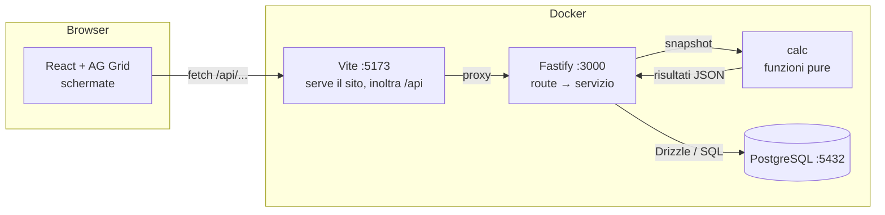
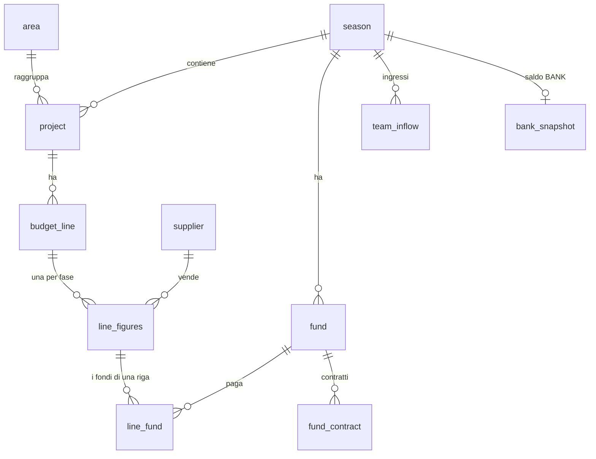

# Come funziona, passo per passo

Questo documento mette insieme i pezzi descritti in [tecnologie.md](tecnologie.md) e segue ciò che succede davvero: aprendo una pagina, modificando una cella, e seguendo un singolo importo dal database allo schermo. Alla fine c'è una tabella "voglio cambiare X, dove metto le mani".

## 1. La mappa



Tre regole tengono in piedi tutto:

1. **I dati inseriti si salvano, i risultati si ricalcolano.** Nel database ci sono solo ciò che le persone digitano (quantità, costo unitario, fondo, date…). Netto, IVA, outflow, subtotali, saldi, Gantt, totali **non sono mai salvati**: si ricalcolano a ogni richiesta. Non possono quindi essere "vecchi" né incoerenti.
2. **Un solo posto per i conti.** Tutte le regole stanno in `packages/calc`. Il sito non calcola niente; le analisi di domani useranno lo stesso codice.
3. **Il database ha l'ultima parola.** Le regole che si possono far rispettare al database (non negativo, nome unico, riferimenti validi) sono vincoli del database, non solo controlli nel codice.

## 2. Percorso A: aprire la pagina di un'area

Scrivi `http://localhost:5173/budget/hw` e premi invio.

| # | Dove | Cosa succede |
| --- | --- | --- |
| 1 | Browser → Vite | Vite risponde con `index.html` e i moduli JavaScript del sito (per ogni indirizzo, perché le "pagine" sono nel browser) |
| 2 | React (`App.tsx`) | si monta l'albero: `QueryClientProvider` (cache), `NoticeProvider` (avvisi), `BrowserRouter` (indirizzi). Il router vede `budget/:code` con `code = "hw"` e mostra `Shell` (menu) con dentro `AreaPage` |
| 3 | `AreaPage` | lancia otto `useQuery`: la scheda dell'area e le liste per le tendine (categorie, priorità, aliquote IVA, fondi per fase e in tutto, fornitori); il menu e la tabella dell'IVA ne lanciano altre due |
| 4 | `api/client.ts` | ogni query è una `fetch("/api/…")` |
| 5 | Vite → Fastify | il proxy inoltra a `http://api:3000/api/…` (dentro Docker) |
| 6 | Fastify | trova la rotta `GET /api/areas/:code/sheet` e chiama `getAreaSheet("hw")` |
| 7 | `loadSnapshot()` | apre **una transazione di sola lettura** e legge nove tabelle (aree, progetti, voci, cifre, fondi, contratti, ingressi, fornitori, BANK), più le impostazioni da `loadLookups()`. Ne esce lo **snapshot**: un unico oggetto con tutto, in interi |
| 8 | `calc.areaSheet()` | `computeLines` calcola ogni voce (importi, IVA a carico del team, scadenza), poi somma per progetto e per area |
| 9 | Fastify → React | la risposta è JSON; React Query la mette in cache con chiave `["sheet","hw"]` |
| 10 | `AreaPage` | disegna i totali e, per ogni progetto, un `AgGridReact` con le voci e la riga dei subtotali fissata in fondo; sotto, la tabella dell'IVA da pagare |

La transazione di sola lettura del punto 7 serve a una cosa precisa: se mentre leggiamo qualcuno salva una modifica, le nove letture non possono vedere metà del vecchio e metà del nuovo.

## 3. Percorso B: modificare una cella

Clicchi la cella *Priority* di una voce e scegli "High".

| # | Dove | Cosa succede |
| --- | --- | --- |
| 1 | AG Grid | si apre la tendina; scegli "High" |
| 2 | `valueSetter` (`areaColumns.tsx`) | **non scrive nella riga**: chiama `commit(riga, { priority: "High" })` e risponde "non ho cambiato niente io" |
| 3 | `commit` (`AreaPage.tsx`) | `act(() => api.updateLine(id, { version, priority }))`: la `version` è quella che la riga aveva quando l'hai caricata |
| 4 | Rete | `PATCH /api/lines/91` con corpo `{"version":1,"priority":"High"}` |
| 5 | Fastify + Zod | `updateLineInput.parse(corpo)`: la versione deve essere un intero positivo, la priorità una delle tre |
| 6 | `updateLine()` | chiede l'utente (`getCurrentUser`: il controllo comune l'aveva già ricavato dal cookie con il JWT e dal database), valida la categoria e apre `runWrite(...)` |
| 7 | `runWrite` | **apre la transazione e dice al database chi sta scrivendo**; il servizio trova la voce e la sua area e chiede `canWrite(utente, area)`: un `viewer`, o un `pm` di un'altra area, ricevono **403** e la transazione si annulla |
| 8 | Il database | esegue `UPDATE budget_line SET priority='High', version = version + 1 WHERE id = 91 AND version = 1` |
| 9a | Se la riga è stata trovata | la versione passa a 2; se la richiesta portava anche cifre (`figures`) vengono salvate nella stessa transazione; la transazione si chiude (commit); risposta 200 |
| 9b | Se **nessuna** riga è stata trovata (qualcuno l'aveva già cambiata: la versione ora è 2) | il servizio lancia `conflict(...)`; la transazione si annulla; il gestore degli errori risponde **409** |
| 10 | `useAction` | in ogni caso, `invalidateQueries()`: tutte le query visibili si riscaricano |
| 11 | Schermo | arrivano le righe nuove, con la nuova priorità (o con ciò che l'altra persona aveva scritto) e i totali ricalcolati. In caso di 409 compare anche un avviso in basso a destra |

Da qui si capiscono tre proprietà del sistema:

- **Niente sovrascritture silenziose.** Il controllo `version` nell'`UPDATE` (blocco ottimistico) garantisce che due persone non si pestino i piedi senza saperlo.
- **Lo schermo non può mentire.** Dopo ogni scrittura si ricarica dal server: se è stata rifiutata, la cella torna al valore vero.
- **Le scritture sono tutto-o-niente.** La voce, le sue cifre e (domani) la riga dello storico stanno nella stessa transazione.

Le altre scritture (progetti, voci, contratti, fornitori, ingressi, BANK) seguono lo stesso schema: rotta sottile → Zod → servizio → `runWrite` → vincoli del database come ultima difesa.

## 4. Percorso C: la vita di un importo

Prendiamo una voce: **10 pezzi a 100,00 € l'uno**, sponsor "nessuno", IVA 22%, pagata dal **Team's fund**, acquistata il **20/11/2026**.

**Nel database** (stringhe esatte, non numeri a virgola mobile):

| Colonna | Valore |
| --- | --- |
| `quantity` | `10.000` |
| `unit_net_cost` | `100.0000` |
| `sponsor_type` | `none` |
| `vat_rate` | `22.00` |
| `line_fund` | una riga con l'id del Team's fund (posizione 1) |
| `purchase_date` | `2026-11-20` |

**Nello snapshot** (interi: nessun decimale in tutto il motore):

| Campo | Valore | Unità |
| --- | --- | --- |
| `quantityMilli` | 10 000 | millesimi |
| `unitCostE4` | 1 000 000 | decimillesimi di euro |
| `vatRate` | 22 | percento |

**Nel motore** (`lineAmounts`, poi `computeLines`):

| Passo | Conto | Risultato |
| --- | --- | --- |
| netto | 10 000 × 1 000 000 ÷ 100 000 | **100 000** centesimi = 1.000,00 € |
| IVA | 100 000 × 22% (arrotondata al centesimo) | **22 000** = 220,00 € |
| lordo | netto + IVA | 122 000 = 1.220,00 € |
| sponsor | tipo "nessuno" | 0 |
| outflow | lordo − sponsor | **122 000** = 1.220,00 € |
| chi paga l'IVA | il fondo è del team | `teamVatCents = 22 000` |
| scadenza IVA | 20/11/2026 è nel 4° trimestre → 16 febbraio dell'anno dopo; è un martedì | `vatDueDate = 2027-02-16` |

**Nelle viste**:

- *Area*: la riga mostra netto 1.000,00 €, IVA 220,00 €, outflow 1.220,00 €. L'IVA che il team paga (220,00 €, scadenza 16/02/27) non è più una colonna della griglia: si vede nel report **VAT OUTFLOW / PROJECT** in fondo alla pagina, nel Gantt e in CASH FLOW.
- *Gantt*: due movimenti di cassa. A **novembre 2026** escono 1.000,00 € (l'IVA non esce ora); a **febbraio 2027** escono 220,00 € (l'IVA alla sua scadenza).
- *Tabella "Team's fund"*: quei due movimenti entrano come uscite del team, e il saldo mensile parte dal BANK.
- *CASH FLOW*: se la data dell'acquisto è successiva alla data BANK, il "Left value" scende di 1.220,00 €.

**Sullo schermo**: `money(122000)` → `1.220,00 €`. Il formato è solo presentazione, in `lib/format.ts`.

Perché interi: `0,1 + 0,2` in JavaScript fa `0,30000000000000004`. Con migliaia di righe e IVA da arrotondare, gli errori da decimali binari si sommano e i totali non tornano al centesimo. Con interi non c'è errore. Il **solo** punto in cui si arrotonda è `roundDiv` in `packages/calc/src/money.ts` (l'IVA, al centesimo, riga per riga): se il tesoriere decide altrimenti (domanda Q7) si cambia lì.

## 5. Il modello dei dati



- **`budget_line`** è la voce (nome, categoria, priorità, nota, `version`). Le **cifre** stanno in `line_figures`, **una riga per fase** (`estimate` e `actual`): è il modo di non avere le colonne duplicate del foglio. Una fase senza riga vale "tutto zero".
- **`fund`** unisce due cose del foglio: l'elenco dei fondi e il "Team's fund". La casella `pays_vat` è il "DOES IT PAY VAT?" (una sola per fondo). Un fondo esterno è uno **sponsor**: ha aliquota, gruppo, modo e tipo, e decide da solo IVA e copertura delle righe che paga ([sponsor-e-fondi.md](sponsor-e-fondi.md)). I fondi di una riga stanno in **`line_fund`**, in ordine.
- **`fund_contract`** sono le righe delle tabelle CASH FROM; **`team_inflow`** quelle di CASH FLOW; **`bank_snapshot`** il riquadro BANK (un importo a una data).
- **`project.owner_name`** è la persona scritta nella riga gialla del foglio.

## 6. Dove stanno gli "hardcode" e perché (regola 4)

Alcune cose sono fisse *per ora* ma diventeranno impostazioni: le categorie, le aliquote IVA, le scadenze IVA, la soglia del ±15%, il modo di confrontare con la data BANK, l'utente corrente, i permessi.

Invece di scriverle come costanti sparse, **ognuna vive dentro la funzione che un giorno sarà l'API di quella cosa**:

```ts
// apps/api/src/modules/lookups/lookups.service.ts
export async function getSettings(): Promise<Settings> {
  // HARDCODED: becomes the `setting` table / an admin page. Values reproduce the old script.
  return {
    varianceThreshold: 0.15,
    vatBaseWhenTotalSponsor: "net",
    bankCompare: { summary: "day", timeline: "month" },
    vatReportHorizon: { from: { year: 2026, quarter: 3 }, to: { year: 2027, quarter: 4 } },
  };
}
```

Il valore fa questo viaggio:

1. `getSettings()` → 2. `loadLookups()` lo raccoglie con categorie e regole IVA → 3. entra nello **snapshot** (`snapshot.lookups`) → 4. il motore lo legge (per esempio `cashFlowSummary` usa `bankCompare.summary`).

Il motore non chiama mai l'API (è puro): i valori gli arrivano nello snapshot. Così, per rispondere alla domanda Q2 del tesoriere basta cambiare **una riga** qui; il giorno in cui diventa una tabella si cambia **il corpo** di `getSettings()` (una query al posto del `return`) e nessun altro file. Ogni hardcode ha una riga in [hardcoded-registry.md](hardcoded-registry.md) e il commento `// HARDCODED:` nel codice (`grep -rn HARDCODED apps` li trova tutti).

## 7. Come sappiamo che i numeri sono giusti

Tre strati, dal più piccolo al più grande:

| Strato | Cosa verifica | Quanto |
| --- | --- | --- |
| **Test del motore** | ogni regola, con esempi fatti a mano (anche quelli di [regole-script-attuale.md](regole-script-attuale.md)) | 99 test, millisecondi |
| **Test dell'API** | il ciclo vero: creare progetti e voci, versione, vincoli, e che le viste cambino di conseguenza, su un database di prova ricreato ogni volta | 43 test |
| **Riconciliazione** (`pnpm reconcile`) | legge il tuo `Budget 26-27.xlsx`, ricalcola tutto col motore e confronta **ogni valore che il foglio aveva salvato** | 1.995 confronti, tutti uguali |

La riconciliazione ha una variante `-- --db`: i dati passano per il database (xlsx → database → snapshot → motore) e si confronta di nuovo. Se coincide anche così, schema, caricamento e lettura non perdono né deformano nulla.

Cosa la riconciliazione **non** copre: i dati reali sono semplici (IVA quasi sempre al 22%, nessun ingresso in CASH FLOW, un BANK a metà ottobre). I rami sugli ingressi, sullo sponsor parziale e sul confronto con la data BANK sono coperti dai test del motore, non dal foglio.

## 8. Cosa succede quando…

| Situazione | Risultato |
| --- | --- |
| Due persone modificano la stessa voce | la seconda riceve 409 e un avviso; vede i dati aggiornati e rifà la modifica |
| Scrivi `-5` come quantità | l'API risponde 400 (Zod); anche se passasse, il database lo rifiuta (`CHECK quantity >= 0`) |
| Scegli un'aliquota IVA non prevista | 400: `listVatRates()` è l'elenco ammesso |
| Sponsor "parziale" con valore maggiore del netto | 400: il valore dev'essere tra 0 (escluso) e il netto |
| Cancelli un fondo che paga delle voci | 409: "This fund pays N budget lines" |
| Il database è spento | `/api/health` risponde 503; le altre richieste 500 con messaggio generico (il dettaglio è nei log) |
| Una voce non ha ancora tipo di sponsor o aliquota | l'IVA vale 0 e compare il triangolo arancione: "incompleta" |
| Aggiungi una voce senza data d'acquisto | non compare nei Gantt (il foglio faceva lo stesso) |

## 9. Voglio cambiare… dove metto le mani

| Voglio… | Tocco |
| --- | --- |
| una categoria in più, un'aliquota IVA, le scadenze IVA | la funzione giusta in `apps/api/src/modules/lookups/lookups.service.ts` |
| rispondere a Q1 (IVA con sponsor totale) o Q2 (confronto con BANK) | `getSettings()`, stesso file |
| il modo di arrotondare (Q7) | `roundDiv` in `packages/calc/src/money.ts` |
| un colore, un font, una spaziatura | `apps/web/src/theme/tokens.css` (e Figma) |
| una **colonna nuova** su una voce | `schema.ts` → `pnpm db:generate` → `db:migrate` → Zod in `budget.schema.ts` → `saveFigures`/`updateLine` in `budget.service.ts` → tipo `Figures` in `calc/snapshot.ts` e `loadSnapshot` in `snapshot.ts` → colonna in `areaColumns.tsx` |
| una **vista/analisi nuova** | funzione in `packages/calc/src/` con il suo test → `views.service.ts` + rotta in `views.routes.ts` → funzione in `api/client.ts` → pagina in `apps/web/src/pages/`, rotta in `App.tsx`, voce di menu in `Shell.tsx` |
| un **endpoint nuovo** | `x.service.ts` + `x.routes.ts`, registrato in `app.ts`, funzione in `api/client.ts` |
| i permessi dei ruoli | `canWrite()` e le funzioni vicine in `modules/auth/auth.service.ts` (+ il test `roles.test.ts`) |
| il login e i token | `modules/auth/` ([accesso-e-storico.md](accesso-e-storico.md)) |
| tracciare un'altra tabella nello storico | una migrazione che aggancia il trigger `audit_row()` (come `0002_audit_triggers.sql`) |
| i dati per le analisi con script | gli endpoint `/api/views/*` restituiscono già JSON pronto per Python |
| l'inventario | un modulo nuovo (`modules/inventory/`) con le sue tabelle, che punta a `budget_line.id` |

## 10. Il glossario foglio ↔ codice

| Nel foglio | Nel codice |
| --- | --- |
| EXPECTED / ESTIMATED | fase `estimate` |
| ACTUAL | fase `actual` |
| i 6 fogli di area (MT + DMT, SW, …) | tabella `area` (6 righe) |
| blocco giallo di un progetto | `project` + `subtotal` calcolato; il nome nella riga gialla = `owner_name` |
| una riga del foglio | `budget_line` + due `line_figures` |
| la tendina "TOTAL SPONSORIZED" (9 voci) | due campi: `sponsor_type` (none/partial/total) e `vat_rate` (0/11/22) |
| CASH FROM (sponsor, tabelle e riepilogo) | `fund` + `fund_contract`; riepilogo = `fundSummary()`; regole degli sponsor = `settleLine()` |
| "Team's fund" | `fund` con `kind = 'team'`, uno per stagione |
| DOES IT PAY VAT? (oggi "PAYS VAT" nella tabella SPONSORS) | `fund.pays_vat` |
| BOUGHT FROM | `supplier` (una lista unica) |
| CASH FLOW (tabelle) e BANK | `team_inflow` e `bank_snapshot` |
| EXPECTED / ACTUAL OUTFLOW | `outflowCents` di una voce in una fase |
| l'IVA che il team paga di tasca sua per una riga e il giorno in cui scade (la scadenza trimestrale dopo la data d'acquisto): prima le colonne VAT TO PAY e VAT DUE, tolte dalla griglia il 23 ottobre 2026; il calcolo resta | `teamVatCents` e `vatDueDate` |
| EXPECTED / ACTUAL GANTT | `gantt(snapshot, fase)` |
| TOTAL | `totals(snapshot)` |
| CASH FROM / BOUGHT FROM ANALYSES | `analysisByFund`, `analysisBySupplier` |
| CATEGORY ANALYSES | `itemsView(snapshot, filtri)` |
| il blocco "ALL ITEMS" + una tabella per categoria | `blocksOf(snapshot)`: `ALL` più le categorie |
| il menu "Update All" | non serve: le viste si ricalcolano da sole a ogni richiesta |

## 11. Limiti attuali, da sapere

- **Login e storico ci sono** ([accesso-e-storico.md](accesso-e-storico.md)), ma l'app va ancora usata solo in locale: mancano HTTPS, backup e deploy ([produzione.md](produzione.md)).
- **Il token di accesso (24 ore) non si revoca da solo**: si disattiva la persona dalla pagina Users (vale dalla richiesta dopo) o si cambia `JWT_SECRET` (disconnette tutti).
- **Dati per stagione**: oggi esiste solo la stagione 2026-2027, scelta dentro `getCurrentSeason()`.
- **Incolla multi-riga da Sheets** non garantita nella griglia (versione Community).
- **Sette domande aperte** per il tesoriere: il comportamento dello script è replicato com'è e ogni domanda è un'impostazione ([regole-script-attuale.md](regole-script-attuale.md), §15).
- **Layout non disegnato su Figma**: menu, tabelle e grafici usano i token ma vanno rivisti con un designer ([stile-interfaccia.md](stile-interfaccia.md)).
