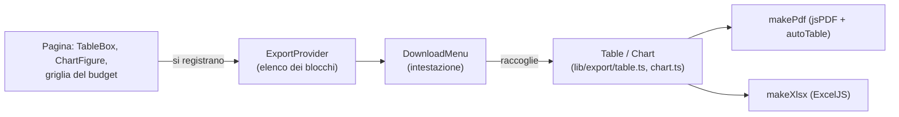

# Scaricare tabelle e grafici (PDF ed Excel)

Ogni pagina con tabelle o grafici ha un pulsante **Download** tra i comandi dell'intestazione, sotto la descrizione. Si apre un riquadro con l'elenco di quello che c'è nella pagina in quel momento (le tabelle con l'icona della tabella, i grafici con quella del grafico, nell'ordine in cui compaiono): si spunta cosa mettere nel file, si sceglie **PDF** o **Excel** e si preme **Download**.

**I file li fa il browser, non il server.** Il sito non manda niente da nessuna parte: il PDF e il file Excel si costruiscono nella pagina, da quello che la persona sta guardando. Quindi il file contiene esattamente ciò che si vede (stessi filtri, stesso blocco scelto, stesso prezzo selezionato) e non servono né un'API né un permesso in più: chi vede la pagina può scaricarla.

## 1. Cosa c'è nel file

| | PDF | Excel |
| --- | --- | --- |
| Tabella | testo, con le intestazioni a gruppi (EXPECTED / ACTUAL), le righe di totale in grigio, le fasce dei gruppi in giallo | un foglio per tabella, con numeri e date **veri** (si possono sommare), formato euro/percentuale/data, intestazione bloccata, celle unite dove la tabella le unisce |
| Grafico | un'immagine, **sempre su fondo bianco** con testi scuri e legenda (a capo se non c'è posto) | nel foglio: l'immagine e sotto i numeri del grafico (in euro), perché in Excel si possano riusare |
| Pagina del PDF | A4 orizzontale; **A3 orizzontale** se una tabella ha più di 14 colonne (le griglie del budget ne hanno 27), così una tabella non si spezza mai su due pagine | — |

Il file segue **l'ordine che si vede**: se una tabella è ordinata per una colonna (vedi [stile-interfaccia.md](stile-interfaccia.md), punto 8), è scaricata così.

Il nome del file è il titolo della pagina e il giorno: `mt-dmt-2026-10-23.pdf`, `expected-gantt-2026-10-23.xlsx`.

## 2. Come funziona

- **Un blocco** è una parte della pagina che si può scaricare. Si dichiara in un solo modo, scelto per il tipo di parte:
  - `TableBox` (`components/ExportBlocks.tsx`) al posto del vecchio `
`: legge la tabella HTML così com'è (`tableFromDom`); scrive anche il contenuto delle caselle e delle tendine, non solo il testo;
  - `ChartFigure` (stesso file), già dentro `BarsChart` e `LineChart`: quindi **ogni grafico nuovo si scarica senza fare niente**;
  - la griglia del budget (AG Grid) si registra con `useExportBlock` in `AreaPage.tsx` e si legge dall'API della griglia (`tableFromGrid`: colonne come sono mostrate, gruppi EXPECTED/ACTUAL, riga dei subtotali).
- I blocchi si registrano quando compaiono e si tolgono quando spariscono (si cambia blocco o si apre un altro progetto: l'elenco segue la pagina). L'ordine dell'elenco è quello dello schermo.
- `DownloadMenu` (`components/DownloadMenu.tsx`) sta nell'intestazione di ogni pagina; senza blocchi non si vede.
- **Le librerie si caricano solo quando si scarica** (`import()` dinamico): `jspdf` + `jspdf-autotable` per il PDF, `exceljs` per l'Excel. Chi non scarica non le scarica.

### Il modello comune

`lib/export/table.ts` descrive una tabella come righe di celle (`Cell`: testo, valore vero, formato, unioni, allineamento, grassetto, riempimento). Il PDF e l'Excel si fanno dalla stessa descrizione, quindi non possono dire cose diverse. Il testo diventa valore vero con `typedValue`: `1.220,00 €`, `22%`, `7,5`, `14/10/26` e `2026-10-14` (le date sono sempre UTC, senza fuso). Un numero senza unità in una colonna **non numerica** resta testo (un codice `0042` mantiene gli zeri).

Le colonne senza niente dentro (i pulsanti di cancellazione) si tolgono (`dropEmptyColumns`).

### I grafici

Recharts disegna un SVG. `chart.ts` lo clona, ci scrive dentro gli stili calcolati, lo ridisegna su un canvas **bianco** a doppia risoluzione con il titolo e la legenda, e lo passa come PNG. Colori di testo, griglia e assi sono quelli «da carta» (`INK`, `GRID`, `AXIS` in `chart.ts`), non quelli del tema scuro; le serie tengono i colori Utility del design system. Le barre non hanno animazione (`isAnimationActive={false}`): un grafico scaricato a metà animazione uscirebbe vuoto.

## 3. Cosa non fa (per ora)

- Non scarica le tabelle di **modifica** come moduli: scrive i valori delle caselle, non i comandi.
- Non scarica lo **storico** oltre le righe caricate nella pagina.
- Il PDF usa i font standard (lettere latine ed euro): un carattere fuori da quelli diventa `?`.
- Se un grafico è molto stretto (finestra stretta) l'immagine è stretta: il file prende la larghezza che il grafico ha a schermo.

## 4. Come si aggiunge

- **Una nuova tabella in una pagina**: si avvolge in `<TableBox title="Nome nel file">…</TableBox>` invece di `
`.
- **Un nuovo grafico**: si usa `BarsChart` o `LineChart`; non serve altro.
- **Una nuova pagina**: si mette `<DownloadMenu />` in fondo all'intestazione (`<header className="page-header">`), dentro lo stesso `
` degli altri comandi della pagina.
- **Un altro formato** (CSV…): si scrive una funzione `makeXxx(title, blocks): Promise<Blob>` accanto a `pdf.ts` e `xlsx.ts` e la si aggiunge alla scelta in `DownloadMenu`.

## 5. Prove

- Test (`apps/web/src/lib/export/*.test.ts`): `typedValue` (soldi, percentuali, date, date inesistenti, numeri nudi), `place` (unioni), `dropEmptyColumns`, `sheetName` (caratteri vietati, 31 caratteri, nomi uguali) e `fileBase`.
- Giro nel browser: PDF ed Excel di una pagina con la griglia (le 27 colonne), di una con grafico e tabella (TOTAL) e di ogni voce del menù; i file si riaprono (il PDF con `pdftoppm`, l'Excel con ExcelJS) e si controllano numeri, date, unioni e fondo bianco del grafico. Vedi [collaudo.md](collaudo.md).
