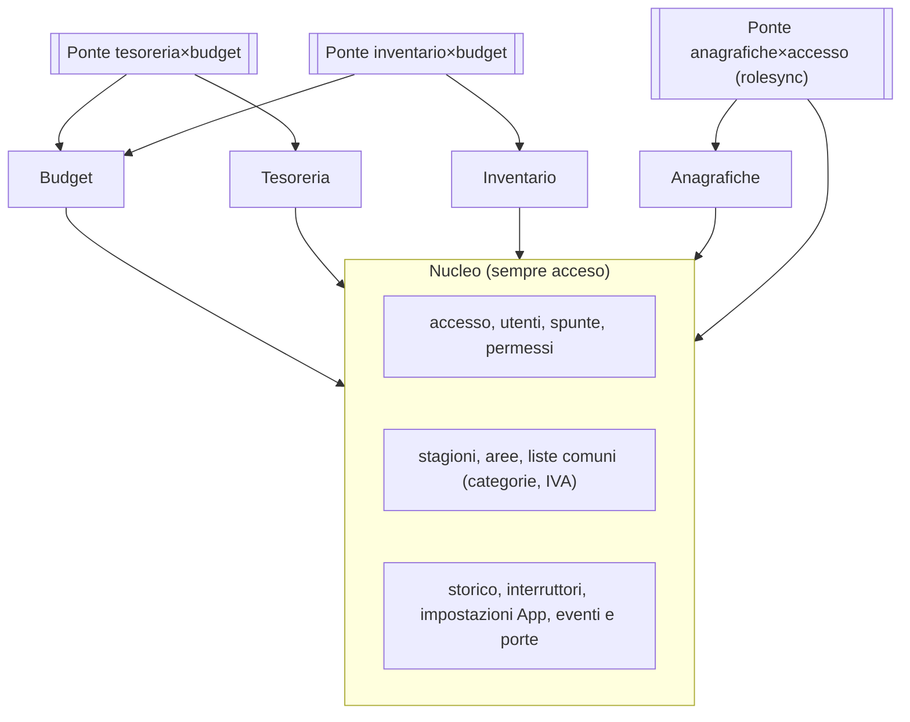
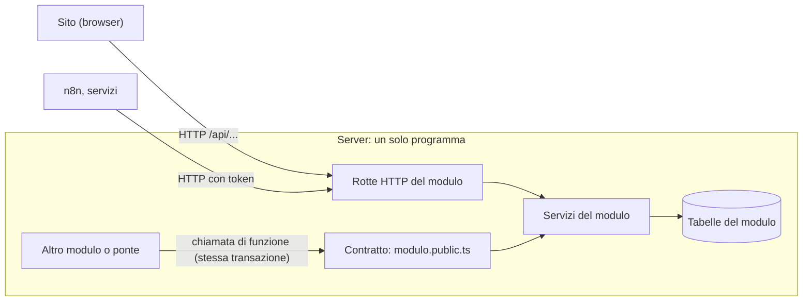

# ADR-2: l'ERP a moduli (budget, tesoreria, inventario, anagrafiche)

**Stato:** **fatto** (26–27 novembre 2026, passi G0–G8, §11). Le cinque decisioni aperte sono state prese il 26 novembre (§14). Come si usa oggi e come si aggiunge un modulo: [moduli.md](moduli.md).
**Chi decide:** l'utente.
**Collegati:**
- [anagrafiche-architettura.md](anagrafiche-architettura.md) (ADR-1): le anagrafiche sono già fatte così, e sono il modello;
- [moduli.md](moduli.md): come si accendono e spengono i moduli, e come se ne aggiunge uno;
- [design-prossimi-lavori.md](design-prossimi-lavori.md): le fasi A–F. Questa è la **fase G**, da fare dopo A, B, C, E e prima di D e F.

---

## 1. Cosa chiede l'utente

1. Poter **accendere e spegnere** budget, inventario e tesoreria, come oggi le anagrafiche.
2. **Separare le funzionalità anche nelle pagine**: spento un modulo, non deve restare niente di suo, nemmeno dentro le pagine degli altri.
3. **«API» intese anche come funzioni**: ogni modulo offre funzioni che il resto dell'app usa, e nessuno accede direttamente ai suoi oggetti o li modifica. Così tutto è «super modulare».
4. **Lo stesso per le anagrafiche.**
5. La domanda: **i moduli comunicano internamente con API HTTPS?**

## 2. Com'è oggi (misurato il 26 novembre 2026)

### 2.1 La risposta alla domanda: come si parlano

| Fra chi | Come |
| --- | --- |
| Browser ↔ server | **HTTP**, con JSON: gli indirizzi `/api/…`. Il sito non tocca mai il database. |
| Servizi esterni (n8n) ↔ server | HTTP, con un token: `/api/…` e `/ext/…`. |
| **Un modulo ↔ un altro, dentro il server** | **Nessuna HTTP.** Il server è **un solo programma** (Node con Fastify) e i moduli sono cartelle: si chiamano **come funzioni**, nello stesso processo, e possono stare nella stessa transazione del database. |

**Funzioni e non HTTP è la scelta giusta e resta.** È veloce e permette di fare «tutto o niente». Per esempio «Pay» in TO PAY scrive il movimento del registro e il suo legame con la riga del budget in una transazione sola; con due servizi in HTTP questo non si potrebbe garantire.

**Il problema non è *come* si parlano, ma *cosa* toccano.** Oggi un modulo legge e scrive **direttamente le tabelle e i servizi interni degli altri**. L'idea dell'utente («API come funzioni, senza accedere agli oggetti degli altri») è proprio la soluzione. Le anagrafiche la applicano già: [anagrafiche-architettura.md](anagrafiche-architettura.md) e `registry.public.ts`.

### 2.2 I legami nel codice del server

Ogni modulo è una cartella in `apps/api/src/modules/`, e c'è un solo file di schema per tutte le tabelle (`db/schema.ts`). Gli import diretti fra moduli sono pochi: il legame vero passa dallo schema, perché ogni servizio può importare qualsiasi tabella.

| Chi | Tocca, di altri | Perché |
| --- | --- | --- |
| `cash` (tesoreria) | `budget_line`, `project`, `category`, `team_inflow`, `fund`, `supplier`, `season` | pagamenti delle righe, TO PAY, pagamenti da legare, area ADMINISTRATION, inflow ricevuti, Voce di partenza delle categorie |
| `cashflow` | `cash_entry`, e `insertEntry` e il saldo del registro da `cash.service` | BANK dal registro, «Mark as received» |
| `inventory` | `budget_line`, `project`, `season` | PENDING e arrivi, progetto di un movimento e di una produzione, statistiche per progetto e per macchina |
| `seasons` | `project`, `budget_line`, `fund` | contare le righe di una stagione; la stagione nuova copia progetti e sponsor |
| `settings` | `budget_line`, `line_figures`, `fund`, `inventory_item`, `item_type`, `stock_movement` | il «USED BY» di categorie, IVA, unità e posti; la rinomina di una categoria o di un'unità, ripetuta nel testo delle righe e dei pezzi |
| `audit` (storico) | un caso per tabella in `labelOf` | i nomi leggibili |
| `auth` | `permissionsOf` con le spunte Treasury e Sponsors | i permessi dei moduli sono scritti nel nucleo |
| `suppliers` | `line_figures` | USED BY |
| `snapshot.ts` | budget, fondi, inflow e BANK (`cashflow`), pagamenti e ADMINISTRATION (`cash`), arrivi (`stock_movement`) | **il punto dove tutto si incontra**: il calcolo vede tutto |
| `registry` | solo `auth` e `users` | già rispettato, con le prove |

### 2.3 I legami nel database

Le chiavi esterne che puntano al nucleo (`season`, `area`, `app_user`, `category`) vanno bene. Ci sono **cinque legami fra moduli**:

| Colonna | Punta a | Alla cancellazione |
| --- | --- | --- |
| `stock_movement.budget_line_id` | `budget_line` | set null |
| `stock_movement.project_id` | `project` | set null |
| `inventory_item.make_project_id` | `project` | set null |
| `team_inflow.cash_entry_id` | `cash_entry` | set null |
| `category.default_voce_id` | `cash_category` | set null |

`cash_entry_line` (movimento ↔ riga) è già una tabella di legame a sé.

### 2.4 I legami nel sito

- **Le chiamate all'API**: un solo `api/client.ts` e un solo `api/types.ts` per tutti.
- **Le pagine**: tutte in `pages/`. Menù (`Shell.tsx`) e indirizzi (`App.tsx`) elencano tutto, e solo le anagrafiche hanno `IfModule`.
- **Le pagine si mescolano**:
  - il budget mostra pagato e arrivato;
  - la pagina di un pezzo dice «from the budget»;
  - i form dell'inventario chiedono il progetto (`inventoryProjects`);
  - il registro ha «Link to budget lines».
- **Settings è già divisa per modulo** (`platform/settingsSections.ts`: Budget, Inventory, Register, Registry, App). Users ha le spunte Treasury e Sponsors.

### 2.5 Cosa c'è già di buono

- **Le anagrafiche**: contratto `registry.public.ts` con `onRegistryChange`, `onRegistryUse`, `peopleInViews`, `groupsOfRegistry`; il ponte `rolesync`; le prove di architettura in `apps/api/src/architecture.test.ts`.
- **L'interruttore dei moduli** (`appmodules`): indirizzi in 404, `/me.modules`, menù.
- **I motori di calcolo puri** (`packages/calc`, `packages/registry`).

---

## 3. La decisione, in breve

**Un monolite modulare**: un solo server e un solo database, divisi in tre tipi di parti.

- **Nucleo** (sempre acceso): accesso e utenti, stagioni e aree, liste comuni, storico, interruttori, impostazioni dell'app.
- **Moduli** (spegnibili): **budget**, **tesoreria**, **inventario**, **anagrafiche**. Un modulo conosce solo il nucleo.
- **Ponti** (accesi da soli quando sono accesi i due moduli che collegano): **tesoreria×budget**, **inventario×budget**, **anagrafiche×accesso** (esiste già: `rolesync`). Ciò che ha bisogno di due moduli vive in un ponte, mai dentro uno dei due.

Ogni modulo e ogni ponte ha un **contratto**: le «API come funzioni» dell'utente. Il contratto contiene:
- funzioni pubbliche (letture e azioni);
- eventi;
- porte (domande che il modulo fa e che altri possono rispondere).

**Nessuno tocca tabelle o funzioni interne di un altro.** Lo fanno rispettare le prove di architettura, come oggi per le anagrafiche.



Una freccia vuol dire «usa il contratto di». Nessuna freccia entra in un ponte: **nessuno dipende da un ponte**.

---

## 4. Le parti

### 4.1 Il nucleo (cartella `apps/api/src/platform/`)

| Cosa | Oggi in | Note |
| --- | --- | --- |
| accesso, sessioni, token, `/me` | `modules/auth` | `/me` raccoglie permessi e moduli **dai contratti**, non li scrive più a mano |
| utenti, ruoli, aree di un pm, **spunte** | `modules/users` | le spunte le dichiarano i moduli (§8.5) |
| stagioni, macchine, sola lettura | `modules/seasons` | la stagione nuova non copia più il budget da sé: manda l'evento `seasonCreated` e il budget risponde |
| aree | rotta `/areas` in `modules/budget` | le aree sono di tutti (utenti, progetti, pezzi, tipi); l'area derivata ADMINISTRATION è del ponte tesoreria×budget |
| liste comuni: **categorie** e **aliquote IVA** | `modules/settings`, `modules/lookups` | usate da budget, inventario e tesoreria; il «USED BY» e la rinomina diventano domande ed eventi (§5.2) |
| impostazioni dell'app (`setting`, `/settings/site`) | `modules/settings` | gli interruttori del calcolo sono del budget, con le sue chiavi |
| storico | `modules/audit` | i nomi leggibili li danno i moduli (`auditLabel`) |
| interruttori dei moduli | `modules/appmodules` | l'elenco viene dai contratti, non più scritto a mano (oggi `listModuleDefs()`, HARDCODED) |
| annulla (Ctrl+Z, fase F) | — | il motore nel nucleo, le regole nei moduli |
| salute | `modules/health` | — |
| **eventi, porte e domande d'uso** | — (oggi solo nelle anagrafiche) | il meccanismo comune (§5.2), in `core/` |

`apps/api/src/core/` resta l'infrastruttura (transazioni, errori, soldi, validazione, sicurezza). Il nucleo **non conosce nessun modulo**.

### 4.2 I moduli

| Modulo | Pagine (menù) | Tabelle | Settings | Spunte e permessi | Indirizzi API di oggi (dopo: sotto `/api/<modulo>/`, §8.2) |
| --- | --- | --- | --- | --- | --- |
| **budget** | BUDGET (aree), CASH FROM, BOUGHT FROM, CASH FLOW (inflow e BANK a mano), Gantt, analisi, TOTAL | `project`, `budget_line`, `line_figures`, `line_fund`, `fund`, `fund_contract`, `supplier`, `team_inflow`, `bank_snapshot` | Budget (interruttori del calcolo, priorità, aliquote degli sponsor) | spunta **Sponsors**; `canWrite` per area | `/budget/projects`, `/budget/lines`, `/budget/funds`, `/budget/suppliers`, `/budget/inflows`, `/budget/bank`, `/budget/areas/:code/sheet`, `/budget/views/…`, `/budget/lookups/priorities`, `/budget/lookups/sponsor-rates`, `/budget/lookups/vat-rules`, `/budget/lookups/settings`, `/budget/settings/calculation` |
| **tesoreria** | CASH REGISTER, FINANCIAL STATEMENT | `cash_entry`, `cash_category` (Voci), `cash_method`, `cash_opening` | Register (Voci, metodi) | spunta **Treasury** | `/treasury/entries`, `/treasury/register`, `/treasury/openings`, `/treasury/categories`, `/treasury/methods`, `/treasury/import`, `/treasury/statement` |
| **inventario** | INVENTORY, pezzi, componenti, statistiche | `inventory_item`, `item_type`, `item_type_param`, `item_param_value`, `stock_movement`, `component_part`, `item_datasheet` (+file), `item_image`, `unit`, `location`, `category_field` | Inventory (tipi, unità, posti, campi per categoria) | `canManageInventory` | `/inventory/…` tranne `pending`, `projects` e il ricevere da una riga; `/settings/units`, `/settings/locations`, `/settings/uncategorized-fields`, `/lookups/units`, `/lookups/locations`, `/lookups/category-fields` |
| **anagrafiche** | REGISTRY e le sue tabelle | `reg_*` | Registry (persone, tabelle) | permessi propri del registro | `/registry/…`, e quelli pubblici `/forms/…`, `/ext/…` |

**CASH FLOW sta nel budget**: è la previsione dei soldi del budget (uscite delle righe, inflow, BANK). Senza tesoreria funziona come prima del registro, con il BANK scritto a mano, che c'è già (`bank_snapshot`).

### 4.3 I ponti

| Ponte | Cosa contiene | Tabelle sue | Indirizzi di oggi (dopo: sotto `/api/<ponte>/`, §8.2) |
| --- | --- | --- | --- |
| **tesoreria×budget** (`bridges/treasury-budget/`) | <ul><li>TO PAY (e gli ordini della fase D)</li><li>i pagamenti delle righe (`cash_entry_line`) e «Link to budget lines» nel registro</li><li>i pagamenti da legare</li><li>«paid» nel budget</li><li>l'area derivata **ADMINISTRATION**</li><li>il **BANK dal registro**</li><li>gli inflow **ricevuti** («Mark as received», «Not received»)</li><li>ACTUAL di CASH FLOW fatto dalle entrate del registro</li><li>la **Voce di partenza** di una categoria</li><li>la cancellazione scelta della fase C, per la parte registro</li></ul> | `cash_entry_line`, `inflow_receipt`, `category_voce`, `purchase_order` e `order_line` (fase D) | `/cash/to-pay`, `/cash/to-pay/pay`, `/cash/payable-lines`, `/cash/to-link`, `/cash/entries/:id/lines`, `/cash/category-defaults`, `/inflows/receivable`, `/inflows/:id/receive`, `/orders` |
| **inventario×budget** (`bridges/inventory-budget/`) | <ul><li>PENDING</li><li>ricevere da una riga del budget</li><li>gli arrivi nel budget (ARRIVED, data d'arrivo ACTUAL, stati)</li><li>il progetto di un movimento e di una produzione («Make new»)</li><li>le statistiche per progetto</li><li>«from the budget» nei movimenti</li></ul> | `receipt_line`, `movement_project`, `item_make_project` | `/inventory/pending`, `/inventory/pending/:lineId/receive` (nuovo, staccato da `/inventory/receive`), `/inventory/projects` |
| **anagrafiche×accesso** (`bridges/registry-access/`, oggi `modules/rolesync`) | i ruoli dell'ERP presi dal registro | `role_sync` | `/role-sync` |

Un ponte **è acceso solo se lo sono tutti e due i suoi moduli**. Non ha un interruttore suo.

### 4.4 Cosa succede spegnendo

**Il budget**
- **Sparisce**:
  - i gruppi Budget, Views, Cash e Total del menù, e Settings › Budget;
  - la spunta Sponsors;
  - per i ponti spenti: TO PAY, PENDING, «Link to budget lines», «paid», ADMINISTRATION, il progetto nei form dell'inventario.
- **Resta**:
  - inventario (pezzi, movimenti senza progetto, componenti, statistiche per macchina, stagione, area, categoria, posto);
  - registro e rendiconto;
  - anagrafiche.

**La tesoreria**
- **Sparisce**:
  - CASH REGISTER, FINANCIAL STATEMENT, Settings › Register, la spunta Treasury;
  - TO PAY, ADMINISTRATION, «Mark as received», il BANK dal registro, l'ACTUAL di CASH FLOW dal registro, «paid».
- **Resta**: budget, CASH FLOW con il BANK a mano, inventario, anagrafiche.
- **Cambia nei numeri**: CASH FLOW e Gantt contano come prima del registro (BANK a mano, inflow ACTUAL scritti a mano): è il comportamento che c'è già senza registro. I pagamenti tornano a contare quando la tesoreria si riaccende.

**L'inventario**
- **Sparisce**: il gruppo Inventory, Settings › Inventory, PENDING, ARRIVED e la data d'arrivo ACTUAL nel budget, gli stati d'arrivo.
- **Resta**: budget, tesoreria, anagrafiche.
- **Cambia nei numeri**: nel budget nessuna riga risulta arrivata.

**Le anagrafiche**
- **Sparisce**: come oggi ([moduli.md](moduli.md)), più il ponte dei ruoli.
- **Resta**: tutto il resto.

**Per tutti i moduli**
- **Spegnere non cancella niente**: le tabelle restano, le migrazioni girano sempre, e riaccendendo torna tutto com'era.
- **Spento tutto** restano Users, Settings › App e History.
- **La pagina iniziale** (deciso, §14):
  - è la prima pagina del primo modulo acceso, nell'ordine budget → inventario → tesoreria → anagrafiche;
  - per il budget, la prima area del menù;
  - spento tutto, Settings.

  Oggi è scritta a mano: `/budget/mt-dmt`.

---

## 5. Il contratto: le «API come funzioni»

### 5.1 Un'unica porta

- **Nel server**, ogni modulo e ogni ponte ha **un file `<nome>.public.ts`**. È l'unica cosa che gli altri possono importare. Le anagrafiche ce l'hanno già.
- **Nel sito**, ogni modulo ha **`public.ts`** (componenti e funzioni che gli altri possono usare) e **`index.tsx`** (il suo manifesto, §7.2).

### 5.2 Cosa c'è in un contratto

| Tipo | Che cos'è | Esempi |
| --- | --- | --- |
| **Letture** | funzioni che restituiscono **dati semplici**, mai righe del database né tabelle | `budget.linesForPaying(seasonIds)`, `budget.lineLabels(ids)`, `budget.projectsOfSeason(seasonId)`, `treasury.entriesByIds(ids)`, `treasury.registerBalanceAt(day)`, `inventory.itemsByIds(ids)` |
| **Azioni** | funzioni che scrivono, con gli **stessi controlli** delle rotte HTTP (permessi, stagione aperta, validazione) e un `tx` facoltativo per entrare nella transazione di chi chiama | `treasury.insertEntry(tx, input)`, `inventory.addReceipt(tx, input)`, `budget.assertLineWritable(tx, lineId)` |
| **Eventi** | «è successo questo»: chi ascolta gira nella stessa transazione e può rifiutare lanciando un errore | `platform.onSeasonCreated(tx, season, from)`, `platform.onLookupRenamed(tx, kind, old, new)`, `onRegistryChange` (c'è già) |
| **Porte** | una domanda che il modulo dichiara («quanto è stato pagato di queste righe?»), con la risposta di partenza («niente»); un ponte la riempie | `budget.payments`, `budget.receipts`, `budget.outsideBudget`, `budget.registerBank`, `inventory.projects`, `treasury.entryLinks` |
| **Domande d'uso** | «chi usa questa cosa?», prima di cancellarla; è la versione generale di `onRegistryUse` | `platform.usedBy("category", nome)` → «12 budget lines, 3 items» |
| **Dichiarazioni** | ciò che il nucleo raccoglie da tutti all'avvio: spunte, permessi, nomi per lo storico, regole di Ctrl+Z, indirizzi | `declareFlag`, `declarePermission`, `auditLabel`, `undoRules`, `routes` |

### 5.3 Le regole di un contratto

1. **Dati semplici**: oggetti con numeri, testi e booleani, che si possono scrivere in JSON. Soldi in centesimi interi o decimali in testo, date ISO (`YYYY-MM-DD`), id numerici, come in [CLAUDE.md](../CLAUDE.md). **Mai** tabelle Drizzle, righe del database o query.
2. **Un'azione controlla come la sua rotta**: la rotta HTTP e la funzione pubblica chiamano lo stesso servizio. Una regola vale allo stesso modo per il sito, per n8n e per un altro modulo. Le funzioni che lavorano in una transazione già aperta (i nomi che finiscono in `In`: `deleteInflowsIn`, `deleteEntryIn`) dividono il lavoro così (27 novembre 2026, revisione dell'architettura):
   - **chi può** lo controlla chi chiama, come farebbe una rotta (`assertCanChangeInflows`, `assertCanManageCash`);
   - **le regole del modulo** le fa sempre la funzione, mandando i suoi eventi. Per esempio `deleteInflowsIn` manda `inflowDeleting` per ogni inflow, quindi la cancellazione del budget e quella scelta del ponte passano dalla stessa regola («un inflow ricevuto lo cancella solo la tesoreria»), scritta una volta sola (`assertCanDeleteInflow`, nel ponte). Prima il ponte la riscriveva a mano.
3. **Nomi stabili e spiegati**: ogni funzione ha il suo commento. Una prova elenca i nomi esportati da ogni contratto (un'istantanea), così un cambio è sempre voluto.
4. **Porte con risposta di partenza**: un modulo funziona anche se nessuno risponde. È ciò che rende possibile spegnere.
5. **Il nucleo salta chi è spento**: eventi, porte e domande d'uso sono registrati all'avvio da tutti, con il nome del modulo o del ponte. Chi li chiama passa dal nucleo, che salta quelli dei moduli spenti. I moduli non devono sapere di poter essere spenti, come oggi le anagrafiche.

### 5.4 HTTP e funzioni: le due facce



- **Le rotte HTTP** sono per il sito e per i servizi esterni.
- **Il contratto** è per gli altri moduli e i ponti.
- **Tutti e due passano dagli stessi servizi.** Un modulo non chiama mai le rotte HTTP di un altro.

### 5.5 Esempi: com'è oggi e come sarà

| Caso | Oggi | Dopo |
| --- | --- | --- |
| **«Pay» in TO PAY** | `cash-links.service.ts` legge `budget_line`, `project`, `season` e scrive `cash_entry` e `cash_entry_line` | il ponte tesoreria×budget, in una transazione: <ol><li>chiede le righe con `budget.linesForPaying`</li><li>scrive il movimento con `treasury.insertEntry(tx, …)`</li><li>scrive i legami nella sua tabella `cash_entry_line`</li></ol> |
| **Cancellare una categoria** in Settings | `settings.service.ts` conta `budget_line` e `inventory_item` | il nucleo chiede `usedBy("category", nome)`: il budget risponde «12 budget lines», l'inventario «3 items» (solo i moduli accesi) |
| **Rinominare una categoria** | `settings.service.ts` aggiorna il testo in `budget_line` e `inventory_item` | il nucleo manda `onLookupRenamed(tx, "category", vecchio, nuovo)`: ognuno aggiorna le sue righe, anche da spento (§8.3) |
| **Stagione nuova** | `seasons.service.ts` copia progetti e sponsor | il nucleo crea la stagione e manda `onSeasonCreated(tx, nuova, precedente)`: il budget copia progetti e sponsor e aggiunge il «Team's fund» |
| **Il calcolo** | `snapshot.ts` legge tutto | lo snapshot diventa **del budget**: legge le sue tabelle e chiede alle porte `payments`, `receipts`, `outsideBudget` e `registerBank`. Le risposte di partenza («nessun pagamento», «niente arrivato», «nessuna area derivata», «BANK a mano») sono già quelle del calcolo senza registro e senza inventario. `packages/calc` non cambia. |
| **«Use, move, count…» con il progetto** | `MovementForm` chiama `/inventory/projects`, che legge `project` | il form dell'inventario ha un **punto di aggancio** (§7.4) per «a cosa serve»; il ponte inventario×budget ci mette la scelta del progetto e salva il legame nella sua tabella `movement_project` |

---

## 6. I dati

### 6.1 Uno schema per proprietario

- **`db/schema.ts` si divide** in `db/schema/platform.ts`, `budget.ts`, `treasury.ts`, `inventory.ts`, `registry.ts` e uno per ponte. La configurazione di Drizzle (`apps/api/drizzle.config.ts`) prende tutti i file. Dividere **non cambia il database**: la prova è che `drizzle-kit generate` non trova differenze.
- **Un servizio importa solo il suo file di schema.** Le tabelle degli altri si raggiungono dai loro contratti.
- **Le chiavi esterne vanno solo verso il nucleo**; quelle di un ponte, verso i suoi due moduli.

### 6.2 I cinque legami fra moduli diventano tabelle dei ponti

**Deciso (26 novembre, domanda 1)**: tabelle dei ponti, non colonne lasciate dove sono.

**Ogni tabella ha la sua colonna `id` intera.** Il trigger dello storico (`audit_row()`) scrive `NEW.id`, quindi ogni tabella che finisce nello storico ne ha bisogno. Il legame vero è un vincolo `unique`.

| Oggi | Dopo (tabella del ponte) | Comportamento uguale a oggi |
| --- | --- | --- |
| `stock_movement.budget_line_id` | `receipt_line`: `id`, `movement_id` **unico** → `stock_movement` (cascade), `line_id` → `budget_line` (cascade) | cancellare la riga toglie il legame, come il set null di oggi |
| `stock_movement.project_id` | `movement_project`: `id`, `movement_id` unico (cascade), `project_id` (cascade) | idem |
| `inventory_item.make_project_id` | `item_make_project`: `id`, `item_id` unico (cascade), `project_id` (cascade) | idem |
| `team_inflow.cash_entry_id` | `inflow_receipt`: `id`, `inflow_id` unico (cascade), `entry_id` unico (cascade) | cancellare l'entrata riporta l'inflow a «non ricevuto»; un inflow ha un'entrata, un'entrata un inflow, come oggi |
| `category.default_voce_id` | `category_voce`: `id`, `category_id` unico (cascade), `voce_id` (cascade) | idem |
| `cash_entry_line` | resta com'è (ha già `id`), ma è **del ponte** | — |

**La migrazione**, una per legame, nel passo in cui si sposta quel codice (G4 o G5):
1. crea la tabella, con il trigger dello storico;
2. copia i dati dalla colonna;
3. toglie la colonna.

Va provata su una copia dei dati veri. Le query che usavano le colonne passano ai ponti; i punti sono quelli del §2.2.

### 6.3 Il resto dei dati

- **I collegamenti per nome** ([schema-database.md](schema-database.md)): la categoria scritta sulle righe e sui pezzi, l'unità e il posto sui pezzi e sui movimenti. Restano per nome. La rinomina arriva con l'evento `onLookupRenamed` e ogni modulo aggiorna le sue righe.
- **`setting`** resta del nucleo. Ogni modulo usa le sue chiavi, con il suo nome davanti, e le legge solo lui.
- **Storico**: i trigger non cambiano. I nomi leggibili li dà ogni modulo con `auditLabel(tabella, riga)`, al posto dello `switch` di `labelOf`.
- **Area derivata** (ADMINISTRATION, `area.derived`): la riga resta nella tabella delle aree del nucleo, ma la riempie il ponte tesoreria×budget. Con la tesoreria spenta non compare.

---

## 7. Il sito

### 7.1 Le cartelle

```
apps/web/src/
  core/        request() all'API, componenti comuni (Table, SearchSelect, Peek, FormPanel, Picture…), lib generiche,
               Shell e App costruiti dai manifesti, punti di aggancio (slot), bozze e Ctrl+Z (fasi E e F)
  platform/    login, Users, Settings › App e liste comuni, History, stagioni
  modules/
    budget/    pagine (aree, CASH FROM, BOUGHT FROM, CASH FLOW, Gantt, analisi, TOTAL), api.ts, types.ts, index.tsx, public.ts
    treasury/  CASH REGISTER, FINANCIAL STATEMENT, import, liste del registro…
    inventory/ INVENTORY, pezzo, componenti, statistiche, tipi, form di movimenti e produzione…
    registry/  le pagine e i componenti delle anagrafiche di oggi
  bridges/
    treasury-budget/  TO PAY, PayForm, PayLines, ReceiveInflow, ordini, e ciò che mette nelle pagine degli altri
    inventory-budget/ PENDING, il ricevere da una riga, la scelta del progetto, ARRIVED nel budget
    registry-access/  la parte «ruoli dell'ERP» di Settings › Registry
```

**Il client e i tipi si dividono** (fatto in G7, tappa 1). `api/client.ts` e `api/types.ts` si dividono per proprietario. `request()` resta nel `core`; i tipi condivisi (utente, stagione, area) vanno in `platform`.

### 7.2 Il manifesto di un modulo (`index.tsx`)

Ogni modulo e ogni ponte dichiara in un solo oggetto:
- `key` e, per un ponte, i suoi due moduli (`needs`);
- gli **indirizzi delle pagine** (le `Route`);
- il **suo gruppo del menù**, con le voci e chi le vede (dai permessi);
- le **sezioni di Settings**;
- le **spunte** che mostra in Users (dichiarate dal server, §8.5);
- le **parti che mette nelle pagine degli altri** (§7.4).

`App.tsx`, `Shell.tsx`, la pagina Settings e la pagina Users si costruiscono **dai manifesti dei moduli accesi** (fatto in G7, tappa 2; Users lo era già: le spunte vengono dal server). Il server lo dice in `/me.modules`, e `/me.bridges` dice quali ponti sono accesi (G8; fino ad allora il sito accende un ponte quando sono accesi i suoi due moduli). Spento un modulo:
- le sue pagine non esistono («This page does not exist», oppure la pagina iniziale);
- il suo gruppo del menù non c'è;
- le sue parti nelle pagine degli altri non compaiono.

`IfModule` non serve più (tolto in G7, tappa 2).

### 7.3 Le regole del sito

- **Le pagine di un modulo importano solo**: i loro file, `core`, `platform` e il `public.ts` degli altri moduli. Un modulo non importa mai un ponte.
- **Un ponte importa** i `public.ts` dei suoi due moduli.
- **Il `core` non importa nessuno** (da G7, tappa 4): quel che sa di chi è dentro glielo dà la piattaforma (`core/session.ts`).
- **Ciò che un modulo presta** è l'elenco dei nomi del suo `public.ts`, scritto nella prova: cambiarlo è una scelta. I suoi punti di aggancio li definisce in `slots.ts`.
- **`App.tsx` e `Shell.tsx`** conoscono i moduli solo dall'elenco dei manifesti.

### 7.4 I punti di aggancio (slot)

**Una pagina dichiara dove altri possono aggiungere qualcosa**, con le proprietà che passa. Un modulo o un ponte acceso ci aggiunge il suo pezzo. Il meccanismo è nel `core`: `defineSlot` e `<Slot name=… />`. È come le porte del server, ma per l'interfaccia.

Elenco di partenza, preso dalle pagine di oggi:

| Punto di aggancio | Di chi è | Chi lo riempie | Cosa ci mette |
| --- | --- | --- | --- |
| `budget.grid.columns` | budget | inventario×budget | ARRIVED e la data d'arrivo ACTUAL |
| `budget.line.facts` (scheda su telefono) | budget | tesoreria×budget, inventario×budget | «Paid …», stato d'arrivo |
| `budget.cashflow.inflowActions` | budget | tesoreria×budget | «Mark as received», «Not received» |
| `budget.cashflow.actualSource` | budget | tesoreria×budget | l'ACTUAL dalle entrate del registro, con la sua spiegazione |
| `budget.cashflow.deleteTargets` | budget | tesoreria×budget | il gruppo CASH REGISTER del popup di cancellazione (fase C) |
| `treasury.register.rowActions` | tesoreria | tesoreria×budget | «Link to budget lines» |
| `treasury.register.rowFacts` | tesoreria | tesoreria×budget | «paid …», «received the inflow …» |
| `treasury.settings.voci` | tesoreria | tesoreria×budget | la Voce di partenza di ogni categoria |
| `inventory.movement.purpose` | inventario | inventario×budget | la scelta del progetto in «Use, move, count…», «Make new», i valori di partenza di produzione |
| `inventory.receive.sources` | inventario | inventario×budget | «da una riga del budget» in «More arrived» |
| `inventory.item.movementFacts` | inventario | inventario×budget | «from the budget» |
| `inventory.stats.cuts` | inventario | inventario×budget | «per progetto» |
| `settings.registry.roles` | anagrafiche | anagrafiche×accesso | i ruoli dell'ERP dal registro |

Ogni punto di aggancio ha un tipo (le proprietà che riceve) e una prova che lo verifica (§12).

**Com'è andata (G7, tappa 3).** Sono diventati punti di aggancio solo quelli dove il sito importava un ponte: `budget.cashflow.inflowActions` (che comprende anche `deleteTargets`), `treasury.register.rowActions`, `treasury.settings.voci` (con il nome `treasury.settings.panels`) e `inventory.movement.purpose` (con il nome `inventory.purpose.projects`). Gli altri non servono, perché quei dati arrivano già nella risposta del proprietario, riempiti sul server dalle porte del ponte (passi G4 e G5): ARRIVED e lo stato d'arrivo (`line.arrival`, che il budget disegna da sé), «Paid …» e «received the inflow …» del registro, «from the budget» del pezzo, i tagli per progetto delle statistiche, la spiegazione delle entrate del registro in CASH FLOW. Il dettaglio è nella sezione «G7» del §11.

---

## 8. Accendere e spegnere

1. **L'elenco dei moduli viene dai contratti.** `appmodules` legge le dichiarazioni (chiave, nome, descrizione, indirizzi) di budget, tesoreria, inventario e anagrafiche, invece della lista scritta a mano. La riga di [hardcoded-registry.md](hardcoded-registry.md) sui moduli si toglie.
2. **Ogni modulo e ogni ponte passa sotto il suo nome** (deciso, domanda 4): `/api/budget/…`, `/api/treasury/…`, `/api/inventory/…`, `/api/registry/…`, `/api/treasury-budget/…`, `/api/inventory-budget/…`, `/api/registry-access/…`. Il nucleo resta senza prefisso (`/api/me`, `/api/users`…): non si spegne mai.
   - **In `app.ts`** ogni modulo e ponte si registra con il suo prefisso, che è la sua chiave, in un solo ciclo (`owned`: in Fastify, `register(rotte, { prefix })`). **Un file di rotte non scrive mai il suo prefisso** (dal 27 novembre 2026 nemmeno inventario e anagrafiche, che prima lo scrivevano a mano): così il cancello spegne davvero tutto ciò che è del modulo. Lo controlla `routes.test.ts` (§12, regola 7).
   - **Il cancello** (`addModuleGate`) guarda solo il primo pezzo dell'indirizzo. Gli elenchi di indirizzi non servono più. Risponde 404 per un modulo spento e per un ponte con uno dei due moduli spento.
   - **Non cambiano**, perché sono già al loro posto o sono pubblici: `/api/registry/…`, `/api/registry/public/…`, `/ext/…`, `/forms/…`. Sono quelli che usa n8n.
   - **Ogni passo (G3–G6) cambia insieme** gli indirizzi del server, le chiamate del sito, le prove e i documenti che li citano. Così l'app funziona dopo ogni passo.
   - **Prima del passo G4**: controllare se qualcosa fuori dall'ERP (un flusso di n8n, uno script, un token di servizio) chiama i vecchi indirizzi di budget, tesoreria o inventario. Si guarda nei flussi di n8n e nel log del proxy. Se sì, va aggiornato nello stesso rilascio. **Non si tengono redirect**: due indirizzi per la stessa cosa sono esattamente ciò che si vuole togliere.

   **La tabella dei nuovi indirizzi** (quelli che oggi non sono già sotto il nome giusto):

   | Oggi | Dopo |
   | --- | --- |
   | `/api/projects`, `/api/lines`, `/api/funds`, `/api/suppliers`, `/api/bank` | `/api/budget/projects`, `/api/budget/lines`, `/api/budget/funds`, `/api/budget/suppliers`, `/api/budget/bank` (fatto in G6; anche `/api/areas/:code/sheet` → `/api/budget/areas/:code/sheet`) |
   | `/api/inflows` (aggiungere, elencare, cancellare) | `/api/budget/inflows` (fatto in G6) |
   | `/api/views/…` (gantt, analysis, totals, cashflow, funds-summary, items, vat-report) | `/api/budget/views/…` (fatto in G6) |
   | `/api/lookups/priorities`, `/api/lookups/sponsor-rates`, `/api/lookups/vat-rules` | `/api/budget/lookups/…` (fatto in G6, con `/api/lookups/settings`) |
   | `/api/settings/calculation` | `/api/budget/settings/calculation` (fatto in G6; gli interruttori si leggono da `/api/budget/lookups/settings`) |
   | `/api/cash/entries`, `/api/cash/register`, `/api/cash/openings`, `/api/cash/categories`, `/api/cash/methods`, `/api/cash/import`, `/api/cash/statement` | `/api/treasury/entries`, `/api/treasury/register`, `/api/treasury/openings`, `/api/treasury/categories`, `/api/treasury/methods`, `/api/treasury/import`, `/api/treasury/statement` |
   | `/api/settings/units`, `/api/settings/locations`, `/api/settings/uncategorized-fields` | `/api/inventory/units`, `/api/inventory/locations`, `/api/inventory/uncategorized-fields` (fatto in G5; i campi di una categoria: `PUT /api/inventory/category-fields/:id`; la parte di Settings: `GET /api/inventory/lists`) |
   | `/api/lookups/units`, `/api/lookups/locations`, `/api/lookups/category-fields` | `/api/inventory/units`, `/api/inventory/locations`, `/api/inventory/category-fields` (fatto in G5: una sola parola per lista, la lettura è quella dei moduli) |
   | `/api/cash/to-pay`, `/api/cash/to-pay/pay`, `/api/cash/payable-lines`, `/api/cash/to-link` | `/api/treasury-budget/to-pay`, `/api/treasury-budget/to-pay/pay`, `/api/treasury-budget/payable-lines`, `/api/treasury-budget/to-link` |
   | `/api/cash/entries/:id/lines` | `/api/treasury-budget/entries/:id/lines` |
   | `/api/cash/category-defaults` | `/api/treasury-budget/category-voci` |
   | `/api/inflows/receivable`, `/api/inflows/:id/receive` | `/api/treasury-budget/inflows/receivable`, `/api/treasury-budget/inflows/:id/receive` |
   | `/api/inventory/pending`, `/api/inventory/projects` | `/api/inventory-budget/pending`, `/api/inventory-budget/projects` (fatto in G5) |
   | `/api/inventory/receive` con una riga del budget | `/api/inventory-budget/pending/:lineId/receive`. `/api/inventory/receive` resta per gli arrivi fuori budget (fatto in G5) |
   | `/api/role-sync` | `/api/registry-access/role-sync` |
   | `/api/areas` (oggi nelle rotte del budget) | resta `/api/areas`, ma del nucleo |

   Gli indirizzi delle fasi nuove nascono già al loro posto: gli ordini (D) sotto `/api/treasury-budget/orders`, Ctrl+Z (F) sotto `/api/changes` (nucleo). La cancellazione scelta degli inflow (C), fatta prima della fase G, si sposta nel passo G4: la parte con il registro va sotto `/api/treasury-budget/…`.
3. **Lo stato dei moduli si legge una volta per richiesta** e vale per tutta la richiesta (oggi `isModuleOn` legge il database a ogni domanda).
4. **Settings › App › Modules** mostra i quattro moduli. Sotto ciascuno, cosa si spegne con lui, ponti compresi: «Turning off Budget also hides TO PAY, PENDING and the projects in the inventory». **I ponti non hanno un interruttore.**
5. **Le spunte degli utenti le dichiarano i moduli** (deciso, domanda 2). Oggi sono colonne di `app_user` (`treasury`, `sponsors`).
   - **La tabella del nucleo** `user_flag`: `id`, `user_id` → `app_user` (cascade), `flag` (testo), unico su `(user_id, flag)`, con il trigger dello storico.
   - **Ogni modulo dichiara le sue spunte**: chiave, nome, spiegazione, ruoli che possono averla (oggi solo `pm`), permessi che dà. Treasury dalla tesoreria, Sponsors dal budget.
   - **Users** mostra quelle dei moduli accesi.
   - **La rotta che cambia un utente** accetta l'elenco delle spunte. Rifiuta quelle che nessun modulo dichiara, e quelle date a un ruolo che non può averle: oggi un viewer o un admin → 400, come adesso. Non tocca le spunte dei moduli spenti, che restano per quando si riaccendono.
   - **Migrazione** (passo G1): copia le due colonne in `user_flag` e le toglie.
   - **I permessi** (`canManageCash`, `canManageFunds`, `canChangeInflows`, `canManageInventory`…) li dichiara ciascun modulo con la sua regola.
   - **Un ponte può allargare un permesso.** Esempio: oggi la Treasury può cambiare gli inflow, che sono del budget. Lo dichiara il ponte tesoreria×budget, non il budget.
6. **Spento non vuol dire scaricato.** Il codice di tutti i moduli si carica sempre: eventi, porte e regole si registrano all'avvio, e il nucleo salta quelli spenti. Così riaccendere è immediato e non c'è niente da reinstallare.
7. **Due tipi di eventi** (deciso, domanda 3):
   - **funzionalità** (mostrare, calcolare, mandare un webhook): solo ai moduli accesi;
   - **manutenzione dei dati**: **a tutti**, anche agli spenti, così riaccendendo i dati sono in ordine. Sono:
     - `onLookupRenamed`: la categoria rinominata si aggiorna anche nelle righe del budget spento;
     - `onSeasonCreated`: la stagione nuova ha i suoi progetti, gli sponsor e il Team's fund anche se il budget è spento.
   - **i controlli che proteggono i dati sono sempre «data»** (corretto il 27 novembre 2026, dalla revisione della pull request di G). Vale per ogni domanda o evento che serve a **rifiutare** una modifica: i legami restano nel database anche a modulo spento, e un controllo saltato li rovina in un modo che si vede solo riaccendendo. Sono tre:
     - `usedBy` («chi usa questa categoria, aliquota, stagione?»): una categoria che le righe del budget spento scrivono per nome è ancora in uso, e non si cancella. Anche la colonna USED BY di Settings conta quindi i moduli spenti;
     - `entryChanging`: un movimento del registro che ha pagato righe o ricevuto un inflow non cambia verso né scende sotto i suoi legami, anche con il budget spento;
     - `inflowDeleting`: un inflow ricevuto lo cancella solo la tesoreria, anche con la tesoreria spenta.

   Chi dichiara un evento dice di che tipo è. Il nucleo lo rispetta. **Prima di dichiarare «feature» un evento o una domanda, chiedersi: se chi risponde è spento e salta, i dati restano giusti? Se no, è «data».**

---

## 9. Le opzioni considerate

| | A. Solo interruttori | B. Monolite modulare: contratti e ponti (**scelta**) | C. Servizi separati in HTTP | D. B più uno schema Postgres per modulo |
| --- | --- | --- | --- | --- |
| Cosa vuol dire | accendere e spegnere gli indirizzi e il menù dei moduli di oggi, senza toccare il codice | quello descritto qui | un programma e un database per modulo, che si parlano in HTTP | come B, ma ogni modulo ha il suo schema e il suo ruolo nel database, che rifiuta gli accessi agli altri |
| Fatica | bassa | alta, ma a passi | molto alta | molto alta |
| Spegnere un modulo è sicuro? | **no**: Settings, stagioni e calcolo leggono comunque le tabelle del budget; le parti miste (pagato, arrivato) restano a metà | sì: ciò che serve a due moduli è in un ponte, e le porte hanno risposte di partenza | sì | sì |
| «Tutto o niente» fra moduli (pagare = movimento + legami) | sì | **sì** (stessa transazione) | **no**, servono compensazioni | sì |
| Chi fa rispettare i confini | nessuno | le prove di architettura | la rete | il database |
| Server da gestire | uno | uno | uno per modulo | uno |
| Adatto a un team piccolo con un server | sì | **sì** | no | eccessivo oggi |

**Perché B**:
- è l'unica che rende davvero sicuro spegnere senza perdere le transazioni;
- è la strada già presa con le anagrafiche, che funziona e ha le sue prove;
- D si può aggiungere dopo, se mai servisse, sopra B.

---

## 10. Conseguenze

**Diventa più facile**
- Spegnere e riaccendere un modulo.
- Capire chi usa cosa: basta leggere i contratti.
- Cambiare l'interno di un modulo senza rompere gli altri.
- Aggiungere un modulo nuovo: manifesto, contratto e ponti, senza toccare nucleo, menù o Settings.
- Le fasi D e F: ordini nel ponte, regole di Ctrl+Z nei contratti.

**Diventa più difficile**
- Una funzione che serve a due moduli va pensata come ponte, con il suo contratto. Non basta più una query con un `join` in più.
- Il codice si sposta molto: le cartelle cambiano, e i riferimenti nei documenti (percorsi di file) vanno aggiornati.

**Da tenere d'occhio**
- **Le prestazioni dello snapshot**: le porte sono funzioni nello stesso processo e fanno le stesse query di oggi, solo divise. Si misura prima e dopo.
- **L'elenco delle porte e dei punti di aggancio** deve restare corto: si aggiunge solo ciò che serve davvero.

---

## 11. Il piano di lavoro (fase G, a passi)

Ogni passo lascia l'app funzionante, con tutte le prove verdi e i documenti aggiornati, e si rilascia da solo.

**Le prove di architettura del §12 nascono al primo passo** con un **elenco delle violazioni di oggi** (la «lista delle eccezioni»):
- una violazione nuova fa fallire la prova;
- una violazione tolta va cancellata dalla lista, così la lista può solo accorciarsi;
- alla fine del passo G8 la lista è vuota.

| Passo | Cosa | Fatto quando |
| --- | --- | --- |
| **G0 — fatto (26 novembre 2026)** | Le regole come prove, con la lista delle eccezioni di oggi. Il meccanismo comune nel `core`: eventi, porte, domande d'uso, dichiarazioni, con il «salta chi è spento». | le prove girano e la lista elenca il §2.2 (fatto: `architecture.map.ts`, `core/contracts.ts`, [prestazioni.md](prestazioni.md)) |
| **G1 — fatto (26–27 novembre 2026)** | Il **nucleo** in `platform/`: auth, users, seasons, aree (da `/areas` del budget), liste comuni, settings dell'app, audit, appmodules, health. Settings e stagioni smettono di leggere le tabelle degli altri (`usedBy`, `onLookupRenamed`, `onSeasonCreated`, `seasonUsage`); lo storico usa `auditLabel`. Le spunte diventano dichiarazioni (domanda 2). | il nucleo non importa nessun modulo |
| **G2 — fatto (27 novembre 2026)** | **Lo schema si divide** per proprietario. Nessuna migrazione. | `drizzle-kit generate` non vede differenze (fatto: «No schema changes») |
| **G3 — fatto (27 novembre 2026)** | **Anagrafiche** in `modules/registry`, e `rolesync` diventa `bridges/registry-access`. Sono già in regola: si spostano e si adattano le prove. | prove di oggi verdi con i percorsi nuovi |
| **G4 — fatto (27 novembre 2026)** | **Tesoreria** in `modules/treasury` con `treasury.public.ts`. Le parti miste (`cash-links`, `outside-budget`, `loadPayments`, inflow ricevuti, BANK dal registro, Voce di partenza) vanno in `bridges/treasury-budget`. Migrazione di `inflow_receipt` e `category_voce`. | tesoreria e ponte senza eccezioni |
| **G5 — fatto (27 novembre 2026)** | **Inventario** in `modules/inventory` con `inventory.public.ts`. PENDING, ricevere da una riga, arrivi, progetti e statistiche per progetto vanno in `bridges/inventory-budget`. Migrazione di `receipt_line`, `movement_project`, `item_make_project`. | idem |
| **G6 — fatto (27 novembre 2026)** | **Budget** in `modules/budget` con `budget.public.ts`: budget, fondi, fornitori, CASH FLOW a mano, viste, e lo **snapshot con le porte**. | idem; i numeri di prova del calcolo identici (stessi test, stesso foglio di riconciliazione) |
| **G7 — fatto (27 novembre 2026)** | **Il sito**: cartelle (§7.1), manifesti, punti di aggancio, client e tipi divisi, menù, indirizzi e Settings dai manifesti, prove del sito. | nessuna pagina importa un altro modulo se non dal suo `public.ts` |
| **G8 — fatto (27 novembre 2026)** | **Gli interruttori** per budget, tesoreria e inventario in Settings › App › Modules; `/me.bridges`; la prova di tutte le combinazioni (§12); la lista delle eccezioni vuota. | le 16 combinazioni passano |

### G0: cosa c'è (26 novembre 2026)

- **`apps/api/src/architecture.map.ts`**: i dati che le prove controllano.
  - Il proprietario di ogni cartella di `modules/` e di `snapshot.ts` (nucleo, budget, tesoreria, inventario, anagrafiche, ponti).
  - Il proprietario di ognuna delle 48 tabelle.
  - **La lista delle eccezioni di oggi**: 9 import fra proprietari diversi e 33 usi di una tabella di un altro (§2.2, misurati dal codice). Ognuna ha il commento del passo che la scioglie.
- **`apps/api/src/architecture.test.ts`** (5 prove nuove):
  - ogni cartella e ogni tabella ha un proprietario, e niente di più;
  - un proprietario importa solo il suo codice, il `core` e i motori (un ponte anche il `*.public` dei suoi moduli);
  - un proprietario usa solo le sue tabelle (e quelle del nucleo);
  - nessuno importa un ponte, tranne `app.ts`;
  - un file `*.public` non mostra niente di Drizzle, e i nomi che mostra sono scritti nella prova.

  Una violazione nuova fa fallire la prova; una tolta dal codice deve uscire dalla lista, che quindi può solo accorciarsi. Gli strumenti del database (i seed) e `app.ts` possono usare tutto.
- **`apps/api/src/core/contracts.ts`**: il meccanismo comune, tutto funzioni in un processo.
  - *Eventi*: ascoltano in ordine, nella stessa transazione, e uno può rifiutare con un errore.
  - *Domande* («chi usa questa categoria?»): raccolgono la risposta di ognuno.
  - *Porte*: una risposta sola, e una risposta di partenza quando nessuno risponde o il ponte è spento.
  - *Dichiarazioni*: ciò che il nucleo raccoglie all'avvio.

  Ognuno è registrato con il nome del suo proprietario; chi chiede passa `Active` (chi è acceso in questa richiesta, da `activeOwners`), e gli spenti vengono saltati. Gli eventi e le domande di tipo `data` (manutenzione dei dati) arrivano anche agli spenti, quelli di tipo `feature` no (§8.7). 11 prove in `core/contracts.test.ts`.
- **Il benchmark** (`pnpm bench`) e la **baseline**: [prestazioni.md](prestazioni.md). Alla fine di ogni passo G1–G8 si confronta con la baseline.

### G1: come sono fatte le domande e gli eventi (26 novembre 2026)

- **`platform/platform.public.ts`** è ciò che i moduli usano del nucleo:
  - `usedBy` (la domanda «chi usa questo?» per categorie, aliquote, unità, posti, stagioni) con `usageOf` e `totalUse`; di tipo `data` dal 27 novembre (§8.7): risponde anche chi è spento;
  - gli eventi `lookupRenamed` e `seasonCreated`, di manutenzione dei dati (arrivano anche ai moduli spenti);
  - la dichiarazione `auditLabels` (come lo storico nomina le righe);
  - `currentActive()` (chi è acceso: oggi tutti, riga 15 di [hardcoded-registry.md](hardcoded-registry.md)).
- **I moduli rispondono dal loro `*.contract.ts`**: `budget.contract.ts` (righe e sponsor per categoria e aliquota, righe per stagione, la categoria rinominata nelle righe, il Team's fund e la copia di progetti e sponsor in una stagione nuova), `inventory.contract.ts` (pezzi, tipi, unità, posti, la rinomina), `treasury.contract.ts` (i nomi del registro nello storico). Si leggono all'avvio (`app.ts`), e il budget prima dell'inventario, così i messaggi restano «N budget lines and M items».
- **Settings, stagioni e storico** non importano più nessuna tabella di budget o inventario: da 33 a 24 le eccezioni di tabella (restano le liste dell'inventario che Settings gestisce, fino a G5).
- **Le spunte (tappa 4):** la tabella `user_flag` (utente, spunta; migrazione `0040`, con lo storico) al posto delle colonne `app_user.treasury` e `app_user.sponsors`. Le dichiarano i moduli (`userFlags` in `platform.public.ts`): Treasury dal registro di cassa, Sponsors dal budget. `User.flags` si legge nella stessa query delle aree. `GET /api/flags` le elenca alla pagina Users; `PATCH /api/users/:id` accetta `flags` (l'elenco intero), rifiuta una spunta che nessuno dichiara o che il ruolo non può avere, e toglie quelle che il nuovo ruolo non può avere. Le regole dei permessi restano in `auth.service.ts` e leggono le spunte: passano ai moduli in G4 e G6.
- **Più veloce, non più lento:** una domanda per elenco con una query raggruppata per modulo, al posto di una query per voce: la pagina Settings passa da 3,3 a 1,7 ms alla taglia reale ([prestazioni.md](prestazioni.md)).

### G2: come è diviso lo schema (27 novembre 2026)

- **`apps/api/src/db/schema/`**: un file per proprietario, con le sue tabelle e i suoi enum: `platform.ts` (11 tabelle), `budget.ts` (9), `treasury.ts` (4), `inventory.ts` (12), `registry.ts` (11) e i ponti `treasury-budget.ts` (1: `cash_entry_line`) e `registry-access.ts` (1: `role_sync`). `columns.ts` ha ciò che serve a tutti (`id()`, `bytea`). Nessun nome di tabella o di colonna cambia: **`drizzle-kit generate` dice «No schema changes»**.
- **`db/schema.ts`** riunisce i file (`export * from`) per chi vuole tutte le tabelle: il client del database, gli strumenti e le prove. **Un servizio importa il file del suo proprietario** (`../../db/schema/budget`) e di nessun altro: la prova di architettura lo fa rispettare con la stessa regola degli import, e la vecchia mappa «tabella → proprietario» e la sua lista di eccezioni non servono più: il proprietario di una tabella è il file in cui sta. La regola vale anche per i file dello schema fra loro (le chiavi esterne vanno verso il nucleo; quelle di un ponte, verso i suoi due moduli).
- **Le chiavi esterne che attraversano i moduli sono nella lista delle eccezioni**: `team_inflow.cash_entry_id` e `category.default_voce_id` (verso la tesoreria, G4) e `stock_movement`/`inventory_item` verso progetti e righe (G5). Le eccezioni sono ora 30: 9 import di codice fra proprietari e 21 file dello schema di un altro proprietario (prima erano 33 tabelle, ora contate per file).

### G3: il primo ponte (27 novembre 2026)

- **`modules/rolesync` è `apps/api/src/bridges/registry-access/`** (i file sono gli stessi: `rolesync.service.ts`, `rolesync.routes.ts`). Le anagrafiche erano già un modulo in regola e restano dov'erano.
- **Risponde sotto il nome del ponte:** `/api/registry-access/role-sync` (e `/preview`) al posto di `/api/role-sync`, registrato in `app.ts` con il suo prefisso (`register(rotte, { prefix: "/registry-access" })`). Nessun redirect dal vecchio indirizzo (§8.2). L'interruttore dei moduli lo conosce: con il Registry spento anche `/api/registry-access/…` dà 404. Il sito (`modules/registry/api.ts`) usa il nuovo indirizzo.
- **Le regole di architettura** leggono la cartella `bridges/` (una cartella di ponti ha il nome di un ponte che esiste, e il suo proprietario è quel ponte). Cercando un modo per provarle ho visto che **non vedevano un `import "x"` senza `from`**, cioè un file caricato per quello che fa: ora lo vedono, e una prova a mano (un file di un modulo che importa il ponte e un altro modulo) fa fallire tre prove come deve.

### G4: la tesoreria e il suo ponte (27 novembre 2026)

Cinque tappe, tutte fatte.

- **Tappa 1, i dati:** `team_inflow.cash_entry_id` e `category.default_voce_id` sono le tabelle `inflow_receipt` e `category_voce`, del ponte (migrazione `0041`, con lo storico). Il budget e il nucleo non puntano più alla tesoreria.
- **Tappa 2, la cartella:** `modules/cash` è `modules/treasury`, con `treasury.public.ts`.
- **Tappa 3, il ponte `bridges/treasury-budget/`:** il codice che aveva bisogno di registro e budget insieme esce dai due moduli, e **nessuno dei due importa più l'altro**.
  - **Il budget chiede** (`modules/budget/budget.ports.ts`, mostrato da `budget.public.ts`): cinque porte, ognuna con la risposta semplice di quando nessuno risponde. `registerBank` (cosa tiene il registro in Cassa e Banca a fine giorno; senza risposta il BANK è quello scritto a mano), `inflowReceipts` (quali inflow previsti sono arrivati, con quale movimento), `registerSponsorship` (i soldi in entrata con la spunta Sponsorship: il lato ACTUAL di CASH FLOW), `linePayments` (cosa hanno pagato i pagamenti di ogni riga: niente) e `outsideBudgetOf` (l'area ADMINISTRATION dal registro: nessuna). Più l'evento `inflowDeleting`, con cui chi ha legato un inflow può rifiutare di cancellarlo. Lo snapshot e CASH FLOW usano solo queste.
  - **La tesoreria mostra** (`treasury.public.ts`): letture di fatti semplici (`entriesByIds`, `moneyInBetween`, `paymentsBetween`, `sponsorshipMoneyBetween`, `outsideBetween`, `lastPaymentMethodId`), `insertEntry`, `deleteEntryIn`, `registerBalanceAt`, `assertCanManageCash`, `assertListed`, e ciò che il registro chiede al ponte: la porta `entryLinks` (a cosa è legato ogni movimento: l'inflow che ha ricevuto e le righe che ha pagato) e l'evento `entryChanging` (un movimento legato non può cambiare verso o scendere sotto quel che ha pagato).
  - **Il budget mostra** (`budget.public.ts`): `computedLines` (le righe come le vede il calcolo), `seasonsOfLines`, `lineLabels`, gli inflow come fatti (`inflowsByIds`, `inflowsOfSeason`, `deleteInflowsIn`), `bankOf` e `assertCanChangeInflows`.
  - **Il ponte** (`treasury-budget.contract.ts`) risponde alle cinque porte e a `entryLinks`, ascolta `entryChanging` e `inflowDeleting`, e dichiara il permesso `canChangeInflows` (il pm con Treasury cambia anche gli inflow; admin e Sponsors li ha il budget). I servizi sono quelli di prima, spostati e riscritti sulle funzioni pubbliche: `payments.service.ts` (righe pagabili, TO PAY, Pay, pagamenti da legare), `receipts.service.ts` («Mark as received»), `inflow-delete.service.ts` (la cancellazione scelta), `category-voce.service.ts`, `outside-budget.service.ts`, `links.service.ts` (cosa dicono le due tabelle del ponte). Le prove di questi percorsi sono nella cartella del ponte.
  - **Le regole di architettura** si stringono: un ponte importa lo schema dei suoi moduli **solo dal proprio file di schema** (per le chiavi esterne), mai nei servizi. Le eccezioni scendono a 9, **tutte dell'inventario** (G5) o del suo ingresso nello snapshot (G6).
  - **Gli indirizzi** sono cambiati nella tappa 4.
  - **Costo:** dove prima c'era una query con un join ora ce ne sono due o tre piccole (i movimenti legati, le righe pagate, le etichette), perché il registro e il budget non si uniscono più nella stessa query. Le liste lunghe di id (le righe pagate di un registro grande) vanno al database come **un solo parametro** (`anyOf` in `core/sql.ts`), non uno per id: con 3.273 righe pagate la lettura delle etichette scendeva da 9,4 a 2,2 ms. Misure in [prestazioni.md](prestazioni.md).

- **Tappa 4, gli indirizzi** (la tabella del §8.2): il registro risponde sotto **`/api/treasury/…`** (`register`, `entries`, `openings`, `statement`, `import`, `categories`, `methods`) e il ponte sotto **`/api/treasury-budget/…`** (`to-pay`, `to-pay/pay`, `to-link`, `payable-lines`, `entries/:id/lines`, `category-voci`, `inflows/receivable`, `inflows/:id/receive`, `inflows/related`, `inflows/delete`). Le rotte sono scritte senza prefisso nei loro file e `app.ts` le registra con il prefisso del proprietario, come per `registry-access`. **Nessun redirect**: i vecchi indirizzi danno 404, e una prova lo controlla. `/api/inflows` e `/api/bank` restano del budget (cambiano in G6). Il sito chiama i nuovi indirizzi (`api/client.ts`); fuori dall'ERP nessuno chiamava i vecchi (non ci sono ancora flussi di n8n o script sul registro).

- **Tappa 5, la chiusura:** prova nel browser di CASH REGISTER (i movimenti e i legami, il pannello «Link to budget lines»), TO PAY (l'elenco, il modulo Pay aperto e chiuso, i pagamenti da legare), CASH FLOW (il BANK e l'ACTUAL dal registro, un inflow in ritardo, «Mark as received» e il pannello di cancellazione aperti e chiusi) e Settings › Register (le Voci per categoria): tutte le chiamate ai nuovi indirizzi rispondono 200, niente salvato. Baseline del benchmark rinnovata ([prestazioni.md](prestazioni.md), §3): rispetto a prima di G4 le 64 risposte sono identiche e i tempi dentro il ±12%.
- **Cosa resta per G8:** con la tesoreria spenta nessuno dichiara `canManageCash`, quindi nemmeno un admin potrà scrivere il BANK a mano; e `/me` dovrà dire quali ponti sono accesi.

### G5: l'inventario e il suo ponte (27 novembre 2026)

Cinque tappe, come G4: i dati (1), le liste dell'inventario che escono dal nucleo (2), il ponte `bridges/inventory-budget/` (3), gli indirizzi (4), la chiusura (5). **Deciso con l'utente (A):** il progetto di un movimento, di una produzione e di un articolo resta nei moduli e negli indirizzi dell'inventario come «a cosa serve» (`projectId`, `makeProjectId`); l'inventario lo passa, nella stessa transazione, a una porta che il ponte riempie (controlla che il progetto esista e scrive il legame). Senza il ponte nessuno lo tiene, e un progetto mandato è un errore 400. Una richiesta sola, e gli indirizzi di movimenti, produzioni e articoli non cambiano.

- **Tappa 1, i dati:** le tre colonne dell'inventario che puntavano al budget sono tabelle del ponte (`db/schema/inventory-budget.ts`, migrazione `0042`): `receipt_line` (l'acquisto che un arrivo completa), `movement_project` (il progetto di un movimento: anche le parti prese da una produzione) e `item_make_project` (il progetto di «Make new»). Ognuna con il suo `id` e lo storico; il legame è unico dalla parte del movimento o dell'articolo; cancellare la riga o il progetto toglie il legame (cascade, come il `set null` di prima). Lo schema dell'inventario non punta più al budget. Il codice (l'inventario e lo snapshot) legge e scrive le tabelle nuove, con 5 eccezioni temporanee al posto di quella dello schema, finché il codice non passa al ponte (tappa 3). Le risposte hanno la stessa forma: `projectId` e `budgetLineId` di un movimento e `makeProjectId` di un articolo ci sono ancora, letti dalle tabelle nuove.

- **Tappa 2, le liste dell'inventario:** unità, posti e campi per categoria escono dal nucleo (`platform/settings`, `platform/lookups`) ed entrano nel modulo (`modules/inventory/lists.service.ts`), con i loro indirizzi: `/api/inventory/units`, `/locations`, `/category-fields`, `/uncategorized-fields` e `GET /api/inventory/lists` per la pagina Settings (nel design erano `/api/inventory/settings/…` e `/lookups/…`: una sola parola per lista è più semplice). `GET /api/settings` ha ora solo categorie, aliquote e interruttori; il sito legge le due risposte nella sezione Inventory. L'inventario conta e rinomina le sue liste da solo: la domanda «chi usa?» del nucleo non ha più `unit` e `location`, e l'evento della rinomina solo `category`. Una categoria nuova riceve i campi degli articoli senza categoria dall'evento nuovo del nucleo `categoryCreated` (portata `data`). Il permesso `canManageInventory` lo dichiara l'inventario; le categorie hanno la loro regola nel nucleo (`canKeepCategories`, admin e pm come prima), così spegnere l'inventario non le blocca. Le eccezioni scendono di 2 (il nucleo non tocca più tabelle dell'inventario).

- **Tappa 3, il ponte `bridges/inventory-budget/`:** l'inventario e il budget non si importano più, e **la lista delle eccezioni dell'architettura è vuota** (era l'obiettivo di G8).
  - **L'inventario chiede** (`modules/inventory/inventory.ports.ts`, mostrati da `inventory.public.ts`), con la scelta A: `knownProjects` (i progetti che esistono, con il nome: un progetto mandato all'inventario deve essere uno di questi, se no `404`/`400` come prima), `keepMovementProject` e `keepMakeProject` (chi tiene il progetto di un movimento e di «Make new», nella stessa transazione), `movementTies` e `makeProjects` (i legami da leggere), `statsBudget` (righe, progetti e aree di una stagione per le statistiche) e `lineCarsOfReceipts` (la macchina di un arrivo per una riga). Senza il ponte: nessun progetto da scegliere, niente legato, statistiche senza comprato né in arrivo.
  - **Il budget chiede** `lineReceipts` (quanto è arrivato di ogni riga e quando: ARRIVED e la data d'arrivo ACTUAL); senza il ponte niente è arrivato. Lo snapshot non legge più l'inventario.
  - **L'inventario mostra** `assertCanManageInventory`, `receiveIn` e `checkReceipt` (l'arrivo a prezzi dati, dentro una transazione aperta: gli arrivi fuori budget dell'inventario e quelli per una riga del ponte finiscono lì), `receiptOfPurchaseInput`, `movementsByIds`, `itemIdentities`. **Il budget mostra** in più `computedSeason`, `projectsByIds`, `projectsOfSeason`, `lineCars`, `lockLine`.
  - **Nel ponte:** PENDING, l'arrivo per una riga (blocca la riga, prende prezzi, progetto e marca/modello dalla riga, scrive l'arrivo con l'inventario e i legami nelle sue tabelle), l'elenco dei progetti, e le risposte alle porte (`ties.service.ts`, `pending.service.ts`, il contratto, le rotte). Le sue prove sono in `bridges/inventory-budget/pending.routes.test.ts`.
  - **Un indirizzo cambia già qui:** l'arrivo per una riga è `POST /api/inventory-budget/pending/:lineId/receive` (il design lo voleva «nuovo, staccato»), perché l'inventario non può chiamare il ponte; `POST /api/inventory/receive` è solo per gli arrivi fuori budget e rifiuta `lineId`. PENDING e i progetti restano a `/api/inventory/…` fino alla tappa 4.

- **Tappa 4, gli indirizzi:** il ponte risponde sotto **`/api/inventory-budget/…`**: `GET /pending`, `GET /projects` e `POST /pending/:lineId/receive`, registrati da `app.ts` con il prefisso del ponte. Nessun redirect: `/api/inventory/pending`, `/api/inventory/projects` e le liste vecchie (`/api/lookups/units`…) danno 404, e una prova lo controlla. Il sito chiama i nuovi indirizzi (`api/client.ts`; l'indirizzo della pagina PENDING nel sito, `/inventory/pending`, non cambia).

- **Tappa 5, la chiusura:** prova nel browser sul database di sviluppo (solo letture): PENDING da `/api/inventory-budget/pending` e il modulo dell'arrivo per una riga (prezzi dalla riga), la pagina di un articolo con l'arrivo «from the budget» e un altro con il suo progetto, COMPONENTS con la scelta dei progetti da `/api/inventory-budget/projects`, le statistiche per progetto (con «on its way» dal budget) e per macchina, ARRIVED nel budget, Settings › Inventory. Baseline del benchmark rinnovata ([prestazioni.md](prestazioni.md), §3): rispetto alla fine di G4 le risposte sono identiche (tranne `GET /api/settings`, cambiato apposta) e i tempi dentro il ±10%.
- **Cosa resta per G6–G8:** il budget non ha ancora una cartella sola (`budget`, `funds`, `suppliers`, `views`, `cashflow` e lo snapshot, G6) né i suoi indirizzi sotto `/api/budget/`; il sito non è ancora diviso per modulo (G7); gli interruttori di budget, tesoreria e inventario (G8). La lista delle eccezioni è già vuota.

### G6: il budget in un modulo (27 novembre 2026)

Quattro tappe: una cartella sola (1), i permessi del budget (2), gli indirizzi sotto `/api/budget/` (3), la chiusura con la riconciliazione col foglio (4).

- **Tappa 1, una cartella sola:** i file di `funds`, `suppliers`, `views`, `cashflow` e `src/snapshot.ts` sono in `modules/budget/` (allo stesso livello: hanno già nomi propri; spostati da uno script che ricalcola gli import). Le liste e gli interruttori del budget escono dal nucleo: priorità, aliquote fisse degli sponsor, regole IVA, orizzonte del rapporto IVA, aliquota di partenza, categoria dell'area derivata, interruttori del calcolo (lettura e `updateCalculation`), `loadLookups` e `defaultLookups` sono in `modules/budget/lookups.service.ts`, con le loro rotte (`lookups.routes.ts`, agli indirizzi di prima). La struttura del rendiconto (`getStatementLayout`) è della tesoreria (`statement.service.ts`). Il nucleo tiene categorie, aliquote IVA ed «editing on a phone». **Una risposta cambia:** `GET /api/settings` non ha più `calculation`; la sezione Budget di Settings legge gli interruttori da `GET /api/lookups/settings`. Gli export di `apps/api/package.json` (`./lookups`, `./snapshot`) puntano ai file nuovi. La mappa dell'architettura ha quattro cartelle di moduli e nessuna regola speciale per lo snapshot.

- **Tappa 2, i permessi del budget:** il budget dichiara `canManageFunds` (admin e pm con Sponsors), `canChangeInflows` (admin e pm con Sponsors; il ponte tesoreria×budget aggiunge il pm con Treasury) e `canManageSuppliers` (admin e pm); `canEditShared` di `/api/me` è `canManageFunds`. In `auth.service.ts` restano `can()`, `canWrite` per area (le aree sono del nucleo), `canKeepCategories`, `canViewHistory` e i permessi del nucleo (utenti, Settings); `hasFlag` non serve più. **Ora ogni permesso di un modulo lo dichiara il modulo:** spento un modulo (G8), i suoi permessi non valgono più.

- **Tappa 3, gli indirizzi:** tutto il budget risponde sotto **`/api/budget/…`** (la tabella del §8.2, più `/areas/:code/sheet` e `/lookups/settings`): `app.ts` registra con il prefisso `/budget` le sei parti delle rotte (`budget`, `lookups`, `funds`, `suppliers`, `cashflow`, `views`), che nei loro file non hanno prefisso. Nessun redirect: i vecchi indirizzi danno 404, e una prova lo controlla insieme alle liste del nucleo, che restano dove sono (`/api/areas`, `/api/lookups/categories`, `/vat-rates`, `/api/settings`). Il sito (`api/client.ts`, 36 righe), le prove e le pagine del benchmark usano i nuovi indirizzi; i documenti anche.

- **Tappa 4, la chiusura:** prova nel browser sul database di sviluppo (solo letture): la pagina di un'area, CASH FROM, BOUGHT FROM, CASH FLOW, i due Gantt, i tre TOTAL, le tre analisi e Settings › Budget (gli interruttori dal budget), tutte da `/api/budget/…` e senza errori. **La riconciliazione con il foglio vero passa intera** (`reconcile`, sul computer: 520/520 righe, 336/336 celle di TOTAL, Gantt, analisi, IVA: «All checks match»), ed è anche la prova che gli export nuovi (`@erp/api/lookups`, `@erp/api/snapshot`) funzionano. Benchmark: risposte identiche; la baseline intera non è rinnovata perché il computer era occupato ([prestazioni.md](prestazioni.md)).
- **Cosa resta per G7–G8:** il sito diviso per modulo con i punti di aggancio (G7); gli interruttori di budget, tesoreria e inventario e `/me.bridges` (G8).

### G7: il sito diviso per modulo (27 novembre 2026)

Cinque tappe: le cartelle con il client e i tipi divisi (1), i manifesti (2), i punti di aggancio (3), le regole del sito strette (4), la chiusura nel browser (5). L'aspetto del sito non cambia: ogni tappa confronta l'impronta delle pagine prima e dopo.

- **Tappa 1, le cartelle:** i 172 file del sito sono passati da `components/`, `pages/`, `lib/` e `api/` alle cartelle del §7.1, spostati da uno script che ricalcola gli import (nessuna riga cambiata oltre agli import e ai nomi qui sotto):
  - `core/`: i componenti comuni (`Button`, `SearchSelect`, `Picture`, i grafici…), `core/ui` (Table, FormPanel, RowAction…), `core/export`, le lib generiche (formati, ordinamento, bozze, schermo, tema…) e `core/api.ts`; `theme/` resta dov'è ed è del core;
  - `platform/`: login, menù (`Shell.tsx`), scelta della stagione, Users, History, Settings, stagioni, token, permessi e moduli accesi;
  - `modules/budget|treasury|inventory|registry/` e `bridges/treasury-budget|inventory-budget/`: pagine, componenti e lib di ciascuno, in una cartella piatta;
  - fuori restano solo `App.tsx`, `main.tsx` e la prova di architettura.
- **Il client e i tipi divisi:** `api/client.ts` e `api/types.ts` non ci sono più. `core/api.ts` tiene `request()`, `ApiError`, `upload` e `get/post/patch/put/del`; ogni proprietario ha il suo `api.ts` (`platformApi`, `budgetApi`, `treasuryApi`, `inventoryApi`, `treasuryBudgetApi`, `inventoryBudgetApi`; il registry aveva già il suo) e il suo `types.ts`. Una chiamata sta nel file del proprietario del suo indirizzo (`/api/budget/…` → `budgetApi`). I tipi del motore che il sito usa li riesporta `core/calcTypes.ts`.
- **Tre file rinominati:** nella stessa cartella due nomi che differiscono solo per la maiuscola si confondono (il disco del Mac non distingue `NewLine.ts` da `newLine.ts`). `lib/newLine.ts` è diventato `modules/budget/lineDraft.ts`, `lib/typeTree.ts` `modules/inventory/typeBranches.ts`, `lib/deleteInflow.ts` `bridges/treasury-budget/inflowVoices.ts`, con i loro test.
- **`Shell.tsx` sta in `platform/`**, non in `core/` come diceva il §7.1: usa il login e la stagione, e il core non conosce nessuno.
- **Le regole del sito** (§7.3) sono in `apps/web/src/architecture.test.ts`. Ogni file appartiene al proprietario della sua cartella. Un modulo usa i suoi file, il core, la piattaforma e il `public.ts` degli altri moduli; un ponte i `public.ts` dei suoi due moduli; un ponte lo importa solo `App.tsx`. Dove il codice di oggi non obbedisce ancora c'è la lista `SITE_EXCEPTIONS` (44 righe, solo a scendere), divisa per la tappa che le toglie:
  - la piattaforma che disegna le pagine dei moduli (Settings, il menù): i manifesti, tappa 2;
  - un modulo che disegna un pezzo di un ponte o di un altro modulo: gli slot, tappa 3;
  - un ponte che usa i file privati dei suoi moduli, e il core che usa il login (`useAction`, `useDraft`, `draftGuard`) o un file del budget (`useDragOrder`): tappa 4.
- **Visto scrivendo:** dopo i nomi nuovi Vite e la cartella condivisa del contenitore ricordavano i file vecchi (`./NewLine` portava ancora a `newLine.ts`). Il contenitore `web` va riavviato dopo questa tappa (`docker compose restart web`).
- **Tappa 2, i manifesti:** ogni modulo e ogni ponte ha il suo `index.tsx` con un oggetto `Manifest` (il tipo è in `platform/manifest.tsx`):
  - `key` e `needs`, i moduli di cui ha bisogno: un ponte è acceso solo con tutti e due i suoi;
  - `routes`, le pagine; il registry anche `openRoutes`, i moduli pubblici fuori dal login;
  - `menuGroups`, i gruppi del menù: titolo, posto, gli indirizzi che lo aprono da solo, e chi lo vede (`useShown`, un hook: il Registry chiede al server);
  - `menu`, le voci: in un gruppo suo o di un altro, con il posto e chi le vede (`shown`);
  - `settings`, le sezioni di Settings: chiave, nome, posto, chi può usarle e il componente.

  Anche la piattaforma ha il suo (`platform/index.tsx`: Users, Settings, History, il gruppo Admin e la sezione App).
- **L'unico elenco** è `apps/web/src/manifests.ts` (`MANIFESTS`), del cablaggio come `App.tsx`. `App.tsx` lo passa alla piattaforma con un contesto React (`ManifestsProvider`) e `useManifests()` dà quelli accesi secondo `/api/me` (`modules`): così `platform/` non importa nessun modulo.
- **`App.tsx`** monta le pagine di tutti i manifesti; quelle di un modulo spento portano alla prima pagina, come faceva `IfModule`, che non c'è più.
- **`Shell.tsx`** disegna i gruppi dei manifesti accesi, in ordine, ciascuno con le sue voci. Le voci dei ponti stanno nei gruppi dei moduli: TO PAY in Treasury, PENDING in Inventory. TO PAY porta anche l'indirizzo che apre il suo gruppo (`paths` della voce), perché gli indirizzi del gruppo sono della tesoreria.
- **Settings:** `SettingsPage.tsx` tiene l'intestazione e le schede; ogni sezione viene dal suo modulo e carica da sé i suoi dati (mentre carica, l'intestazione e le schede si vedono già):
  - Budget: `modules/budget/BudgetSettings.tsx`, con le stagioni (`platform/SeasonsPanel.tsx`) e le aliquote IVA (`platform/VatRatesPanel.tsx`), che sono del nucleo;
  - Inventory: `modules/inventory/InventorySettings.tsx`, con Categories (le categorie sono del nucleo, ma il riquadro ha i campi dei pezzi);
  - Register: `CashListsPanel`; Registry: `RegistrySettings`; App: `platform/AppSettings.tsx`.
- **Users non cambia:** le spunte le dichiarano già i moduli sul server (`/api/flags`, dal passo G1).
- **Restano per G8:** `/me.bridges` (per ora il sito accende un ponte quando sono accesi i suoi moduli) e la pagina iniziale, che resta `/budget/mt-dmt`.
- **Le regole del sito** sanno che `modules/budget` da solo è il manifesto (`index.tsx`) e che il cablaggio è `App.tsx`, `main.tsx` e `manifests.ts` (con la sua prova). Le eccezioni scendono da 44 a 35: le 9 della piattaforma che disegnava le pagine dei moduli (Settings e il menù) non ci sono più.
- **Prove nuove:** `manifests.test.ts` legge i manifesti veri: le sezioni di Settings per ruolo e con il Registry spento (le stesse di prima), l'ordine dei gruppi del menù, ogni voce in un gruppo che esiste, indirizzi e chiavi unici, i ponti accesi solo con i loro due moduli. `settingsSections.test.ts` prova la funzione con manifesti inventati.
- **Tappa 3, i punti di aggancio:** il meccanismo è in `core/slots.tsx`: `defineSlot<T>(nome)` fa un punto di aggancio che prende un `T`, `fill(punto, valore)` è ciò che un manifesto ci mette (`fills`), `useSlot(punto)` dà ciò che ci hanno messo i manifesti accesi (nessuno: una lista vuota) e `<Slot>` disegna i componenti che lo riempiono. Il menù della piattaforma passa alle pagine i `fills` dei manifesti accesi. Il proprietario della pagina definisce il punto nel suo `public.ts` (nuovo, in `modules/budget`, `treasury`, `inventory`): così il ponte lo importa senza toccare i file privati del modulo.
  - **`budget.cashflow.inflowActions`** e **`treasury.register.rowActions`** prendono una `RowActionFill` (in `core/slots.tsx`): i pulsanti su una riga e il modulo che aprono sotto la riga (`RowAction`), con il titolo, il contesto e la bozza che lo tiene aperto. La pagina tiene quale azione è aperta, una alla volta, come faceva il registro. Il ponte tesoreria×budget le riempie in `bridges/treasury-budget/rowActions.tsx`: «Mark as received» / «Not received» e «Delete inflow» in CASH FLOW, «Link to budget lines» nel registro.
  - **`treasury.settings.panels`**: i riquadri in più di Settings › Register, dopo le liste del registro. Il ponte ci mette la Voce di partenza per categoria (`bridges/treasury-budget/CategoryVoci.tsx`, che prima stava nel registro).
  - **`inventory.purpose.projects`**: come si chiedono i progetti a cui può andare un movimento, un arrivo o una produzione. Il ponte inventario×budget ci mette la sua chiamata (`GET /api/inventory-budget/projects`); i cinque moduli dell'inventario la usano con `useProjects()` (`modules/inventory/projects.ts`). Senza il ponte la lista è vuota.
  - **Cambia di poco una cosa sola:** in CASH FLOW prima si potevano aprire insieme «Mark as received» e «Delete» (due stati separati); ora è una sola azione aperta alla volta, come nel registro. L'azione aperta si ricorda con il nome `cash-flow:<fase>:open` (prima `…:receiving`): chi aveva un incasso aperto lo ritrova chiuso una volta.
  - **Non sono punti di aggancio** (vedi il §7.4): ARRIVED e lo stato d'arrivo, perché `line.arrival` è un dato del budget (lo riempie sul server la porta del passo G5). La pillola (`ArrivalPill`) passa dal ponte al budget, e PENDING la prende dal `public.ts` del budget. Con l'inventario spento quella colonna resta vuota: se nasconderla lo decide G8.
  - **Spostati al loro proprietario:** `missingMake` (marca e modello mancanti di una riga) dall'inventario al budget, che è l'unico a usarlo; `decimalText` da `budget/lineEdit.ts` a `core/format.ts` (è un formato di numeri, lo usano anche il registro e il ponte).
  - **L'arrivo di una riga del budget:** `ReceiveForm` (inventario) descrive l'acquisto con un suo tipo (`PurchaseToReceive`) e manda l'arrivo dove gli dice chi lo apre (`send`). PENDING (il ponte) gli passa il proprio indirizzo (`inventoryBudgetApi.receiveLine`), e `inventoryApi.receive` resta solo per gli arrivi fuori budget. Prima l'inventario conosceva l'indirizzo del ponte.
  - **Restano per G8:** senza il ponte tesoreria×budget in CASH FLOW non c'è modo di cancellare un inflow (la cancellazione è tutta del ponte, perché è il suo indirizzo che lista anche il registro). Il budget da solo avrà bisogno della sua.
  - **Le regole del sito:** le eccezioni scendono da 35 a 17. Restano le 4 del core e le 13 dei ponti che usano file privati dei moduli (la tappa 4), compresa una nuova: `CategoryVoci` legge le Voci dal registro.
  - **Prova nuova** in `manifests.test.ts`: un ponte riempie solo i punti di aggancio dei suoi due moduli, un modulo solo i suoi.
- **Tappa 4, le regole strette:** le eccezioni delle regole del sito sono **zero** (erano 17).
  - **Il core non importa più nessuno.** `useDraft`, `useRemembered`, `useAdder` e `useAction` chiedevano al login (`platform/auth.tsx`) l'id di chi è dentro e cosa fare a sessione scaduta. Ora lo chiedono a `core/session.ts` (`useSession`: `userId`, `expired`), che la piattaforma riempie quando qualcuno entra (`AuthGate`, con `forgetUser` come `expired`). `moveNear`, `dropTarget` e `Drop` (dove cade una riga trascinata) passano da `modules/budget/projectView.ts` a `core/dragOrder.ts`, con le loro prove: li usa `useDragOrder`, cioè ogni lista da trascinare.
  - **I ponti usano solo i `public.ts`.** Ogni modulo ha ora `slots.ts` (i suoi punti di aggancio, che le sue pagine importano) e `public.ts` (l'elenco di ciò che presta, che importano gli altri). Così l'inventario non ha più un giro di import (public → ReceiveForm → projects → public). Cosa prestano:
    - il budget: `inflowActions`, il tipo `Inflow`, `ArrivalPill`;
    - la tesoreria: `registerRowActions`, `registerSettings`, i tipi `CashAccount` e `CashEntryRow`, `registerLists` (le Voci e i metodi di pagamento, che il pagamento e l'incasso del ponte scelgono);
    - l'inventario: `purposeProjects`, i tipi `ProjectRef` e `PurchaseToReceive`, `ReceiveForm`, `useInventoryLookups`, `usePrice`, `inventoryItems` (quel che serve a PENDING).
  - **Due regole nuove** in `architecture.test.ts`: i nomi di ogni `public.ts` sono scritti nella prova (`SITE_PUBLIC`, come `PUBLIC_NAMES` del server), e `defineSlot` sta solo nei `slots.ts`. `SITE_EXCEPTIONS` resta, vuota: una riga nuova è una scelta da discutere.
  - **Le tre liste dei conti** (Cassa, Banca, Paypal) restano tre: il registro mette prima la Cassa, il pagamento e l'incasso del ponte prima la Banca (quella di partenza).
- **Tappa 5, la chiusura:** nel browser sul database di sviluppo, con il Registry spento e riacceso da Settings › App › Modules:
  - **spento:** niente gruppo Registry nel menù, niente scheda Registry in Settings; `/registry` e `/registry/<tabella>` portano alla prima pagina, `/settings/registry` alla prima sezione; `/api/registry/…` risponde 404 e il modulo pubblico dice «The Registry module is turned off»; le altre pagine, ponti compresi (TO PAY, PENDING), restano dove sono;
  - **riacceso:** tutto torna (il gruppo con le sue voci, la scheda, le pagine), con le stesse impronte di prima;
  - **sul telefono** il menù ha gli stessi gruppi del computer, senza scorrere di lato.

  Le prove: sito 282, API 599 (non toccata in G7). Il passo G7 è finito.
- **Cosa resta per G8** (raccolto nelle cinque tappe):
  - gli interruttori di budget, tesoreria e inventario, `/me.bridges` (oggi il sito accende un ponte quando sono accesi i suoi moduli) e la pagina iniziale automatica (oggi `/budget/mt-dmt`);
  - con l'inventario spento, la colonna ARRIVED del budget resta vuota: nasconderla o no;
  - con la tesoreria spenta, CASH FLOW non ha modo di cancellare un inflow (la cancellazione è tutta del ponte): il budget avrà bisogno della sua;
  - con il ponte inventario×budget spento, i moduli dell'inventario mostrano la scelta del progetto vuota: nasconderla;
  - dove stanno le liste del nucleo quando il modulo che le mostra è spento: le categorie sono nella sezione Inventory di Settings, le stagioni e le aliquote IVA in quella Budget;
  - il ponte anagrafiche×accesso nel sito: la parte «ruoli dell'ERP» di Settings › Registry è ancora nel modulo registry;
  - appena spento un modulo, il sito chiede un'ultima volta i suoi dati (due 404 in console) prima che `/api/me` dica che è spento: succedeva anche prima di G7, non si vede niente;
  - la prova delle 16 combinazioni (§12).

### G8: gli interruttori (27 novembre 2026)

Tre tappe: gli interruttori nel server (1), il sito che si spegne a pezzi (2), la chiusura con il giro di ogni modulo spento e i documenti (3). Scelte dell'utente: per le liste comuni (categorie, stagioni, aliquote IVA) la **A**: restano dove sono, e quando la loro sezione di Settings sparisce passano in Settings › App (tappa 2).

- **Tappa 1, gli interruttori nel server:**
  - **Ogni modulo e ogni ponte si presenta** nel suo contratto: `moduleInfo` (chiave, nome, descrizione, posto nel pannello) per budget, tesoreria, inventario e anagrafiche; `bridgeInfo` (chiave, moduli di cui ha bisogno, cosa si spegne con lui) per tesoreria×budget, inventario×budget e anagrafiche×accesso. Le anagrafiche e il ponte dei ruoli hanno un contratto nuovo (`registry.contract.ts`, `registry-access.contract.ts`). `listModuleDefs` legge le dichiarazioni: le righe 12 e 15 del [registro degli hardcode](hardcoded-registry.md) sono fatte.
  - **Chi è acceso, una volta per richiesta:** il cancello (`addModuleGate`) legge gli interruttori all'inizio di ogni richiesta e tiene `activeOwners(spenti, ponti)` in un `AsyncLocalStorage` (`appmodules.context.ts`), come la stagione scelta; `currentActive()` lo restituisce (fuori da una richiesta: tutti accesi). Così domande, eventi e porte saltano davvero i moduli spenti, e i numeri cambiano come dice il §4.4: con la tesoreria spenta CASH FLOW conta il BANK e gli inflow scritti a mano e nessuna riga pagata.
  - **Il cancello guarda solo il primo pezzo dell'indirizzo** (`/api/<chiave>/…`): 404 per un modulo spento e per un ponte con uno dei suoi moduli spento, con il nome del modulo spento («The Treasury module is turned off»). Il nucleo (`/api/me`, `/api/settings`, `/api/areas`…) risponde sempre.
  - **I permessi non cambiano con gli interruttori** (scelta del piano): `can()` conta le regole di tutti i moduli, accesi o no. Un modulo spento non si vede, ma chi poteva fare una cosa la può ancora fare: con la tesoreria spenta il BANK di CASH FLOW lo scrive a mano chi teneva i soldi. Le **spunte** di Users invece sono solo quelle dei moduli accesi (`declaredFlags`), e quelle dei moduli spenti restano salvate.
  - **`/api/me`** dice `modules` (i quattro) e `bridges` (i tre ponti). **`GET /api/modules`** dà i quattro moduli nell'ordine del menù, ciascuno con `alsoOff`: cosa si spegne con lui (i ponti che ne hanno bisogno). Un ponte non ha interruttore: `PATCH /api/modules/treasury-budget` risponde 404.
  - **Il ponte dei ruoli** chiede `currentActive()` invece di leggere l'interruttore da sé.
  - **Anticipato dalla tappa 2, nel sito:** la **pagina iniziale automatica** (`homeOf` in `platform/home.tsx`, riga 16 del registro degli hardcode): la prima pagina del primo modulo acceso nell'ordine budget → inventario → tesoreria → anagrafiche; per il budget la prima area del menù, il registro solo per chi lo vede, con tutto spento Settings. Ogni manifesto dice la sua prima pagina (`home`). Senza, spento il budget, `/` portava a `/budget/mt-dmt`, che rimandava a `/`. Il pannello Modules dice sotto ogni modulo «Turning it off also hides …».
  - **Prove nuove:** `combinations.routes.test.ts` passa tutte le **16 combinazioni** dei quattro interruttori: gli indirizzi di moduli e ponti spenti danno 404, almeno una lettura di ognuno acceso dà 200 (le viste del budget calcolano lo snapshot con o senza registro e inventario), il nucleo risponde sempre, le spunte sono quelle dei moduli accesi. La prova vuole le letture di ogni modulo e ponte che il server dichiara: uno nuovo non entra senza. Un'altra prova guarda i numeri: una riga pagata dal registro; spenta la tesoreria CASH FLOW la conta da pagare (1.220 €) e il BANK si scrive a mano; riaccesa, tutto torna. Nel sito, `manifests.test.ts` prova la pagina iniziale in ogni caso.

- **Tappa 2, il sito che si spegne a pezzi:**
  - **I ponti accesi li dice il server** (`/api/me`, `bridges`): `manifestOn` non li calcola più dai moduli.
  - **Il pannello Modules** dopo un interruttore rilegge prima `/api/me`, poi tutto il resto: le pagine di un modulo appena spento non chiedono più i suoi dati (i due 404 di G7 spariscono).
  - **Il budget senza l'inventario** non mostra ARRIVED, la data d'arrivo ACTUAL, le icone e i suggerimenti dello stato d'arrivo, né la pillola sulle schede del telefono: lo dice il punto di aggancio `budget.arrivals`, che riempie il ponte inventario×budget (`lookups.arrivals` della griglia). La data d'arrivo EXPECTED, scritta a mano, resta.
  - **L'inventario senza il budget** non chiede il progetto (`useProjects().available`): spariscono «For project» dai moduli e il filtro di COMPONENTS, e le statistiche perdono i tagli per progetto e per area, che passano dai progetti. **«Make new» produce senza progetto**: nel server il progetto di una produzione è facoltativo, e lo chiede una porta nuova, `buildNeedsProject`, che il ponte riempie con «sì» (con il budget acceso la regola di prima resta: senza progetto, 400). Il design (§4.4) diceva che resta il taglio «per area»: passa però dall'area del progetto di un movimento, e senza budget direbbe solo «no project».
  - **CASH FLOW senza la tesoreria:** nessun ponte presta la cancellazione che elenca anche il registro, e il budget mostra la sua: il cestino con una conferma, che chiama `DELETE /api/budget/inflows/:id`.
  - **Le liste del nucleo** (scelta A): ogni sezione di Settings dice quali liste del nucleo mostra (`shows`); quelle che nessuna sezione accesa mostra passano in Settings › App, per chi le teneva (`coreListsKeptInApp`). Il riquadro delle categorie è ora della piattaforma (`platform/CategoriesPanel.tsx`) e l'inventario ci aggiunge le colonne dei campi dei pezzi.
  - **Prove:** sito 288 (285; nuove: le 16 combinazioni dei manifesti — ciò che è spento non c'è, ogni gruppo del menù ha le sue voci, ogni voce un gruppo, c'è sempre Settings › App e una prima pagina —, le liste tenute in App, la griglia senza arrivi); API (la produzione senza progetto con il budget spento; quella senza progetto con il budget acceso resta 400).

- **Tappa 3, la chiusura:**
  - **Nel browser, ogni modulo spento** (sul database di sviluppo, ognuno riacceso subito; ora tutto acceso): spento il budget, l'inventario, il registro, il rendiconto, le anagrafiche, Users e History si aprono; le pagine del budget, TO PAY e PENDING portano alla prima pagina (INVENTORY) e `/settings/budget` alla prima sezione. Spenta la tesoreria, le pagine del budget, PENDING e le statistiche si aprono; CASH REGISTER, TO PAY e il rendiconto portano alla prima pagina. Spento l'inventario, il budget, CASH FLOW, TOTAL, le analisi, il registro e TO PAY si aprono; le pagine dell'inventario e PENDING portano alla prima pagina. Spente le anagrafiche, come in G7. In nessun giro una richiesta ha risposto con un errore (le richieste del sito sono state intercettate).
  - **Visto provando:** con la tesoreria spenta TOTAL, il Gantt e le analisi mostravano ancora l'area ADMINISTRATION, a zero: lo snapshot metteva l'area derivata fra le aree anche senza nessuno che ne desse le righe. Ora c'è solo quando il ponte tesoreria×budget risponde (`snapshot.ts`), come dice il §4.4; con tutto acceso non cambia niente, e una prova lo controlla (`combinations.routes.test.ts`).
  - **Riconciliazione** con il foglio vero, con tutto acceso: «All checks match».
  - **I documenti** della lista qui sotto: [moduli.md](moduli.md) riscritto (le parti, cosa succede spegnendo, come se ne aggiunge uno), [CLAUDE.md](../CLAUDE.md) («Stato» e dove va il codice nuovo), [accesso-e-storico.md](accesso-e-storico.md) (i permessi non cambiano con gli interruttori), [README.md](README.md), [design-prossimi-lavori.md](design-prossimi-lavori.md) (fase G fatta), [collaudo.md](collaudo.md).

  **La fase G è finita.** Restano le fasi D (ordini) ed F (Ctrl+Z) di [design-prossimi-lavori.md](design-prossimi-lavori.md), che nascono già al loro posto (gli ordini nel ponte tesoreria×budget, Ctrl+Z nel nucleo).

**I documenti da aggiornare alla fine** (fatto nella tappa 3 di G8):
- [architettura.md](architettura.md) (struttura del repository e livelli);
- [moduli.md](moduli.md) (riscritto: tutti i moduli, come se ne aggiunge uno);
- [schema-database.md](schema-database.md) (proprietari delle tabelle, tabelle dei ponti);
- [come-funziona.md](come-funziona.md) e [stile-interfaccia.md](stile-interfaccia.md) (percorsi);
- [accesso-e-storico.md](accesso-e-storico.md) (spunte e permessi dichiarati dai moduli);
- [anagrafiche-architettura.md](anagrafiche-architettura.md) (rimando a questo ADR);
- [hardcoded-registry.md](hardcoded-registry.md);
- [collaudo.md](collaudo.md);
- [CLAUDE.md](../CLAUDE.md) («Stato» e convenzioni: dove si mette il codice nuovo).

---

### G9: il confine con il nucleo e la velocità (piano, 27 novembre 2026; da fare)

La revisione dell'architettura del 27 novembre ha trovato **sette punti**: quattro sono stati corretti subito (sotto, «Fatto»), tre restano per questo passo. In più, su richiesta dell'utente, **la velocità deve restare molto alta**: il passo ha una parte sulle prestazioni, misurata con il benchmark (`pnpm bench`, [prestazioni.md](prestazioni.md)) prima e dopo ogni tappa.

**Fatto il 27 novembre 2026** (collaudo nella stessa data):
- `wiring.ts`: ogni contratto letto in un posto solo, anche dagli strumenti (prima `@erp/api/snapshot` dava al riconciliatore un budget senza pagamenti, arrivi, ADMINISTRATION né BANK del registro);
- `deleteInflowsIn` manda `inflowDeleting`: la regola degli inflow ricevuti in un posto solo (§5.3, regola 2);
- i prefissi dati da `app.ts` a tutti e la prova delle rotte (§8.2, §12 regola 7);
- una sola mappa dei ponti, provata (§12 regola 10);
- trovato provando: lo strumento d'import importava `getStatementLayout` da `@erp/api/lookups`, che dalla fase G è del budget e non l'ha più (il controllo dei tipi della CI falliva sul ramo). Ora c'è l'esportazione `@erp/api/statement`, della tesoreria.

**Tappa 1, una porta sola per il nucleo.**
- **Oggi**: i moduli importano sette file interni di `platform/` (`auth.service` 19 volte, `seasons.service` 12, `lookups.service` 5, `lookups/defaults` 4, `users.service` 3, `auth.context` 2) e leggono sue tabelle (`app_user`, `area`, `category`, `audit_log`, `season`, `setting`, `user_area`, `user_flag`). La prova lo permette (`to === "platform"` in `mayImport`).
- **Dopo**: `platform.public.ts` mostra anche le funzioni del nucleo che servono ai moduli: chi firma, `canWrite` e gli altri permessi, la stagione scelta e `assertSeasonOpen`, le aree, le categorie, gli utenti per nome. La regola diventa quella dei moduli: si passa solo da lì, e le tabelle del nucleo si leggono con funzioni. Con una lista di eccezioni che può solo accorciarsi, come in G0.
- **Velocità**: nessuna query in più. Le letture del nucleo diventano funzioni che fanno la stessa query.

**Tappa 2, niente dei moduli dentro il nucleo.**
- La tabella `setting` ha i cinque interruttori del calcolo del budget (`variance_threshold`, `vat_base_when_total_sponsor`, `inflow_vat_rate`, `bank_compare_summary`, `bank_compare_timeline`), e il budget li scrive direttamente. Vanno in una tabella del budget, `budget_setting` (una riga, con lo storico), con una migrazione che copia i valori. Nel nucleo resta `edit_on_phone`.
- `platform/lookups/defaults.ts` ha i campi di un pezzo dell'inventario (`ITEM_FIELDS`) e i valori di partenza del budget: vanno nei loro moduli.
- `permissionsOf` (`auth.service.ts`) elenca a mano i permessi dei moduli (`canManageCash`, `canManageInventory`…), e così il tipo `Me` del sito: `/me.permissions` si costruisce dalle regole che i moduli dichiarano (`permissionRules`). Un permesso nuovo di un modulo non tocca più il nucleo.
- **Velocità**: lo snapshot legge oggi una riga di `setting`; dopo ne legge una di `budget_setting`. Stesso costo.

**Tappa 3, i due meccanismi vecchi.**
- `setManagedCheck` (una variabile globale di `users.service`, impostata da rolesync) diventa una porta del nucleo, che il ponte `registry-access` riempie.
- Rolesync scrive `app_user` e `user_area` direttamente: passa dalle funzioni pubbliche degli utenti, con le stesse regole di Users (per esempio «resta almeno un admin attivo»).

**Tappa 4, la velocità** (misure del benchmark del 27 novembre 2026: le risposte sono identiche a prima, ma le pagine pesanti restano fra 110 e 235 ms):
- **Un solo snapshot per richiesta.** CASH FLOW, Gantt, TOTAL, TO PAY e PENDING calcolano lo snapshot e le righe anche più volte nella stessa richiesta (già P9 in [controllo-bug-e-prestazioni.md](controllo-bug-e-prestazioni.md)): tenerlo per la richiesta, come `currentActive()`.
- **Le porte che leggono tabelle intere.** `entryLinks` legge tutti i legami del registro a ogni apertura del registro; `lineReceipts` tutti gli arrivi di tutte le stagioni a ogni snapshot; `linePayments` tutti i pagamenti. Vanno limitati alla stagione o agli id chiesti, con gli indici che ci sono già.
- **Gli interruttori.** Si leggono dal database a ogni richiesta (0,05–0,2 ms, G8). Si possono tenere in memoria e rileggere solo quando un admin li cambia; un solo server, quindi nessun problema di copie diverse.
- **La regola**: nessuna tappa si chiude se il benchmark peggiora oltre la soglia di [prestazioni.md](prestazioni.md); la tappa 4 deve migliorare le pagine pesanti, misurato.

## 12. Le prove

### Prove di architettura (server)

Estendono `apps/api/src/architecture.test.ts`.
1. Un modulo importa solo i suoi file, `core`, `platform`, i motori (`@erp/calc`, `@erp/registry` dove serve) e **nessun altro modulo**.
2. Un ponte importa solo i suoi file, `core`, `platform` e i `*.public.ts` dei suoi due moduli.
3. Nessuno importa un ponte, tranne `app.ts`, che li collega.
4. Il nucleo non importa nessun modulo né ponte.
5. Un servizio importa solo il suo file di schema.
6. **Ogni tabella ha un solo proprietario.** Quelle con lo storico hanno anche la regola di Ctrl+Z (fase F).
7. Ogni modulo e ponte registra le sue rotte solo sotto il suo prefisso, e il nucleo solo fuori dai prefissi dei moduli. **Fatta il 27 novembre 2026** (`apps/api/src/routes.test.ts`): legge le rotte che il server ha davvero (`onRoute`); i primi pezzi che non sono di un modulo o di un ponte devono essere esattamente quelli del nucleo, scritti nella prova, e ogni modulo e ponte deve avere almeno una rotta sotto il suo nome.
9. **Ogni contratto si legge in `wiring.ts`, e solo lì** (27 novembre 2026). Un contratto che nessuno legge non fa niente, in silenzio: le sue porte danno le risposte di partenza. `wiring.ts` lo leggono il server e le sue prove (da `app.ts`) e gli strumenti fuori dal server (da `snapshot.ts`, l'esportazione `@erp/api/snapshot`).
10. **Una sola mappa dei ponti** (27 novembre 2026): `BRIDGES` di `architecture.map.ts` (le regole degli import) è uguale a ciò che i ponti dichiarano (`bridgeInfo`, che decide cosa si spegne), e il manifesto di ogni ponte del sito dice gli stessi moduli. Quest'ultima parte gira dove c'è tutto il repository (CI e computer); nel container dell'API, che monta solo il server, si salta.
8. I contratti non esportano tabelle o tipi di Drizzle. L'istantanea dei nomi esportati segnala ogni cambio.

### Prove di architettura (sito)

Le regole del §7.3, nello stesso stile di quelle del server, in `apps/web/src/architecture.test.ts` (da G7, tappa 1): il proprietario di ogni file è la sua cartella; la lista `SITE_EXCEPTIONS` è vuota dalla tappa 4 (una riga nuova è una scelta da discutere); `SITE_PUBLIC` elenca i nomi di ogni `public.ts`; `defineSlot` sta solo nei `slots.ts`. I manifesti e i punti di aggancio si provano in `manifests.test.ts` (tappe 2 e 3): sezioni di Settings per ruolo, gruppi del menù, indirizzi, ponti accesi, e chi riempie quali punti di aggancio.

### Le combinazioni

Una prova dell'API passa **tutte le 16 combinazioni** dei quattro interruttori, con `app.inject`. Per ognuna:
- gli indirizzi dei moduli e dei ponti spenti rispondono 404;
- una lettura rappresentativa di ogni modulo acceso risponde 200;
- lo snapshot del budget si calcola.

La prova si costruisce **dai manifesti**: un modulo nuovo vi entra da solo.

Nel sito, una funzione pura `menuFor(modulesOn, permissions)` con la sua prova su tutte le combinazioni.

### I numeri non cambiano

Le prove del calcolo, quelle di riconciliazione con il foglio vero (che si saltano senza `fonti/`) e quelle delle API restano verdi a ogni passo. Spostare il codice non deve cambiare un centesimo.

### Browser

Per ogni modulo: spegnerlo, girare le pagine degli altri (nessun pezzo suo, nessun errore nella console), riaccenderlo, ritrovare tutto.

---

## 13. Cosa resta fuori

- **I redirect dai vecchi indirizzi** (§8.2): non si tengono.
- **La pagina iniziale scelta da ognuno** (domanda 5, strada C): si può aggiungere dopo, sopra la regola automatica.
- **`packages/calc` resta un motore unico e puro.** Ha già file per argomento (inventario, registro, TO PAY…); dividerlo in pacchetti non serve per spegnere i moduli.
- **Schemi Postgres separati per modulo** (opzione D): non ora.
- **Moduli installati o tolti** (codice caricato o no): «spento» vuol dire nascosto e fermo, non disinstallato.
- **Un sistema di plugin esterni** (moduli scritti da altri): non serve.

## 14. Le decisioni (26 novembre 2026)

Le cinque domande sono spiegate una per una, con esempi, pro e contro, in [moduli-domande.md](moduli-domande.md). L'utente ha scelto:

| # | Domanda | Decisione | Dove è scritta |
| --- | --- | --- | --- |
| 1 | I cinque legami fra moduli | **tabelle dei ponti**, ognuna con la sua colonna `id` per lo storico | §6.2 |
| 2 | Le spunte Treasury e Sponsors | **tabella generica `user_flag`**: ogni modulo dichiara le sue | §8.5 |
| 3 | Stagione nuova con il budget spento | **il budget prepara lo stesso**: gli eventi di manutenzione dei dati arrivano a tutti | §8.7 |
| 4 | Gli indirizzi dell'API | **ogni modulo e ponte sotto il suo nome** (`/api/budget/…`), senza redirect; anagrafiche e indirizzi pubblici invariati | §8.2 |
| 5 | La pagina iniziale | **automatica**: la prima pagina del primo modulo acceso (budget → inventario → tesoreria → anagrafiche; per il budget la prima area del menù; spento tutto, Settings) | §4.4 |

Per la 5, l'ordine sta nel corpo di una funzione del sito (per esempio `homePath(me)`), marcato `// HARDCODED:` e scritto in [hardcoded-registry.md](hardcoded-registry.md). Un giorno potrà diventare la scelta di ognuno (la strada C).
