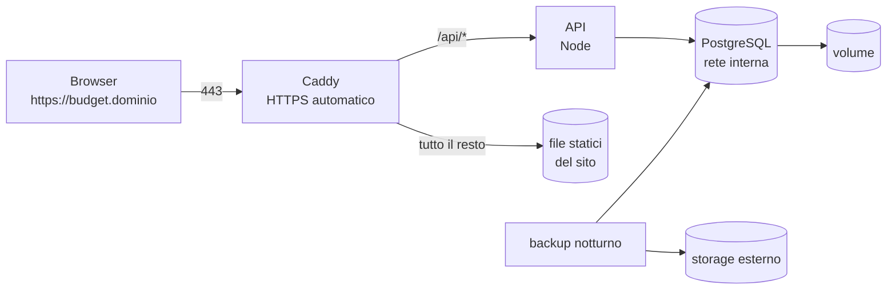

# Dalla v0 alla produzione: cosa manca, cosa è temporaneo, come ospitarlo

Stato al 20 ottobre 2026. **Nessun file di produzione è ancora nel repository**: ciò che segue è la spiegazione e il piano. Le bozze di configurazione (Caddy, ecc.) non sono state provate su un server.

## 1. Dove siamo

La v0 fa tutto ciò che faceva lo script, sui tuoi dati reali, e il motore coincide al centesimo col foglio (1.995 confronti). Ma è un **ambiente di sviluppo sul tuo computer**: funziona, non è ancora un servizio che altre persone possono usare in sicurezza.

La differenza tra le due cose si riassume in sei parole: **chi sei, chi può fare cosa, cosa è successo, backup, HTTPS, aggiornamenti.** Le prime tre ci sono (login con Google, ruoli per area, storico: [accesso-e-storico.md](accesso-e-storico.md)); mancano le altre tre.

## 2. Cosa è temporaneo (solo per lo sviluppo)

| Cosa | Com'è oggi | Perché è solo sviluppo | In produzione |
| --- | --- | --- | --- |
| **Accesso di sviluppo** | `DEV_LOGIN_EMAIL` fa comparire "Sign in as developer" senza Google | in produzione sarebbe una porta aperta | **il server non parte** in produzione se la variabile c'è; si entra solo con Google |
| **Segreti di esempio** | `JWT_SECRET` e password del database sono valori pubblici in `.env.example` | chiunque li conosce | valori lunghi e casuali, solo sul server (`openssl rand -base64 48`) |
| **Rete** | porte 3000, 5173 e **5432 (database)** aperte su `127.0.0.1` | comode per provare; il database non deve mai essere raggiungibile da fuori | solo 80/443 verso Internet; database raggiungibile solo dagli altri contenitori |
| **Password del database** | `erp_dev_password` (proprietario) ed `erp_app_dev_password` (utente dell'API) in `.env.example` | sono pubbliche, stanno nel repository | due segreti lunghi e casuali, solo sul server |
| **Server del sito** | Vite in modalità sviluppo (`vite`), con aggiornamento a caldo e proxy | lento, non ottimizzato, non pensato per il pubblico | `vite build` (2 MB di file statici) servito da un normale server web |
| **Codice condiviso** | cartelle del tuo computer montate nei contenitori; `tsx watch` riavvia a ogni salvataggio | serve a sviluppare | il codice è *dentro* l'immagine, nessuna cartella condivisa, nessun riavvio automatico |
| **Immagine Docker** | un unico `Dockerfile` con tutte le dipendenze di sviluppo e i test | più grande del necessario | immagine di produzione (a più stadi) senza strumenti di sviluppo |
| **`tsx`** | è una dipendenza *di sviluppo* dell'API | in un'immagine di produzione "solo dipendenze vere" non ci sarebbe e l'API non partirebbe | spostarla tra le dipendenze (semplice) o compilare l'API con esbuild (più pulito) |
| **Migrazioni, utente dell'API e dati di base** | si lanciano a mano (`db:migrate`, poi `db:roles`, `db:seed`) | in produzione una dimenticanza = app rotta | passo automatico del rilascio, sempre prima dell'avvio, in quest'ordine |
| **Stagione** | `getCurrentSeason()` cerca "2026-2027"; le date della stagione nel seed (1/9/26 – 31/8/27) sono una mia ipotesi | funziona con una stagione sola | elenco stagioni e selettore |
| **Impostazioni** | categorie, aliquote, scadenze IVA, soglia ±15%, confronti con BANK sono nel codice (sono i `// HARDCODED:` del [registro](hardcoded-registry.md)) | cambiarle richiede di modificare il codice | tabelle e pagina di amministrazione, dopo le risposte del tesoriere |
| **Backup** | non ci sono | se il volume del database si perde, i dati finiscono | copia notturna fuori dal server + prova di ripristino mensile |
| **Test dell'API** | `global-setup` cancella e ricrea il database `erp_test` con le credenziali di `DATABASE_URL` | ok in sviluppo; non va mai lanciato contro il database di produzione | i test girano solo in locale e in CI, mai sul server |
| **Importer dal foglio** | `load -- --replace` cancella e ricarica | serve una volta per la migrazione; dopo, pericoloso | si usa una sola volta; poi viene tolto dal server o protetto |
| **Sicurezza delle richieste** | l'API ha già intestazioni di sicurezza, limite di richieste, controllo CSRF e cookie sicuri; **mancano** HTTPS e le intestazioni delle *pagine* del sito (CSP, HSTS), che le serve un altro programma | su Internet servono | si decide col proxy (da fare) |
| **Logging** | JSON su standard output, visto con `docker compose logs` | basta per un servizio piccolo | rotazione dei log (Docker la fa se configurata) e un controllo esterno di raggiungibilità |

Non temporanei (restano così): gli importi in interi, la logica nel pacchetto `calc`, i vincoli del database, il pattern "rotta sottile + servizio", il blocco ottimistico sulle voci, la struttura delle tabelle.

## 3. Cosa manca

Le stime sono mie e non misurate: **S** ≈ 1 ora, **M** ≈ 2 ore, **L** ≈ 3–4 ore di lavoro assistito, escluse le attività sul server che dipendono da te.

### A. Prima di mettere online (bloccanti)

| # | Cosa | Taglia | Note |
| --- | --- | --- | --- |
| A1 | **Login con Google** e utenti (JWT di 24 ore, dominio del team, primo admin da `ADMIN_EMAILS`) | L | **fatto** e provato con un Google finto; resta provarlo con le credenziali vere (dominio e client OAuth: serve chi amministra il Workspace) |
| A2 | **Ruoli per area** (`admin`, `pm` per area, `viewer`) | M | **fatto**, applicati nel server e provati |
| A3 | **Storico delle modifiche** (`audit_log`, trigger del database) | M | **fatto**: lo vedono admin e pm |
| A4 | **Configurazione di produzione**: immagine a più stadi, `docker-compose.prod.yml`, server web con HTTPS, migrazioni automatiche, segreti da file | M | vedi §5 |
| A5 | **Backup e ripristino** provato, con istruzioni scritte | M | vedi §5.6 |
| A6 | **Integrazione continua** (GitHub Actions): tipi, test, compilazione dell'immagine a ogni modifica | S | **fatto**: `.github/workflows/ci.yml`, vedi [ci.md](ci.md) (da vedere girare al primo push) |

### B. Subito dopo la messa online

| # | Cosa | Taglia |
| --- | --- | --- |
| B1 | Risposte del tesoriere alle **sette domande** (Q1–Q7) → impostazioni al posto degli hardcode (e dove serve, tabelle) | M |
| B2 | **Revisione del layout con un designer**: menu, tabelle, griglia e grafici non sono disegnati su Figma; il logo | M |
| B3 | **Pagina di amministrazione**: categorie, aliquote IVA, scadenze, soglie (utenti e ruoli ci sono già) | L |
| B4 | **Test dell'interfaccia** (Playwright): i percorsi principali, per non rompere niente a ogni modifica | M |
| B5 | **Parallelo con il foglio per due chiusure mensili** (dal piano originale): stessi dati sui due sistemi, differenze spiegate | attività del team |
| B6 | Una **revisione del codice** da parte di una persona del team: gran parte è stato scritto con un assistente, e deve essere comprensibile a chi lo manterrà | attività del team |

### C. Rifiniture di funzionalità (il foglio le aveva, o se ne sente la mancanza)

| Cosa | Oggi | Taglia |
| --- | --- | --- |
| Eliminare un **fondo** dall'interfaccia | l'API lo permette (se non è in uso), la pagina no: cancellando l'ultimo contratto il fondo resta ma sparisce dai menu | S |
| **Rinominare** fondi e fornitori; **riordinare** progetti e voci | ordine fisso (per posizione di inserimento) | M |
| **Incolla di più righe** da Google Sheets | non garantita nella versione gratuita di AG Grid; da valutare (alternativa: griglia diversa o importazione CSV) | L |
| **Esportazione** in CSV/xlsx delle viste | non c'è (era nei rischi del piano) | M |
| **Voci senza categoria** in CATEGORY ANALYSES | non compaiono mai (come nel foglio): 17 voci su 52 nei tuoi dati | S, ma serve una decisione tua |
| **Outflow rosso** nelle analisi | ogni outflow positivo è rosso (come nel foglio), poco utile | S, decisione tua |
| **Nuova stagione**: crearla, portare avanti fondi e fornitori | solo la 2026-2027 | L |
| Uso da **telefono** | la griglia non è pensata per quello | L |
| Stati di caricamento, errori e vuoti più curati; navigazione da tastiera; accessibilità | di base | M |

### D. Il resto del progetto (non è nella v0)

- **Inventario**: unità con tag e QR, stati, ubicazioni, movimenti, creazione dall'arrivo di una voce (piano originale, fase 6). Si aggiunge come modulo nuovo che punta a `budget_line.id`.
- **Analisi con script**: gli endpoint `/api/views/*` restituiscono già JSON utilizzabile da Python; mancano un accesso per gli analisti (token) e i primi notebook.
- Se serviranno analisi SQL dirette: tabelle `calc_*` e un utente del database di sola lettura.

## 4. Dove ospitarlo

| Opzione | Pro | Contro | Quando |
| --- | --- | --- | --- |
| **A. Un VPS** (Hetzner, OVH, DigitalOcean, Contabo…) | pochi euro al mese (indicativamente 4–8 €), controllo totale, server in Europa, la ricetta di questo documento è scritta per questo | l'aggiornamento e la sicurezza del server sono compito vostro | **la scelta consigliata** per un servizio vero |
| **B. Una VM dell'università o del dipartimento** | gratis, vicina al team | dipende dall'ufficio informatico (porte, dominio, HTTPS, regole); la ricetta è la stessa ma l'HTTPS potrebbe doverlo fare il loro sistema | se vi viene offerta: chiedete una VM Linux con Docker |
| **C. PaaS** (Render, Railway, Fly.io) | niente server da amministrare | costa di più, i dati sono su una piattaforma esterna, Compose non si usa tale e quale | se nessuno vuole amministrare un server |
| **D. Un computer in sede** (mini PC) **+ VPN** (Tailscale, WireGuard) | nessun costo, nessuna esposizione su Internet | disponibilità legata alla sede, backup comunque necessari | ottima per il **periodo pilota** |

**Regola di sicurezza**: il login e i ruoli ci sono, ma finché mancano HTTPS, backup e configurazione di produzione (A4, A5) l'app **non va esposta su Internet**. Per un pilota va bene l'opzione D, oppure un server raggiungibile solo via VPN (Tailscale).

## 5. Come si ospita: la ricetta

### 5.1 L'architettura di produzione



- **Caddy** è un server web che ottiene e rinnova da solo il certificato HTTPS (Let's Encrypt). Serve il sito compilato e inoltra `/api` all'API: fa ciò che oggi fa il proxy di Vite.
- **L'API** gira nello stesso modo di oggi, ma senza cartelle condivise, senza riavvio automatico e senza porte pubblicate.
- **Il database** non pubblica nessuna porta: lo raggiunge solo l'API, sulla rete interna di Docker. I dati stanno in un volume.
- Un'**unica immagine** può contenere sia il sito compilato sia l'API.

### 5.2 Cosa cambia rispetto a oggi

| Oggi (sviluppo) | Produzione |
| --- | --- |
| `docker-compose.yml`, servizi `db`, `api`, `web` | `docker-compose.prod.yml`, servizi `db`, `api`, `caddy` |
| servizio `web` con Vite | niente Vite: `vite build` nell'immagine, i file in `/srv/web` letti da Caddy |
| `command: pnpm … dev` | `command: pnpm … start` (senza `watch`) |
| cartelle condivise | nessuna |
| `ports: 127.0.0.1:…` | solo Caddy pubblica 80 e 443; `db` e `api` nessuna porta |
| `.env` con la password di sviluppo | `.env` sul server, permessi `600`, mai nel repository |
| migrazioni a mano | passo del rilascio: `docker compose run --rm api pnpm db:migrate` prima di `up -d` |
| nessun riavvio | `restart: unless-stopped` su ogni servizio |

La configurazione di Caddy (bozza, da provare) è breve:

```
budget.dominio.it {
	encode zstd gzip
	handle /api/* {
		reverse_proxy api:3000
	}
	handle {
		root * /srv/web
		try_files {path} /index.html
		file_server
	}
}
```

La riga `try_files … /index.html` è necessaria: le "pagine" del sito sono nel browser, quindi un indirizzo come `/budget/hw` deve ricevere sempre `index.html`.

### 5.3 Preparare il server (una volta)

1. **Crea il server** (VPS con Ubuntu LTS o Debian) e un **sottodominio** (es. `budget.<vostro dominio>`) con un record DNS di tipo `A` verso l'indirizzo del server.
2. **Accedi con chiave SSH**, disattiva l'accesso con password e quello come `root`, crea un utente normale.
3. **Firewall**: apri solo le porte 22 (SSH), 80 e 443.
4. **Aggiornamenti di sicurezza automatici** (`unattended-upgrades`).
5. **Installa Docker** (con Compose v2) e Git.
6. Copia il progetto sul server (`git clone`) e crea `.env` con i segreti di produzione: password del database lunga e casuale, `PUBLIC_URL` (https), `JWT_SECRET`, `ADMIN_EMAILS`, `GOOGLE_CLIENT_ID`, `GOOGLE_CLIENT_SECRET` e `GOOGLE_ALLOWED_DOMAIN` (tabella in [accesso-e-storico.md](accesso-e-storico.md#5-configurazione-variabili-dambiente)); **senza** `DEV_LOGIN_EMAIL`.

### 5.4 Primo avvio

1. Costruisci e avvia il database, applica le migrazioni (`db:migrate`, come proprietario), crea l'utente dell'API (`db:roles`) e inserisci i dati di base (`db:seed`). In produzione l'API si **rifiuta di partire** se si collega come superutente.
2. **Una volta sola**, carica il foglio (migrazione dei dati): è l'unico momento in cui si usa l'importer; poi non serve più.
3. Avvia tutto, controlla `https://budget.<dominio>/api/health` e fai il primo accesso con un admin.
4. Prova con due persone: un admin e un capo area (il capo area non deve poter modificare un'altra area).

### 5.5 Aggiornare l'app

Per ogni rilascio:

1. **Backup** del database (§5.6).
2. `git pull` della versione da rilasciare (meglio un tag, es. `v0.2.0`).
3. Ricostruisci l'immagine.
4. Applica le migrazioni, poi riavvia i servizi.
5. Controlla `/api/health` e apri due pagine a caso.

**Tornare indietro.** Il codice si ripristina con il tag precedente. Le migrazioni vanno solo avanti: se una migrazione ha rovinato i dati, si ripristina il **backup fatto al punto 1**. Per questo il backup prima del rilascio non è facoltativo.

### 5.6 Backup e ripristino

- **Cosa**: una copia completa del database (`pg_dump`) ogni notte, compressa e **cifrata**, copiata **fuori dal server** (altro servizio di storage, per esempio uno storage compatibile S3 o un altro computer). Una copia sullo stesso server non è un backup.
- **Quanto si tiene**: 30 copie giornaliere e 12 mensili.
- **La prova**: una volta al mese si ripristina l'ultima copia in un database temporaneo e si controlla che le pagine mostrino i numeri attesi. **Un backup mai provato non è un backup.**
- Il ripristino è documentato in un runbook (da scrivere con la messa online).

### 5.7 Sicurezza: la lista

- [x] Login con Google ristretto al dominio del team; cookie `HttpOnly`, `Secure` (con https), `SameSite=Lax`; JWT di 24 ore (da provare con le credenziali vere).
- [x] Ruoli applicati **nel server** (`canWrite`), mai solo nascondendo bottoni nell'interfaccia; provati con test.
- [ ] `JWT_SECRET` lungo e casuale solo sul server; se trapela, lo si cambia (tutti rifanno il login).
- [x] Utente dell'applicazione separato dal proprietario, senza poter cambiare la struttura né scrivere lo storico; l'API in produzione rifiuta un superutente.
- [ ] Database senza porte pubblicate; password lunghe e casuali (due: proprietario e API).
- [ ] HTTPS ovunque (Caddy), HSTS; intestazioni di sicurezza di base.
- [ ] Limiti di richieste sul login.
- [ ] SSH solo con chiavi; firewall; aggiornamenti automatici.
- [ ] Segreti solo nel `.env` del server (`chmod 600`), mai nel repository; ruotati quando cambia chi mantiene il sistema.
- [ ] Contenitori che non girano come `root` dove possibile.
- [x] `pnpm audit` sulle dipendenze: in CI a ogni modifica e Dependabot ogni settimana.
- [ ] Dati personali minimi: solo nome ed email dei membri; chi lascia il team si disattiva, non si cancella (per non rompere lo storico).
- [ ] Mai lanciare i test o l'importer contro il database di produzione.

Il collaudo di robustezza (numeri e testi fuori misura, richieste simultanee, date estreme) è in [collaudo.md](collaudo.md).

**Verifiche iniziali del 20 ottobre 2026** (lo stato di partenza; sotto cosa è cambiato):

| Cosa | Esito |
| --- | --- |
| **SQL injection**: ogni query passa da Drizzle (valori sempre come parametri); nessun `sql.raw` né testo SQL costruito a pezzi; ogni input passa prima da Zod (id numerici, enum, date, decimali con regex, campi sconosciuti scartati) | **nessun punto vulnerabile trovato**. Prova (ora un test permanente, `src/security.test.ts`) con 8 payload classici in tutti i campi di testo (restano testo, le tabelle restano) e 17 richieste ostili su id, percorsi, query string, corpi e callback di login: nessuna risposta 500, nessun effetto |
| Mass assignment (campi extra come `projectId` o `id` in una modifica) | scartati da Zod, la riga non cambia |
| Dipendenze (`pnpm audit`) | 2 avvisi *moderati*, entrambi in strumenti di sviluppo (`esbuild` via `drizzle-kit`, `uuid` via `exceljs`), non raggiungibili dall'API. **Risolti** con due `overrides` |
| Utente del database | l'app si collegava come **superutente** PostgreSQL (`erp`). **Risolto**: ora usa `erp_app` |

**Fatto il 20 ottobre 2026** (dopo le verifiche sopra):

- [x] **Ruoli del database.** L'API si collega come `erp_app`: legge e scrive i dati, non può creare, modificare o cancellare tabelle, non può spegnere il trigger e non può scrivere `audit_log` (lo scrive il trigger con i diritti del proprietario, migrazione `0003`). Il proprietario (`erp`) serve solo a migrazioni, seed e `pnpm db:roles`. Tutta la suite di test gira come utente limitato; `src/db/app-role.test.ts` elenca cosa è vietato.
- [x] **Limite di richieste.** 1.200 al minuto per indirizzo su tutta l'API, **10 al minuto** sulle rotte di accesso; il controllo di salute è escluso. In memoria (un processo: un riavvio azzera i contatori). Dietro un proxy serve `TRUST_PROXY=true`, e **solo** se l'API è raggiungibile unicamente dal proxy: altrimenti chiunque può inventarsi `X-Forwarded-For` e aggirare il limite.
- [x] **Intestazioni di sicurezza dell'API** (`helmet`: CSP `default-src 'none'`, `frame-ancestors 'none'`, `nosniff`, `X-Frame-Options`, `Referrer-Policy`, HSTS) e `Cache-Control: no-store` su ogni risposta.
- [x] **Dipendenze.** `pnpm audit` pulito (due `overrides` in `pnpm-workspace.yaml` per `uuid` ed `esbuild`, da riverificare quando escono `exceljs`/`drizzle-kit` nuovi); Dependabot settimanale; `pnpm audit --prod --audit-level=high` in CI.
- [x] **Controlli contro l'SQL injection nei test**: nessun `sql.raw`/`.unsafe(`, solo modelli `sql` in `execute()`/`query()`, e un attacco con payload classici a tutti i campi (`src/security.test.ts`).
- [x] **Messaggio di accesso**: il server manda una parola (`cancelled`, `expired`, `domain`, `deactivated`, `failed`) e il sito la traduce; un link costruito non può scrivere testo nella pagina.

**Cosa manca ancora** (in ordine di importanza prima di esporre l'app):

- [ ] **HTTPS e proxy** (senza, i cookie non sono `Secure`): da decidere (tailscale serve o sottodominio, quale proxy).
- [ ] **Intestazioni delle pagine del sito** (`Content-Security-Policy`, `Strict-Transport-Security`, `X-Frame-Options`): le serve il proxy o il server web. La CSP dovrà ammettere gli stili che AG Grid inserisce al volo; da provare sul sito compilato.
- [ ] **Immagine di produzione** (oggi gira come `root` con gli strumenti di sviluppo) e `docker-compose.prod.yml`: dipendono dalla scelta del proxy.
- [ ] Il proprietario del database ha ancora una password di sviluppo nel `.env.example`: in produzione due segreti veri.
- [ ] Autenticazione a due fattori: la decide il Workspace Google (da imporre dall'amministratore), non l'app.

### 5.8 Costi indicativi (da verificare)

| Voce | Costo |
| --- | --- |
| VPS piccolo (2 CPU, 4 GB di memoria bastano per decine di utenti) | circa 4–8 € al mese |
| Dominio | spesso gratis come sottodominio di uno che il team ha già; altrimenti circa 10 € all'anno |
| Storage dei backup | pochi centesimi al mese (i dati sono pochi megabyte) |
| Login con Google | gratuito |

## 6. Le decisioni che servono da te

### Decisioni già prese (20 ottobre 2026)

| Tema | Decisione | Dove è sviluppata |
| --- | --- | --- |
| Accesso | **solo login con Google**, account del team; nessun login con password; **JWT di 24 ore, nessuna sessione nel database** | [accesso-e-storico.md](accesso-e-storico.md) |
| Ruoli | tre: `admin` (il tesoriere), `pm` **per area**, `viewer`; primo accesso = `viewer`; i `pm` aggiungono fornitori | [accesso-e-storico.md](accesso-e-storico.md) §6 |
| Storico | **tabella** nel database, scritta da trigger; lo vedono **admin e pm** | [accesso-e-storico.md](accesso-e-storico.md) §8 |
| Server | **vostri server Ubuntu**, raggiunti di solito con **Tailscale** (tranne il sito standard): è l'opzione "D/B" del §4; il **deploy** si decide dopo | [produzione.md](produzione.md) §4 |
| CI su GitHub | **fatta**, sul vostro repository | [ci.md](ci.md) |
| Migrazioni del database | **restano**: il foglio si carica una volta sola, ma le tabelle vanno create e poi aggiornate | [accesso-e-storico.md](accesso-e-storico.md) §5 |

### Ancora da decidere

| # | Decisione | Perché serve |
| --- | --- | --- |
| 1 | **Quale server** dei vostri e come ci si arriva: Docker presente? porte 80/443 occupate dal sito standard? HTTPS con `tailscale serve` o con un sottodominio vostro? | cambia la procedura di rete e di HTTPS |
| 2 | **Dominio**: quale sottodominio, e chi gestisce il DNS | per l'HTTPS e per il login con Google |
| 3 | Il **dominio esatto** degli account Google del team (esiste già, ne risponde qualcuno del team) e un **client OAuth** su Google Cloud: i passi sono in [accesso-e-storico.md](accesso-e-storico.md#cosa-serve-su-google-lo-fa-chi-amministra-il-workspace) | il login si restringe a quel dominio; senza, in produzione l'app non parte |
| 4 | **Chi amministra il server** e chi fa i rilasci | aggiornamenti di sicurezza e backup hanno bisogno di un responsabile |
| 5 | **Dove tenere i backup** (fuori dal server) | prima di andare online |
| 6 | Le **email dei primi admin** (`ADMIN_EMAILS`); poi i capi area li assegna l'admin dalla pagina Users | per il primo accesso in produzione |
| 7 | Le due decisioni del §3C: voci senza categoria e outflow rosso nelle analisi | sono piccole ma toccano ciò che si vede |

## 7. Ordine di lavoro proposto

1. ~~**A1 + A2**: login con Google e ruoli~~ — fatto.
2. ~~**A3**: storico delle modifiche~~ — fatto.
3. **A4 + A5**: configurazione di produzione e backup, con il ripristino provato su una macchina di prova.
4. **A6**: integrazione continua.
5. **Messa online** (§5.3–5.4), prima con 2 persone.
6. **B1–B3**: risposte del tesoriere, revisione del layout, pagina di amministrazione.
7. **B5**: parallelo con il foglio per due chiusure.
8. **D**: inventario e analisi.

I punti 3 e 5 hanno attività che solo tu puoi fare (server, dominio, credenziali di Google).
