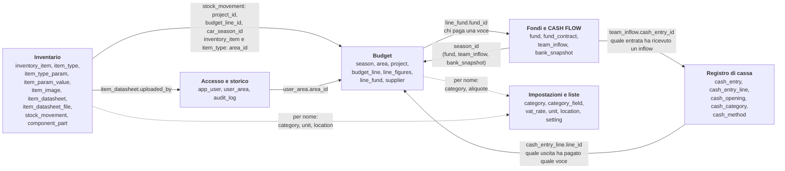
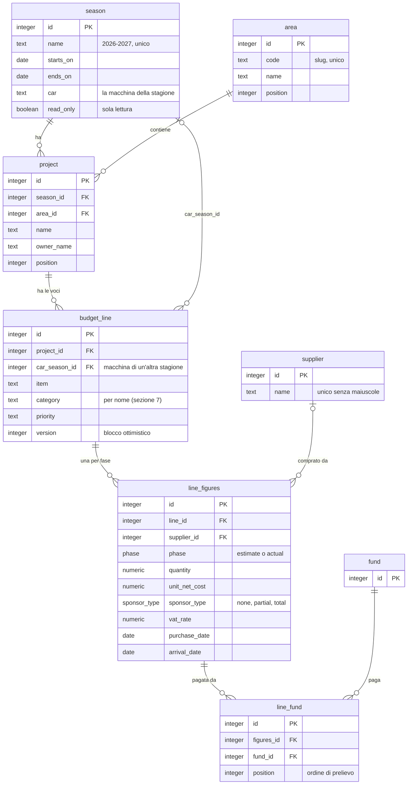
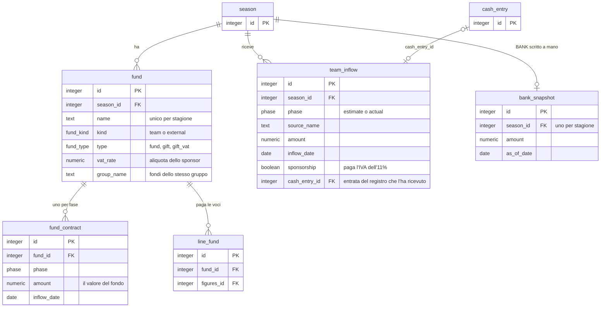
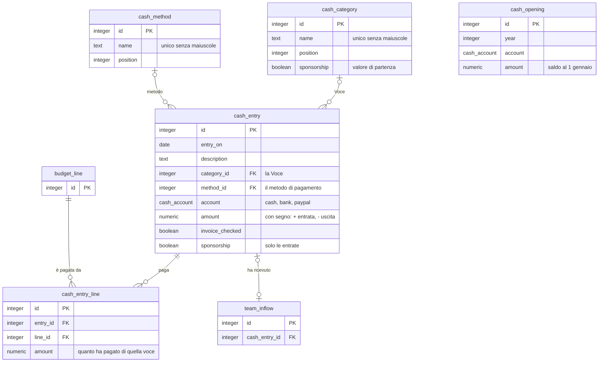
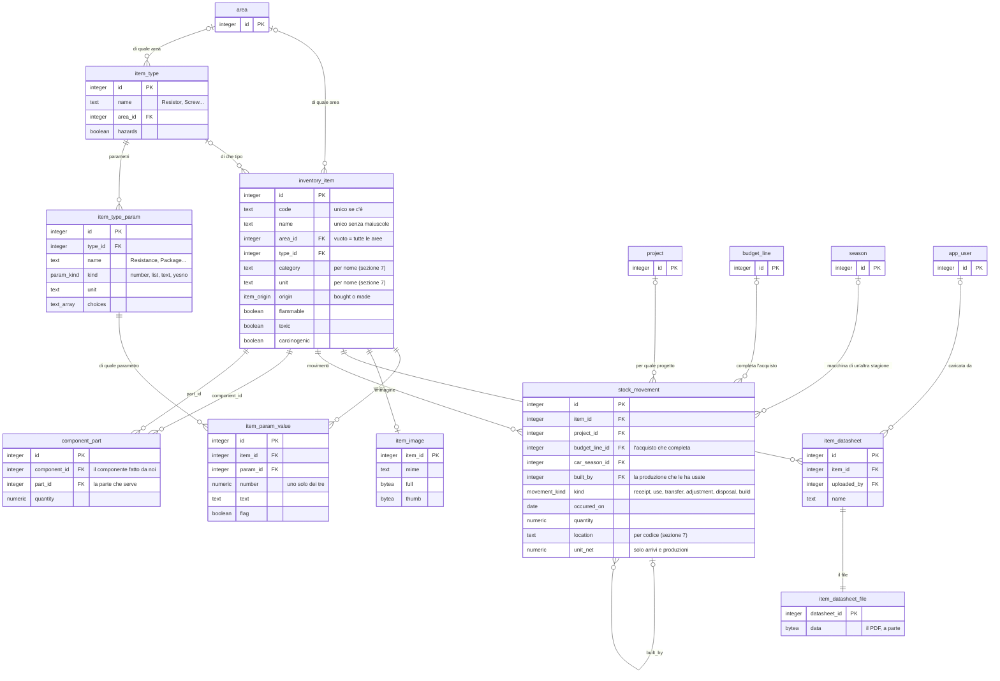
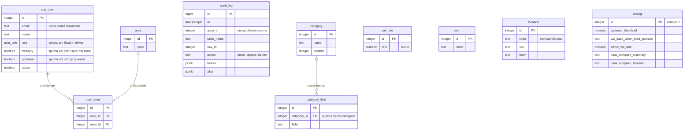

# Com'è organizzato il database

Le **34 tabelle** di PostgreSQL, disegnate. La fonte vera è [apps/api/src/db/schema.ts](../apps/api/src/db/schema.ts) (e le migrazioni in `apps/api/drizzle/`): se cambia lo schema, questo documento va aggiornato nello stesso lavoro. Per le regole di business di ogni area si vedano i documenti indicati in ogni sezione; per l'elenco in tabella e la descrizione di ogni colonna, [architettura.md](architettura.md) (Modello dati).

**Come leggere i diagrammi.** Ogni riquadro è una tabella con le colonne che contano (chiave `PK`, chiave esterna `FK`); le altre sono in `schema.ts`. Le linee sono le chiavi esterne con la loro cardinalità («zampa di gallina»):

| Simbolo | Significa |
| --- | --- |
| `\|\|` | esattamente uno |
| `\|o` | zero o uno |
| `o{` | zero o molti |
| `\|{` | uno o molti |

Esempio: `project ||--o{ budget_line` = un progetto ha zero o più voci, e una voce è di un solo progetto.

## 1. La mappa: sei gruppi e i ponti fra loro

Dentro un gruppo le tabelle sono unite da chiavi esterne (sezioni 2–6). **Fra i gruppi i ponti sono pochi**, ed è qui che si capisce cosa è collegato a cosa. Una linea tratteggiata è un collegamento **per nome** (un testo che deve coincidere con un elenco), non una chiave esterna (sezione 7).

In parole, i cinque ponti che contano:

1. **Stagione → tutto il budget e i soldi.** `season` è la radice: progetti, fondi, inflow e BANK sono di una stagione. Il registro di cassa **non** ha stagione (è dell'anno solare) e l'inventario nemmeno.
2. **Fondo → riga del budget** (`line_fund`): chi paga una riga in una fase.
3. **Registro → riga del budget** (`cash_entry_line`): quale uscita ha pagato quale riga.
4. **Registro → inflow** (`team_inflow.cash_entry_id`): quale entrata ha ricevuto un inflow atteso.
5. **Inventario → budget** (`stock_movement`): un arrivo completa una riga e si attribuisce a un progetto.

## 2. Budget

Stagioni, aree, progetti, voci e le loro cifre. Una voce ha **al più due righe di cifre** (`line_figures`, una per fase: `estimate` e `actual`); una fase senza riga vale tutti zeri. Le regole: [come-funziona.md](come-funziona.md), [stagioni-anni-fiscali-e-macchine.md](stagioni-anni-fiscali-e-macchine.md).

- Cancellare un **progetto** cancella le sue voci, le loro cifre e i fondi di quelle cifre (cascata). Cancellare una voce, idem.
- `fund` è solo accennata qui: è disegnata nella sezione 3.
- Una voce paga con uno o più fondi **in ordine** (`position`): il successivo paga ciò che il precedente non copre ([sponsor-e-fondi.md](sponsor-e-fondi.md)).

## 3. Fondi e CASH FLOW

Gli sponsor sono **fondi virtuali** (o in cassa); il fondo del team è uno solo per stagione. I soldi che arrivano al team (gli inflow) e il BANK stanno qui, indipendenti dai fondi. Regole: [sponsor-e-fondi.md](sponsor-e-fondi.md).

- **Un solo fondo del team per stagione** e **un contratto per fondo e fase**: sono vincoli del database (indice unico parziale su `kind = 'team'`, unicità di `fund_id + phase`).
- Il fondo del team è «semplice»: niente tipo speciale, aliquota o gruppo (un controllo lo impone); l'aliquota IVA si sceglie sulla singola voce.
- `team_inflow.cash_entry_id` è **unico**: un'entrata riceve al più un inflow. Se l'entrata si cancella, il campo torna vuoto (`ON DELETE SET NULL`) e l'inflow torna «non ricevuto».
- `bank_snapshot` serve solo finché il BANK si scrive a mano: con un saldo iniziale nel registro il BANK viene dal registro e questa riga non conta.

## 4. Registro di cassa

Il fondo del team: ogni movimento su Cassa, Banca o Paypal. **I saldi non si salvano mai**: i progressivi si ricalcolano dai movimenti a ogni lettura. Regole: [registro-di-cassa.md](registro-di-cassa.md).

- `cash_opening` non ha chiavi esterne: è una riga per **anno e conto** (unica). Un anno senza saldo iniziale proprio riparte dalla chiusura dell'anno prima.
- Un movimento ha **un solo conto** e un importo **mai zero**; la spunta Sponsorship ha senso solo se l'importo è positivo (due controlli del database).
- `cash_entry_line`: l'importo è sempre sopra zero ed è unico per coppia uscita+voce. Le somme (non oltre l'uscita, non oltre la quota del fondo del team) le controlla l'API.
- Cancellare un movimento cancella i suoi collegamenti alle voci (cascata) e libera l'eventuale inflow; cancellare una voce del budget cancella i collegamenti che la riguardano.

## 5. Inventario

Quello che c'è sullo scaffale **non è un numero salvato**: è la somma dei movimenti (`stock_movement`). Un arrivo congela il prezzo; una produzione congela il costo delle parti. Regole: [inventario.md](inventario.md).

- **Distinta dei componenti** (`component_part`): `component_id` è il componente fatto da noi, `part_id` una sua parte. Un componente non può contenere se stesso, e la coppia è unica.
- **Immagini e PDF** stanno in tabelle a parte (`item_image`, `item_datasheet_file`), così elencare gli articoli non legge mai i byte. Non sono nello storico perché sono binari.
- `item_param_value`: **uno solo** fra `number`, `text`, `flag` è pieno (controllo del database). Un numero è salvato nell'unità del parametro, esatto (10 kΩ = 10000).
- `stock_movement.built_by` punta a un'altra riga della stessa tabella: l'uso di una parte da parte di una **produzione**. Annullare la produzione cancella anche quelle righe (cascata).
- Tipi, parametri e valori sono quelli di Settings › Item types.

## 6. Accesso, impostazioni e storico

Chi può entrare, le liste e gli interruttori che l'admin sceglie in Settings, e il registro delle modifiche. Regole: [accesso-e-storico.md](accesso-e-storico.md), [impostazioni.md](impostazioni.md).

- `user_area` serve solo ai `pm`; `app_user` non si cancella (si **disattiva**), così lo storico continua a puntare a una persona.
- `audit_log` **non ha chiavi esterne di proposito**: lo storico deve sopravvivere a tutto, anche a una riga cancellata o a una persona rimossa. `actor_id` vuoto = non una persona collegata (il seed, l'importer). Lo scrivono dei **trigger** del database nella stessa transazione della modifica: una modifica e la sua storia non possono divergere.
- `setting` ha **una sola riga** (controllo `id = 1`).

## 7. Collegamenti che non sono chiavi esterne

Alcuni elenchi si scrivono **come testo** nelle altre tabelle e si controllano nei servizi, non nel database. Succede perché nacquero come valori del codice (regola 4 di `CLAUDE.md`) e poi diventarono tabelle.

| Dove | Cosa contiene | Con quale elenco deve coincidere |
| --- | --- | --- |
| `budget_line.category`, `inventory_item.category` | il nome della categoria | `category.name` |
| `budget_line.priority` | High, Medium, Low | valori fissi nel codice |
| `line_figures.vat_rate`, `fund.vat_rate` | l'aliquota in percento | un valore di `vat_rate.rate` |
| `inventory_item.unit` | pcs, m, kg… | `unit.name` |
| `stock_movement.location`, `to_location` | il **codice** del posto (`s1-r2`) | `location.code` (non cambia mai) |
| `audit_log.actor_id` | chi ha scritto | `app_user.id` (nessuna chiave) |
| `audit_log.table_name` + `row_id` | quale riga è cambiata | qualunque tabella |
| `cash_opening.year` + `account` | l'anno e il conto del saldo | gli anni e i conti dei movimenti |

Conseguenza pratica: rinominare una **categoria** o un'**unità** in Settings aggiorna anche le righe e gli articoli che la usano (lo fa il servizio); una **categoria o unità in uso** non si cancella; un **posto** non cambia codice, quindi si può rinominare senza toccare i movimenti.

## 8. Cosa fa rispettare il database da solo

Oltre alle chiavi esterne, il database dice no a:

| Regola | Tabella |
| --- | --- |
| un fondo del team per stagione; il fondo del team è semplice; uno sponsor ha un'aliquota | `fund` |
| un contratto per fondo e fase; importo non negativo | `fund_contract` |
| una riga di cifre per voce e fase; quantità e costo non negativi | `line_figures` |
| un fondo una volta sola per riga di cifre, e una sola posizione | `line_fund` |
| importo non negativo; un'entrata riceve al più un inflow | `team_inflow` |
| importo mai zero; la spunta Sponsorship solo sulle entrate | `cash_entry` |
| importo sopra zero; una voce una volta sola per uscita | `cash_entry_line` |
| un saldo iniziale per anno e conto | `cash_opening` |
| quantità sopra zero (tranne il conteggio); prezzi solo su arrivi e produzioni; destinazione solo nei trasferimenti | `stock_movement` |
| un componente non contiene se stesso; quantità sopra zero | `component_part` |
| uno solo fra numero, testo e sì/no | `item_param_value` |
| nomi unici senza badare alle maiuscole (fornitori, articoli, categorie, unità, Voci, metodi, utenti…) | molte |
| una sola riga | `setting` |
| azione di storico solo `insert`, `update` o `delete` | `audit_log` |

## 9. Cosa è nello storico

I trigger `audit_row()` scrivono in `audit_log` ogni inserimento, modifica e cancellazione di **30 tabelle su 34**: tutto ciò che cambia soldi, budget, registro, liste, utenti e inventario. **Non** ci sono: `audit_log` stessa, `area` (le sei aree non cambiano) e i due file binari `item_image` e `item_datasheet_file` (la descrizione della scheda dati sì, `item_datasheet`).

## 10. Tipi enumerati

| Tipo | Valori |
| --- | --- |
| `phase` | `estimate`, `actual` |
| `sponsor_type` | `none`, `partial`, `total` |
| `fund_kind` | `team`, `external` |
| `fund_type` | `fund`, `gift`, `gift_vat` |
| `user_role` | `admin`, `pm` (nel sito «User»), `viewer` |
| `cash_account` | `cash`, `bank`, `paypal` |
| `movement_kind` | `receipt`, `use`, `transfer`, `adjustment`, `disposal`, `build` |
| `item_origin` | `bought`, `made` |
| `param_kind` | `number`, `list`, `text`, `yesno` |

Un valore di un enum **non si toglie** con una migrazione semplice: si ricrea il tipo (come ha fatto `0019` per `treasurer` e `0021` per `sp`).

## 11. Unità dei numeri

Soldi in `numeric(14,2)` nel database e in **centesimi interi** nel codice; quantità `numeric(14,3)` (millesimi nel codice); costi unitari `numeric(14,4)` (decimillesimi di euro nel codice); aliquote `numeric(5,2)` in percento. Le date sono `date` e nel codice stringhe `YYYY-MM-DD`. Mai virgola mobile.
