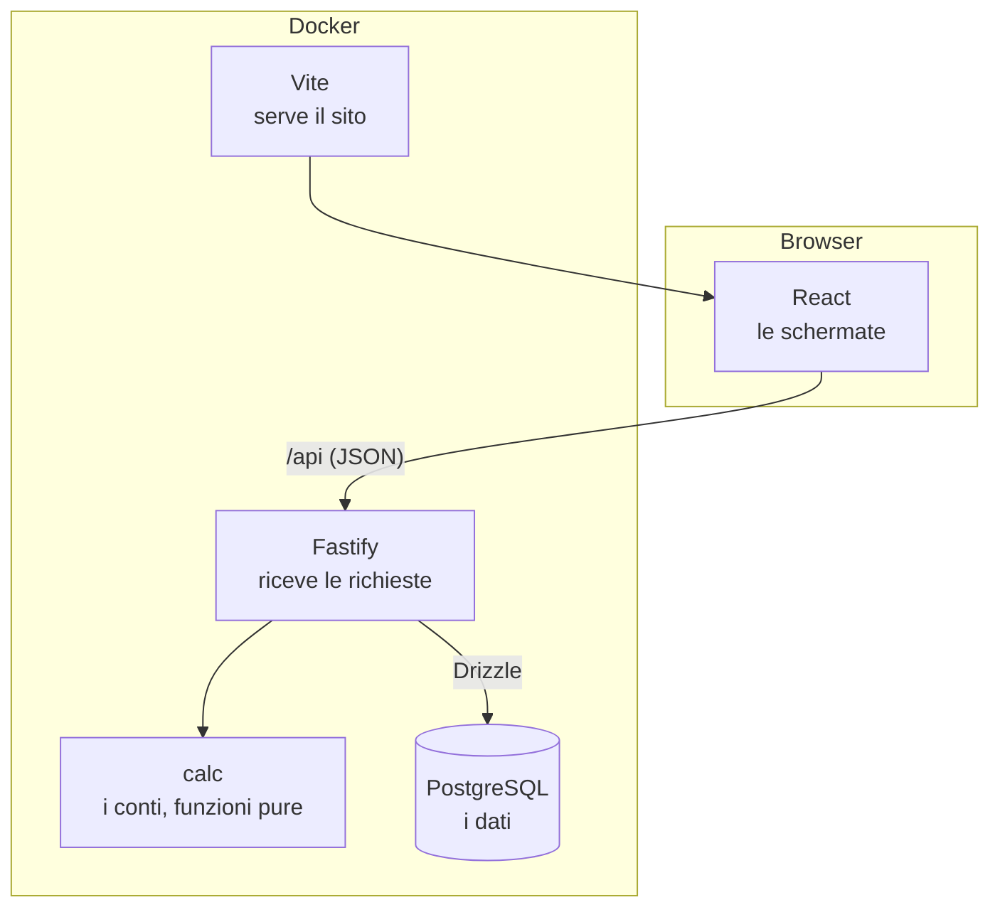

# Le tecnologie, una per una

Per ogni strumento: **il problema che risolve**, **come funziona** (il modello mentale giusto), **come lo usiamo qui** (con codice vero del progetto) e **le trappole**. Alla fine di ognuno c'è il file da aprire per vederlo in azione.

Per il quadro d'insieme e il percorso di una richiesta dal clic al database leggi [come-funziona.md](come-funziona.md); per avviare tutto, [avvio.md](avvio.md).

## Il quadro in una pagina

Il sistema ha tre livelli e un involucro:



| Livello             | Tecnologie                                                   | Cosa fa                                                                            |
| ------------------- | ------------------------------------------------------------ | ---------------------------------------------------------------------------------- |
| **Dati**      | PostgreSQL, Drizzle, pg                                      | conserva ciò che le persone inseriscono, con regole che il database fa rispettare |
| **Regole**    | Node, TypeScript, Fastify, Zod, il pacchetto `calc`        | validano ciò che arriva, calcolano i numeri, rispondono                           |
| **Accesso**   | Google (OIDC), `jose` (JWT), `@fastify/cookie`, trigger PostgreSQL | chi sei, cosa puoi fare, cosa è cambiato ([sezione](#login-jwt-e-storico-jose-cookie-trigger)) |
| **Schermo**   | React, Vite, React Router, TanStack Query, AG Grid, Recharts | mostrano e raccolgono le modifiche, senza fare conti                               |
| **Involucro** | Docker, pnpm                                                 | fanno funzionare tutto uguale su ogni computer                                     |
| **Contorno**  | Vitest, tsx, exceljs, Font Awesome, Fira Code, variabili CSS | test, esecuzione, lettura del foglio, aspetto                                      |

---

## Docker e Docker Compose

**Il problema.** "Sul mio computer funziona": ogni persona ha versioni diverse di Node, di PostgreSQL, di tutto. E per provare il progetto dovresti installare e configurare un database.

**Come funziona.**

- Un'**immagine** è un pacchetto congelato: un mini-sistema Linux con dentro un programma e tutto ciò che gli serve. Si costruisce una volta da una ricetta (il `Dockerfile`) o si scarica già pronta (come `postgres:16`).
- Un **contenitore** è un'immagine in esecuzione: un processo isolato, con il suo filesystem e la sua rete. Si spegne e si riaccende; ciò che scrive dentro sparisce, a meno che non sia in un *volume*.
- **Docker Compose** descrive più contenitori insieme in un file (`docker-compose.yml`): quali, con che configurazione, come si parlano. Un solo comando li accende tutti.

**Come lo usiamo.** Tre servizi (`docker-compose.yml`):

```yaml
services:
  db:
    image: postgres:16
    environment:
      POSTGRES_USER: ${POSTGRES_USER}        # presi dal file .env
      POSTGRES_PASSWORD: ${POSTGRES_PASSWORD}
      POSTGRES_DB: ${POSTGRES_DB}
    volumes:
      - db-data:/var/lib/postgresql/data     # i dati sopravvivono allo spegnimento
    ports:
      - "127.0.0.1:5432:5432"                # visibile dal tuo computer, da nessun altro
    healthcheck: ...                         # "sono pronto" = risponde a pg_isready

  api:
    build: .                                 # usa il Dockerfile
    command: pnpm --filter @erp/api dev
    depends_on:
      db:
        condition: service_healthy           # parte solo quando il database è pronto
    volumes:
      - ./apps/api/src:/app/apps/api/src     # il tuo codice, condiviso col contenitore
```

Le idee da portarsi a casa:

- **Rete interna con nomi**: dentro Docker l'API raggiunge il database scrivendo `db:5432` (il nome del servizio). `docker-compose.yml` costruisce da solo `DATABASE_URL=postgres://…@db:5432/…`. Dal tuo computer invece è `localhost:5432`, perché la porta è pubblicata.
- **`ports: "127.0.0.1:3000:3000"`** = "porta 3000 del contenitore → porta 3000 del tuo computer, solo da dentro il tuo computer". Senza `127.0.0.1` sarebbe raggiungibile da tutta la rete: per questo è scritto.
- **Volume `db-data`**: è dove Postgres tiene i file. `docker compose down` lo lascia; `down -v` lo cancella (e con lui tutti i dati).
- **Bind mount** (`./apps/api/src:/app/apps/api/src`): la cartella del tuo computer *è* quella nel contenitore. Salvi un file e il contenitore lo vede subito: per questo l'API si riavvia da sola. Ogni servizio condivide solo le cartelle che gli servono (`api`: `apps/api/src`, `apps/api/drizzle`, `packages/calc/src`, `tools/import-xlsx/src`; `web`: `apps/web/src`, `packages/calc/src`); di tutto il resto ha la copia fatta alla costruzione dell'immagine. Le dipendenze (`node_modules`) restano quelle installate nell'immagine, perché quelle installate sul Mac (binari per macOS) non funzionerebbero su Linux. Conseguenza pratica: un test va lanciato nel contenitore che condivide quel codice (l'ho scoperto lanciando i test del sito nel contenitore `api`, che ne aveva una copia vecchia).
- **Un solo `Dockerfile` per api e web**: stessa immagine, comando diverso (`command:`). Copia prima solo i `package.json` e installa le dipendenze, poi copia il resto: così Docker riusa lo strato delle dipendenze finché non cambiano.
- **`.env`**: Compose lo legge da solo e sostituisce `${POSTGRES_USER}` ecc. È ignorato da git.

**Trappole.** Se aggiungi una dipendenza devi ricostruire (`up --build`). `down -v` cancella il database. Se un'altra app usa già la porta 5432 (un Postgres installato a mano) il database non parte.

**Dove guardare:** `docker-compose.yml`, `Dockerfile`, `.dockerignore` (esclude `node_modules`, `fonti`, `.env` dall'immagine: dati reali e segreti non entrano mai nell'immagine).

---

## PostgreSQL

**Il problema.** Dove tenere i dati in modo che sopravvivano, che più persone li leggano insieme, e che nessuno possa inserire cose senza senso (un importo negativo, due fondi con lo stesso nome, una voce che punta a un progetto inesistente).

**Come funziona.** È un **database relazionale**: i dati stanno in **tabelle** (righe e colonne tipate) collegate tra loro da **chiavi**. Lo interroghi in **SQL**. I concetti che usiamo:

- **Chiave primaria** (`id`): identifica una riga. Da noi è un contatore automatico (`GENERATED ALWAYS AS IDENTITY`).
- **Chiave esterna**: `budget_line.project_id` punta a `project.id`. Il database *rifiuta* una voce con un progetto che non esiste, e rifiuta di cancellare un progetto che ha voci (a meno di `ON DELETE CASCADE`, che usiamo apposta per cancellare le voci insieme al progetto).
- **Vincoli**: `NOT NULL`, `UNIQUE`, `CHECK (quantity >= 0)`. Sono regole che il database fa rispettare *sempre*, anche se un giorno scrivessimo male il codice dell'API.
- **Indici univoci speciali** (in `schema.ts`):
  - `UNIQUE (season_id, lower(name))`: i nomi dei fondi sono unici *senza distinzione di maiuscole*.
  - `UNIQUE (season_id) WHERE kind = 'team'`: un indice *parziale*; garantisce che ci sia **un solo** "Team's fund" per stagione.
- **Tipo `numeric(14,2)`**: decimale **esatto**. I numeri in virgola mobile (quelli di JavaScript) non lo sono: `0.1 + 0.2` fa `0.30000000000000004`. Per i soldi è inaccettabile, quindi nel database stanno come `numeric`.
- **Tipo `enum`** (`phase`, `sponsor_type`, `fund_kind`): una colonna può contenere solo valori di un elenco.
- **Transazione**: un gruppo di operazioni che riesce **tutto o niente**. Se creo una voce e le sue cifre e la seconda operazione fallisce, anche la prima viene annullata. È la ragione principale per cui non abbiamo scelto Mongo.

**Perché PostgreSQL e non Mongo.** Mongo è un database *a documenti*: ogni elemento è un blocco JSON flessibile, senza struttura imposta e senza relazioni garantite. Va benissimo per dati senza forma fissa. I nostri dati hanno una forma chiarissima (area → progetto → voce → cifre → fondo/fornitore), contengono **soldi** (servono decimali esatti e transazioni) e le regole di integrità sono il cuore del problema. Dove servirà flessibilità (attributi diversi per tipo di pezzo nell'inventario) Postgres ha una colonna `JSONB` che fa la stessa cosa.

**Come lo usiamo.** Dieci tabelle (`season`, `area`, `project`, `budget_line`, `line_figures`, `fund`, `fund_contract`, `team_inflow`, `bank_snapshot`, `supplier`). Per guardarci dentro:

```bash
docker compose exec db psql -U erp -d erp
```

```sql
\dt                                  -- elenca le tabelle
select name, kind from fund;         -- i fondi
\d line_figures                      -- struttura di una tabella, vincoli compresi
```

**Trappole.** Le colonne `numeric` arrivano a JavaScript come *stringhe* ("1220.00"): è voluto, per non perdere esattezza; la conversione è in un solo file (`apps/api/src/core/money.ts`).

**Dove guardare:** `apps/api/src/db/schema.ts` (le tabelle), `apps/api/drizzle/0000_*.sql` (lo stesso in SQL).

---

## Node.js e TypeScript

**Il problema.** JavaScript nasce per i browser. Node lo fa girare anche **fuori** dal browser: è ciò su cui girano l'API e gli strumenti. E JavaScript puro non controlla i tipi: scrivi `fund.nmae` invece di `fund.name` e te ne accorgi solo quando esplode.

**Come funziona.**

- **Node.js** è un interprete JavaScript da riga di comando, con librerie per file, rete, ecc. L'API è un programma Node che resta acceso e risponde a richieste HTTP.
- **TypeScript** è JavaScript con i **tipi**. Un programma separato (`tsc`) legge il codice e *controlla* che i tipi tornino, senza eseguirlo. I tipi **spariscono** quando il codice gira: servono solo a trovare errori prima.

```ts
type Phase = "estimate" | "actual";        // solo questi due valori sono ammessi
function lineAmounts(figures: Figures | null, settings: Settings): LineAmounts { … }
lineAmounts(figures, "abc");               // errore PRIMA di eseguire: "abc" non è un Settings
```

**Come lo usiamo.**

- `tsconfig.base.json` attiva `strict` e `noUncheckedIndexedAccess`. Quest'ultima dice che `array[0]` può essere `undefined`: è il motivo per cui nel codice trovi `!` o `?? 0`. Fastidioso, ma impedisce un'intera classe di errori.
- `noEmit: true`: TypeScript **non produce file**, controlla soltanto. A eseguire il codice pensano `tsx` (API) e Vite (sito). Il controllo si lancia con `pnpm typecheck`.
- **Tipi condivisi**: l'API e il sito importano gli stessi tipi da `@erp/calc` (`AreaSheet`, `Gantt`, `Totals`…). Se cambi la forma di una risposta, il compilatore ti mostra ogni schermata da aggiornare.
- **Moduli ES** (`"type": "module"`, `import`/`export`): lo standard moderno.

**Trappole.** I tipi non esistono a runtime: ciò che arriva da fuori (una richiesta HTTP) va **validato** con Zod; il tipo da solo non protegge.

**Dove guardare:** `tsconfig.base.json`, `packages/calc/src/types.ts`.

---

## pnpm e i workspace (monorepo)

**Il problema.** Il progetto ha più "pezzi" (API, sito, motore di calcolo, importer) che si usano a vicenda, ciascuno con le sue librerie. Tenerli in repository separati vorrebbe dire pubblicare e riscaricare il motore a ogni modifica.

**Come funziona.**

- **pnpm** è un gestore di pacchetti (come `npm`): scarica le librerie elencate in `package.json`.
- **`pnpm-lock.yaml`** registra le versioni *esatte* installate, così tutti (e il Docker) ottengono la stessa cosa. Si committa. `--frozen-lockfile` = "installa esattamente questo, non aggiornare niente".
- Un **workspace** (`pnpm-workspace.yaml`) dichiara che `apps/*`, `packages/*`, `tools/*` sono pacchetti dello stesso progetto. Uno può dipendere da un altro con `"@erp/calc": "workspace:*"`: pnpm crea un collegamento al codice vero, nessuna copia.
- pnpm è **rigoroso**: un pacchetto può importare solo ciò che ha dichiarato nel proprio `package.json`. Se dimentichi una dipendenza, l'errore è immediato (ci è successo con `drizzle-orm` nell'importer).
- Per sicurezza pnpm **non esegue gli script di installazione** delle librerie finché non li autorizzi: in `pnpm-workspace.yaml` c'è `allowBuilds: esbuild: true`, perché esbuild deve scaricare il suo binario.

**Come lo usiamo.**

| Pacchetto                                    | Cos'è                |
| -------------------------------------------- | --------------------- |
| `@erp/calc` (`packages/calc`)            | il motore di calcolo  |
| `@erp/api` (`apps/api`)                  | il server             |
| `@erp/web` (`apps/web`)                  | il sito               |
| `@erp/import-xlsx` (`tools/import-xlsx`) | legge il foglio Excel |

`pnpm -r test` = in tutti i pacchetti; `pnpm --filter @erp/api test` = solo in uno. Nota: `@erp/calc` esporta direttamente i sorgenti `.ts` (`"exports": "./src/index.ts"`), niente fase di compilazione: Vite, tsx e Vitest sanno leggerli.

**Dove guardare:** `package.json` (radice), `pnpm-workspace.yaml`, i `package.json` dei pacchetti.

---

## tsx e Vitest

**tsx** esegue file TypeScript direttamente (`tsx src/main.ts`), usando esbuild per togliere i tipi al volo. `tsx watch` riavvia il programma quando cambia un file: è ciò che hai visto accadere quando salvi un file dell'API. Il flag `--env-file-if-exists=../../.env` (di Node) carica il `.env` se c'è.

**Vitest** è il programma che esegue i test.

```ts
describe("lineAmounts", () => {
  it("partial sponsor: VAT only on what the sponsor does not cover", () => {
    const a = lineAmounts(net1000({ sponsorType: "partial", sponsorValueCents: 40_000, vatRate: 22 }), settings);
    expect(a).toMatchObject({ vatCents: 13_200, outflowCents: 73_200 });
  });
});
```

Nel progetto i test sono di tre tipi, dal più piccolo al più grande:

1. **Del motore** (`packages/calc`): funzioni pure, nessun database, durano millisecondi. Ogni regola del foglio ha almeno un test.
2. **Dell'API** (`apps/api`): chiamano l'API vera con `app.inject()` (senza aprire porte) su un **database di prova** `erp_test`, che viene **ricreato da zero a ogni esecuzione** (`test/global-setup.ts`). Non toccano mai i dati di sviluppo. `fileParallelism: false` perché tutti i file condividono quel database.
3. **La riconciliazione** (`pnpm reconcile`): non è un test automatico ma uno script che confronta il motore con il foglio reale.

**Dove guardare:** `packages/calc/src/*.test.ts`, `apps/api/test/`, `apps/api/vitest.config.ts`.

---

## Fastify

**Il problema.** Il sito deve poter chiedere "dammi i dati di quest'area" o "salva questa modifica". Serve un programma che resti in ascolto di richieste HTTP e risponda.

**Come funziona.** Una richiesta HTTP ha un **metodo** (GET legge, POST crea, PATCH modifica, PUT sostituisce, DELETE cancella), un **percorso** (`/api/areas/hw/sheet`) e a volte un **corpo** JSON. Fastify associa ogni (metodo, percorso) a una funzione:

```ts
export async function healthRoutes(app: FastifyInstance) {
  app.get("/health", async (_request, reply) => {
    const health = await getHealth();
    return reply.code(health.ok ? 200 : 503).send(health);
  });
}
```

- **Plugin e prefisso**: ogni gruppo di rotte è un plugin; in `app.ts` li registriamo tutti sotto `/api`. Per questo `/health` diventa `/api/health`.
- **Gestione degli errori in un punto solo** (`setErrorHandler` in `app.ts`): un errore previsto (`AppError`) mantiene il suo stato (404, 409…), un input sbagliato (`ZodError`) diventa 400, un vincolo violato dal database (codice Postgres `23505`/`23503`/`23514`) diventa 409/400, tutto il resto 500 con messaggio generico.
- **`app.inject()`**: simula una richiesta senza rete, usato dai test.
- Il **log** (pino) scrive una riga JSON per richiesta: lo vedi con `docker compose logs -f api`.

**Come lo usiamo: "rotte sottili".** Una rotta fa solo tre cose: legge e valida l'input, chiama una **funzione di servizio**, restituisce il risultato. La logica sta nel servizio (`*.service.ts`), non nella rotta. Per ogni modulo ci sono due file: `x.service.ts` (le funzioni, che sono "l'API" vera) e `x.routes.ts` (il collegamento HTTP). Questo è il fondamento della regola 4: gli hardcode stanno nelle funzioni di servizio.

**Perché Fastify e non Express.** Più veloce, pensato per TypeScript, plugin e prefissi integrati; Express è più vecchio e più diffuso ma non aggiunge niente che ci serva.

**Dove guardare:** `apps/api/src/app.ts`, `apps/api/src/modules/*/`.

---

## Zod

**Il problema.** I tipi di TypeScript spariscono quando il programma gira. Ciò che arriva dalla rete (il corpo di una richiesta) è *qualunque cosa*: stringhe dove aspetti numeri, campi mancanti, date impossibili. Va controllato a runtime.

**Come funziona.** Descrivi la forma attesa con uno **schema**; Zod ne ricava sia il controllo sia il tipo TypeScript:

```ts
export const decimal = (scale: number) =>
  z.union([z.string(), z.number()]).transform(String)
   .pipe(z.string().regex(new RegExp(`^\\d+(\\.\\d{1,${scale}})?$`), `Expected a number with at most ${scale} decimals`));

export const isoDate = z.string().refine((v) => parseFlexibleDate(v) === v, "Not a valid date (use YYYY-MM-DD)");
```

`schema.parse(dati)` restituisce i dati puliti oppure **lancia** `ZodError`, che il gestore degli errori trasforma in una risposta 400 con l'elenco dei problemi. Esempi del progetto:

- `decimal(2)`: un importo con al massimo 2 decimali, non negativo, come stringa (mai un `float`).
- `isoDate`: una data vera (`2026-02-30` è rifiutata).
- `figuresInput` con `.partial()`: ogni campo è facoltativo; **assente = lascia com'è**, **`null` = svuota**.
- In `core/env.ts` validiamo anche le variabili d'ambiente all'avvio: se manca `DATABASE_URL` il programma si ferma subito con un messaggio chiaro invece di fallire più tardi in modo oscuro.

**Dove guardare:** `apps/api/src/core/validation.ts`, `apps/api/src/modules/budget/budget.schema.ts`, `apps/api/src/core/env.ts`.

---

## Drizzle (e drizzle-kit, e pg)

Sono tre cose che lavorano insieme.

**Il problema.** Parlare con Postgres in SQL puro dal codice vuol dire scrivere stringhe a mano: niente controllo dei tipi, facile sbagliare un nome di colonna, facile l'iniezione SQL. Un **ORM** (Object-Relational Mapper) fa da traduttore tra tabelle e codice.

### Drizzle ORM: lo schema e le query

Lo **schema** descrive le tabelle *in TypeScript*; è la fonte di verità della struttura:

```ts
export const fund = pgTable("fund", {
  id: id(),
  seasonId: integer().notNull().references(() => season.id),
  name: text().notNull(),
  kind: fundKindEnum().notNull(),
  paysVat: boolean().notNull().default(false),
}, (t) => [
  uniqueIndex("fund_season_name_uq").on(t.seasonId, sql`lower(${t.name})`),
  uniqueIndex("fund_one_team_per_season").on(t.seasonId).where(sql`${t.kind} = 'team'`),
]);
```

Le **query** si scrivono come codice, e i risultati hanno il tipo giusto in automatico:

```ts
const [existing] = await tx
  .select()
  .from(fund)
  .where(and(eq(fund.seasonId, seasonId), sql`lower(${fund.name}) = lower(${name})`));
//     ^ existing: { id: number; name: string; kind: "team" | "external"; … } | undefined
```

- `eq`, `and`, `sql`…: i mattoncini della clausola `WHERE`. `sql` permette un frammento di SQL a mano quando serve, senza perdere l'escape sicuro dei valori.
- **Upsert** (inserisci o aggiorna se esiste): `.insert(lineFigures).values(…).onConflictDoUpdate({ target: [lineId, phase], set: … })`. Lo usiamo per le cifre di una voce, che esistono una volta per fase.
- **Transazioni**: `db.transaction(async (tx) => { … })`. Tutto ciò che fai con `tx` riesce insieme o non succede niente. È dentro `runWrite()`.
- **`casing: "snake_case"`**: in TypeScript scriviamo `seasonId`, nel database la colonna è `season_id`. Drizzle traduce. È utile a chi un domani farà analisi in SQL o Python.
- `numeric` → **stringa**: Drizzle restituisce i decimali esatti come testo. Li convertiamo in interi (centesimi) con `core/money.ts`, mai con `parseFloat`.

### drizzle-kit: le migrazioni

**Il problema.** Il database di ognuno (e un domani quello di produzione) deve avere la *stessa struttura* e poterla **cambiare nel tempo** senza perdere i dati.

**Come funziona.** Una **migrazione** è un file SQL che porta il database da uno stato al successivo.

1. Modifichi `schema.ts`.
2. `pnpm db:generate` (drizzle-kit): confronta lo schema con l'ultima "fotografia" salvata in `apps/api/drizzle/meta/` e **scrive un nuovo file SQL** (`0001_….sql`) con solo la differenza.
3. `pnpm db:migrate`: esegue i file non ancora applicati e annota ognuno nella tabella `drizzle.__drizzle_migrations` del database. Per questo si può rilanciare: salta ciò che è già fatto.

Questi file SQL **si committano**: sono la storia della struttura.

### pg

È il **driver**: la libreria che apre la connessione TCP a Postgres e spedisce l'SQL. Gestisce un **pool** di connessioni riusate (in `db/client.ts`: `new pg.Pool(...)`), così ogni richiesta non ne apre una nuova.

**Dove guardare:** `apps/api/src/db/schema.ts`, `client.ts`, `migrate.ts`, `apps/api/drizzle.config.ts`, `apps/api/drizzle/`.

---

## `@erp/calc`: il motore (l'idea centrale)

Non è una libreria esterna ma la scelta di progetto più importante, quindi la spiego qui.

**Il problema.** Nel foglio le regole di calcolo erano sparse in formule di celle. Se un numero è sbagliato, dove guardare? E come garantire che il sito e le analisi di domani facciano lo stesso conto?

**La soluzione.** Un pacchetto di **funzioni pure**: ricevono dati, restituiscono dati, **non toccano** database, rete, orologio. Niente effetti collaterali = si testano in un attimo e danno sempre la stessa risposta.

```ts
export function lineAmounts(figures: Figures | null, settings: Settings): LineAmounts
export function gantt(snapshot: Snapshot, phase: Phase): Gantt
export function totals(snapshot: Snapshot): Totals
```

- **Snapshot**: tutto ciò che serve ai conti (aree, progetti, voci, fondi, contratti, ingressi, BANK e le impostazioni) in un unico oggetto JSON. L'API lo costruisce leggendo il database (`loadSnapshot`); i test lo costruiscono a mano; l'importer lo costruisce dall'Excel. Il motore non sa e non vuole sapere da dove viene.
- **Numeri interi**: gli importi sono centesimi, le quantità millesimi, i costi unitari decimillesimi di euro. Nessun `float`. L'IVA si arrotonda al centesimo riga per riga in un solo punto (`roundDiv`).
- **Mai salvati**: i risultati non si memorizzano. A ogni richiesta si rileggono i dati e si ricalcola; non possono mai essere "vecchi".

**Dove guardare:** `packages/calc/src/` (un file per vista: `gantt.ts`, `totals.ts`, `funds.ts`…).

---

## React

**Il problema.** Una pagina con tabelle e moduli deve restare coerente con i dati: cambia una cifra e devono aggiornarsi totali, grafici, evidenziazioni. Farlo a mano (cercare e aggiornare elementi) diventa ingestibile.

**Come funziona.** Descrivi **come deve apparire l'interfaccia dato lo stato attuale**; React si occupa di aggiornare solo ciò che è cambiato.

- Un **componente** è una funzione che restituisce l'interfaccia (in JSX, un HTML dentro JavaScript).
- Lo **stato** (`useState`) è un dato che, cambiando, fa **ridisegnare** il componente.
- Le **props** sono i dati che un componente riceve dal padre.

```tsx
function NewProjectForm({ areaCode }: { areaCode: string }) {
  const [name, setName] = useState("");          // stato: il testo digitato
  …
  return (
    <form onSubmit={submit}>
      <input value={name} onChange={(e) => setName(e.target.value)} />
      <Button type="submit" disabled={name.trim() === ""}>Add project</Button>   {/* si disabilita da solo */}
    </form>
  );
}
```

Nota la regola: **il sito non fa conti**. Mostra i numeri che arrivano dall'API.

**Dove guardare:** `apps/web/src/pages/`, `apps/web/src/components/`.

---

## Vite

**Il problema.** Il browser capisce HTML, CSS e JavaScript, ma noi scriviamo TypeScript e JSX, importiamo CSS e pacchetti. Serve un passaggio che li prepari, e durante lo sviluppo che aggiorni la pagina appena salvi.

**Come funziona.**

- **Server di sviluppo** (`vite`): serve i file al browser trasformandoli al volo; con l'**HMR** (Hot Module Replacement) aggiorna nel browser solo il modulo cambiato, **senza ricaricare** la pagina e perdere lo stato.
- **Proxy**: nel browser la pagina sta su `localhost:5173`, l'API su `localhost:3000`. Chiamate verso un altro indirizzo sono bloccate dal browser (CORS). La soluzione in `vite.config.ts`:

```ts
const apiUrl = process.env.API_URL ?? "http://localhost:3000";   // in Docker: http://api:3000
export default defineConfig({
  plugins: [react()],
  server: { port: 5173, proxy: { "/api": apiUrl } },             // /api/... → l'API
});
```

  Il browser parla *sempre* con Vite, e Vite inoltra le richieste che iniziano per `/api`. Nessun problema di CORS, nessun indirizzo scritto nel codice del sito.

- `vite build` produrrà i file finali per la produzione (non lo usiamo ancora).

**Dove guardare:** `apps/web/vite.config.ts`, `apps/web/index.html`.

---

## React Router

**Il problema.** Il sito ha 15 "pagine" ma è un'unica pagina web: vogliamo che cliccando una voce del menu cambi l'indirizzo (`/budget/hw`, `/total`), che il tasto Indietro funzioni, che si possano condividere i link, e che la pagina **non si ricarichi** da capo.

**Come funziona.** Associa ogni indirizzo a un componente. Il pezzo variabile dell'indirizzo diventa un parametro:

```tsx
<Route element={<Shell />}>                                  {/* menu fisso + <Outlet/> */}
  <Route index element={<Navigate to="/budget/mt-dmt" replace />} />
  <Route path="budget/:code" element={<AreaPage />} />        {/* :code = "hw", "sw"… */}
  <Route path="gantt/:phase" element={<GanttPage />} />
</Route>
```

Dentro `AreaPage` si legge con `const { code } = useParams()`. `NavLink` nel menu sa quando è la pagina attiva (la voce gialla). `Shell` contiene il menu e un `<Outlet/>` dove entra la pagina corrente.

**Dove guardare:** `apps/web/src/App.tsx`, `components/Shell.tsx`.

---

## TanStack Query

**Il problema.** I dati vengono dal server: vanno richiesti, mostrata un'attesa, gestito l'errore, tenuti in memoria per non richiederli a ogni clic, e **aggiornati** quando qualcuno li modifica.

**Come funziona.** Una **cache** dei dati del server, indicizzata da una **chiave**:

```tsx
const sheet = useQuery({ queryKey: ["sheet", code], queryFn: () => api.sheet(code) });
// sheet.data, sheet.isLoading, sheet.isError
```

- Due componenti che chiedono la stessa chiave fanno **una sola** richiesta.
- `invalidateQueries()` dice "questi dati potrebbero essere vecchi": quelli attualmente visibili vengono **richiesti di nuovo**.
- `staleTime: 5s` e `refetchOnWindowFocus`: tornando sulla scheda del browser i dati si rinfrescano.

**Il nostro schema per ogni scrittura** (`lib/useAction.ts`):

```ts
try { await work(); return true; }
catch (error) { notify("error", error.message); return false; }     // il rifiuto del server diventa un avviso
finally { await queryClient.invalidateQueries(); }                   // in OGNI caso: ricarica tutto
```

La conseguenza è importante: **lo schermo mostra sempre ciò che il server ha davvero**. Se una modifica viene rifiutata, la cella torna al valore vero. Non c'è un secondo stato da tenere allineato.

**Dove guardare:** `apps/web/src/lib/useAction.ts`, `apps/web/src/pages/AreaPage.tsx`.

---

## AG Grid

**Il problema.** Il foglio era una griglia: celle modificabili, tendine, date, totali fissi in fondo, colonne raggruppate. Costruirla con tabelle HTML a mano è un lavoro enorme.

**Come funziona.** Gli passi **le colonne** e **le righe**; lui disegna e gestisce le interazioni.

- `rowData`: le righe (per noi, le voci di un progetto).
- `columnDefs`: per ogni colonna, che cosa mostrare e come modificarlo:
  - `valueGetter`: *come ottenere il valore da mostrare* da una riga.
  - `cellEditor`: l'editor (`agSelectCellEditor` tendina, `agNumberCellEditor`, `agDateStringCellEditor`, testo).
  - `valueSetter`: *cosa fare quando la persona cambia il valore*.
- `pinnedBottomRowData`: la riga fissa dei subtotali (la "riga gialla" del foglio).
- Raggruppare le colonne sotto "EXPECTED" e "ACTUAL" è un `ColGroupDef`.

**Il nostro modo di usarlo: la griglia non modifica mai i propri dati.**

```ts
function editableCell(commit, toPatch) {
  return {
    editable: (p) => isLine(p.data) && !p.node.rowPinned,
    valueSetter: (p) => {
      if (isLine(p.data)) commit(p.data, toPatch(p.newValue));   // manda la modifica all'API
      return false;                                              // "non ho cambiato niente io"
    },
  };
}
```

Il `valueSetter` non scrive nella riga: chiama `commit`, che spedisce `PATCH /api/lines/:id`. Poi `useAction` ricarica tutto e le righe arrivano nuove dal server. In questo modo i calcoli (IVA, totali) non possono divergere dal motore.

- **Tema**: `themeQuartz.withParams({...})` accetta variabili CSS, quindi la griglia usa i token Figma e cambia insieme a chiaro/scuro (`theme/grid.ts`).
- **Una griglia per progetto**: AG Grid Community non ha il raggruppamento di righe (è nella versione a pagamento, Enterprise), quindi ogni progetto ha la sua griglia con i suoi subtotali. L'incolla di più righe da Google Sheets nella versione Community non è garantita: è da verificare.
- `getRowId`: dà a ogni riga un'identità stabile, così dopo il ricaricamento la griglia aggiorna le righe invece di ridisegnarle e perdere la posizione.

**Trappole.** Le celle calcolate sono semplici `valueGetter` senza editor. Il numero di colonne per fase (15) è il motivo per cui la tabella scorre in orizzontale; la colonna `ITEM` è fissata a sinistra (quando si scorre, le colonne passano *sotto* quella fissa: per cliccare una cella nascosta si scorre ancora un po').

Le **icone** della colonna di stato hanno il suggerimento immediato del sistema di AG Grid (`tooltipValueGetter` e `tooltipShowDelay`), non l'attributo `title` del browser: quello arriva con un ritardo di circa un secondo e non è stilabile, mentre quello di AG Grid sta fuori dalla cella (non viene tagliato) e usa i colori del tema (`tooltipBackgroundColor`… in `theme/grid.ts`). Va su più righe (`white-space: pre-line`).

Anche le **barre di scorrimento** sono un caso: AG Grid imposta di suo `color-scheme: light`, quindi in modo scuro la barra orizzontale usciva con la pista bianca, diversa da quella delle tabelle. Il parametro `browserColorScheme: "inherit"` in `theme/grid.ts` le fa seguire lo schema dell'app (chiaro o scuro), identiche alle altre.

Un'altra trappola, solo su Mac: le barre "a comparsa" (larghezza zero) AG Grid le disegna in posizione assoluta, **sopra** la riga dei subtotali, quindi con una sola riga di dati la coprivano. `components.css` riserva sotto i subtotali una fascia di 16 px per la barra e la porta in fondo alla griglia (le regole valgono solo quando AG Grid usa la barra "apple", cioè dove serve; altrove la barra normale occupa già il suo spazio).

**Dove guardare:** `apps/web/src/pages/areaColumns.tsx`, `AreaPage.tsx`, `theme/grid.ts`.

---

## Recharts

**Il problema.** Il foglio aveva circa 50 grafici a colonne.

**Come funziona.** Grafici come componenti React, che si compongono:

```tsx
<ResponsiveContainer width="100%" height={300}>
  <BarChart data={euros}>
    <CartesianGrid stroke="var(--stroke-sub)" vertical={false} />
    <XAxis dataKey={xKey} />
    <YAxis tickFormatter={(v) => compact.format(v)} />
    <Tooltip formatter={(v) => full.format(Number(v))} />
    {series.map((s, i) => <Bar dataKey={s.key} fill={COLOURS[i]} stackId={stacked ? "stack" : undefined} />)}
  </BarChart>
</ResponsiveContainer>
```

Abbiamo **un solo** componente (`BarsChart`) usato da tutte le viste. Converte i centesimi in euro per l'asse, usa come colori le variabili `--utility-1…6` del design system, e `stacked` impila le serie (spese per area) invece di affiancarle. Disegna SVG, quindi è nitido a ogni dimensione.

**Dove guardare:** `apps/web/src/components/BarsChart.tsx`.

---

## Font Awesome e Fira Code

- **Font Awesome Free (set "solid")**: le stesse icone del design Figma, con gli stessi nomi (`faTrash`, `faPen`, `faCircleInfo`). Si importa **solo** l'icona che serve (`import { faTrash } from "@fortawesome/free-solid-svg-icons"`), quindi nel sito finiscono solo quelle usate; si disegna con `<FontAwesomeIcon icon={faTrash} />`.
- **Fira Code** (`@fontsource-variable/fira-code`): il font dell'interfaccia secondo Figma. Il pacchetto lo porta **dentro il progetto**: nessuna richiesta a Google, funziona offline. È un font *variabile*: il peso è un asse continuo (300–700), quindi esiste anche il peso 450 "Retina" del design.

**Dove guardare:** `apps/web/src/theme/base.css` (import del font), `components/Button.tsx` (icone).

---

## Variabili CSS: i "token" di Figma

**Il problema.** I colori e le misure scelti dal designer devono stare **in un punto solo**; altrimenti il sito si riempie di `#f3ff17` sparsi, impossibili da cambiare e da tenere coerenti.

**Come funziona.** Una variabile CSS (`--bg-weak`) si definisce una volta e si usa ovunque con `var(--bg-weak)`. La modalità scura **ridefinisce le stesse variabili** quando il sistema è in scuro:

```css
:root { --bg-weak: #f7f7f7; --text-strong: #1a1a1a; --primary-default: #f3ff17; … }

@media (prefers-color-scheme: dark) {
  :root:not([data-theme="light"]) { --bg-weak: #1a1a1a; --text-strong: #fff; … }
}

.input { background: var(--bg-weak); color: var(--text-strong); border: 1px solid var(--stroke-sub); }
```

I componenti non sanno nulla di chiaro o scuro: usano i nomi, e i valori cambiano da soli. Anche AG Grid e i grafici leggono le stesse variabili.

**Dove guardare:** `apps/web/src/theme/tokens.css` (tutti i valori e da dove vengono), `docs/stile-interfaccia.md`.

---

## exceljs

**Il problema.** I dati reali sono in un file Excel (`.xlsx`), con celle unite, righe colorate, formule e date come numeri seriali.

**Come funziona.** Un `.xlsx` è un archivio ZIP di file XML. `exceljs` lo apre e ti restituisce fogli e celle con: il **valore**, il **risultato salvato delle formule**, il **colore di sfondo** (così riconosciamo le righe gialle dei subtotali, come faceva lo script) e le celle unite.

```ts
function normalise(value: CellValue | undefined): Plain {
  if (value instanceof Date) return value.toISOString().slice(0, 10);   // date → "2026-11-20"
  if ("result" in value) return normalise(value.result);                // formula → il suo risultato
  if ("richText" in value) return value.richText.map((p) => p.text).join("");
  if ("text" in value) return String(value.text);                        // link: tieni il testo, scarta il link
  …
}
```

È usato **solo dall'importer** (`tools/import-xlsx`), mai dall'app. Legge i valori *digitati* (quantità, costi, fondi…) per costruire i dati, e i valori *calcolati dal foglio* per confrontarli col motore (la riconciliazione).

**Dove guardare:** `tools/import-xlsx/src/cells.ts`, `read-inputs.ts`, `read-oracle.ts`, `reconcile.ts`.

---

## Login, JWT e storico: jose, cookie, trigger

**Il problema.** Una volta che l'app è raggiungibile da più persone servono tre risposte: *chi sei* (autenticazione), *cosa puoi fare* (autorizzazione) e *cosa è stato cambiato e da chi* (storico). Non vogliamo gestire password: usiamo gli account Google del team.

**Come funziona (il modello mentale).**

- **OpenID Connect con Google.** Non vediamo mai la password: mandiamo la persona a Google, che la autentica e ci rimanda indietro con un `code` monouso. Il nostro server lo scambia (da server a server, con un segreto che solo noi conosciamo) con un **ID token**: un documento firmato da Google che dice "questa è `ann@dominio.org`, email verificata". Controlliamo la firma con le chiavi pubbliche di Google, per chi è, quando scade e che il dominio sia quello del team. **PKCE** e `state` sono due protezioni contro codici intercettati e callback falsi.
- **JWT (JSON Web Token).** Un pezzo di testo firmato con un segreto del server: dice "questo è l'utente 7, valido fino a domani a quest'ora". Chi non conosce il segreto non può fabbricarne o modificarne uno; il server lo verifica senza consultare nessuna tabella. Il prezzo: **un token già emesso non si può "ritirare"**. Per questo il nostro token porta solo l'id e ruolo/aree/attivo si **rileggono dal database a ogni richiesta**: disattivare una persona vale subito.
- **Cookie `HttpOnly`.** Il token vive in un cookie che il browser rimanda da solo a ogni richiesta e che il JavaScript della pagina non può leggere: una pagina compromessa non può rubarlo. `SameSite=Lax` impedisce di inviarlo da altri siti nelle richieste che modificano dati; in più controlliamo l'intestazione `Origin`.
- **`AsyncLocalStorage`** (Node). Un "contesto" legato alla richiesta in corso: il controllo comune vi mette l'utente e `getCurrentUser()` lo ritrova ovunque, senza passarlo di funzione in funzione. È ciò che ha permesso di non cambiare nessun servizio.
- **Trigger PostgreSQL.** Una funzione del database che parte da sola a ogni inserimento, modifica o cancellazione di una tabella. Scrive in `audit_log` la riga prima e dopo, **nella stessa transazione** della modifica. Chi sta scrivendo glielo dice l'applicazione con `set_config('app.actor_id', …, true)`, un valore che vale solo per quella transazione.

**Come lo usiamo qui.**

| Pezzo | Libreria o strumento | Dove |
| --- | --- | --- |
| firma e verifica dei JWT, chiavi pubbliche di Google | `jose` (v6) | `modules/auth/tokens.ts`, `google.ts` |
| lettura e scrittura dei cookie | `@fastify/cookie` | `modules/auth/auth.routes.ts` |
| validazione delle variabili d'ambiente | Zod | `core/auth-config.ts` |
| l'utente della richiesta | `AsyncLocalStorage` | `modules/auth/auth.context.ts` |
| lo storico | funzione e trigger SQL in una migrazione scritta a mano | `apps/api/drizzle/0002_audit_triggers.sql` |
| intestazioni di sicurezza, niente cache | `@fastify/helmet` | `core/security.ts` |
| limite di richieste per indirizzo | `@fastify/rate-limit` | `core/security.ts` |
| utente del database limitato | ruoli e permessi di PostgreSQL, `SECURITY DEFINER` | `db/app-role.ts`, migrazione `0003_audit_definer.sql` |

Non abbiamo usato una libreria di login completa (Passport, Auth.js, un servizio come Auth0): per un solo provider e tre ruoli il flusso sono poche decine di righe, tutte provate dai test con un Google finto, e nessuna dipendenza decide al posto nostro come funziona la sessione.

- **Ruoli di PostgreSQL.** Un database ha utenti con permessi diversi. Il *proprietario* delle tabelle può tutto su di esse (anche cancellarle o spegnere un trigger); un utente ordinario ha solo i permessi che gli si danno con `GRANT`. L'API usa un utente ordinario (`erp_app`: leggere e scrivere i dati, leggere lo storico), così se le sue credenziali trapelano il danno è limitato. `SECURITY DEFINER` su una funzione la fa girare con i diritti di chi l'ha creata: è per questo che il trigger può scrivere lo storico anche se l'utente dell'API non può.
- **Limite di richieste.** Un contatore per indirizzo e per finestra di tempo: oltre la soglia l'API risponde 429 senza nemmeno guardare chi sei. Ferma chi prova a indovinare o a martellare il login.

**Le trappole.**

- **Dietro un proxy `Host` cambia.** Il controllo anti-CSRF confrontava `Origin` con `Host`: nel proxy di sviluppo di Vite, `Host` arriva come `api:3000` e ogni scrittura veniva rifiutata (visto provando nel browser). Ora si confronta con `PUBLIC_URL`.
- **I numeri nello storico sono JSON**, non stringhe esatte: vanno bene per leggere, non per calcolare.
- **Cambiare `JWT_SECRET` disconnette tutti**; è anche l'unico modo di revocare *tutti* i token insieme.
- **Il cookie ha `Path=/api`**: il browser lo manda solo alle richieste dell'API, non alle pagine del sito.
- **Dietro un proxy tutti hanno lo stesso indirizzo**, e un limite per indirizzo bloccherebbe tutti insieme. `TRUST_PROXY=true` dice di fidarsi di `X-Forwarded-For`, ma solo se l'API è raggiungibile unicamente dal proxy: altrimenti chiunque può inventarsi quell'intestazione e aggirare il limite.
- **I permessi si danno dopo le migrazioni** (`pnpm db:roles`): una tabella nuova, creata da una migrazione, riceve i permessi base dell'utente dell'API grazie ai privilegi predefiniti, ma le eccezioni (come `audit_log`) vanno ricordate in `db/app-role.ts`.
- **Una migrazione "personalizzata"** (drizzle-kit `generate --custom`) non è generata dallo schema: i trigger vanno scritti a mano e committati come le altre.

**Dove guardare:** [accesso-e-storico.md](accesso-e-storico.md) (il disegno completo), `apps/api/src/modules/auth/` e i test `google.test.ts`, `auth.routes.test.ts`, `roles.test.ts`, `audit.routes.test.ts`.

---

## Cosa non abbiamo usato (e perché)

| Strumento                         | Perché non c'è                                                                                |
| --------------------------------- | ----------------------------------------------------------------------------------------------- |
| MongoDB                           | dati relazionali con soldi: vedi la sezione PostgreSQL                                          |
| Un ORM "pesante" (Prisma)         | Drizzle resta vicino all'SQL e non genera codice a parte                                        |
| Redux o simili                    | TanStack Query tiene i dati del server; lo stato locale basta con `useState`                  |
| Tailwind / librerie di componenti | i token di Figma sono già variabili CSS: due sistemi di stile sarebbero ridondanti             |
| Sessioni nel database             | scelta dell'utente: un JWT di 24 ore basta; si revoca disattivando la persona                   |
| Passport / Auth.js / Auth0        | un solo provider e tre ruoli: poche righe nostre, tutte provate dai test                        |
| Caddy / HTTPS, backup             | arrivano col deploy                                                                             |
